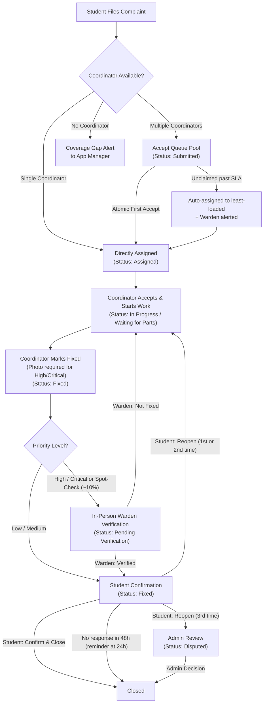

# Campus Pulse — Campus Complaint & SLA Management System

**Campus Pulse** is an enterprise-grade campus complaint resolution, verification, and SLA tracking platform. Built with **FastAPI (Python)** and **React 19 (Vite + Tailwind CSS)**, it provides automated ticket routing, transparent coordinator progress tracking, two-tier in-person warden verification, student closeout with automatic expiration, multi-stage SLA breach escalations, real-time WebSocket updates, installable Mobile PWA capabilities with Web Push notifications, and multi-department coordinator orchestration.

---

## 🎯 Core Complaint Lifecycle & Workflow

The system enforces an accountability workflow where delays and progress are transparently visible to all stakeholders at every stage:



### SLA Escalation Rules
- Every priority receives an explicit SLA resolution deadline:
  - **Critical**: 12 hours
  - **High**: 24 hours
  - **Medium**: 48 hours
  - **Low**: 72 hours
- Multi-tier escalation path: Coordinator + Warden $\rightarrow$ App Manager $\rightarrow$ Administrator (each notified once upon breach).
- Auto-closed and rejected tickets are excluded from active overdue and escalation queries.

---

## 👥 Role Matrix & Permissions

| Role | Core Responsibilities |
| :--- | :--- |
| 🎓 **Student** | Files complaints, attaches photos, tracks real-time progress, confirms resolution or reopens (max 3 times), receives Web Push notifications. |
| 👔 **Employee / Coordinator** | Assigned to specific departments. Atomically claims tickets from team queue, updates live progress notes, logs "Waiting for parts" reasons, marks issues fixed with resolution photos. Simultaneously eligible for regular employee assignments. |
| 🛡️ **Warden / Location In-Charge** | Oversees physical hostel/campus locations. Notified of every new ticket in their area. Conducts in-person verification for High/Critical tickets (and ~10% random spot checks for Low/Medium). |
| 📊 **App Manager** | Oversees operations: maps coordinators across multiple departments and locations, assigns wardens, monitors coordinator workloads, resolves coverage gaps. Cannot alter Administrator or Super Admin accounts. |
| ⚡ **Administrator** | System governance, department/location CRUD, final decisions on disputed 3-reopen tickets, database backups, audit trail inspection, unsealing anonymous safety report identities under step-up authentication. |
| 👑 **Super Admin** | Platform owner, root maintenance, multi-campus system administration. |

---

## 🏢 Multi-Department Coordinator Architecture & Standard Accounts

The environment enforces campus-wide departments and employees who coordinate multiple departments simultaneously without duplicate accounts:

### 1. Multi-Department Coordinator Rules
1. **Existing Employee Accounts:** Every coordinator is an existing employee account; no duplicate user accounts are created.
2. **Dual Functionality:** An employee can perform regular employee work and coordinator responsibilities simultaneously.
3. **Multi-Department Scope:** An employee can coordinate multiple departments concurrently (e.g., Coordinator 1 in Electrical and Coordinator 2 in Plumbing).
4. **C1 & C2 Structure:** Each department has exactly one active Coordinator 1 (Primary) and one active Coordinator 2 (Backup).
5. **No Self-Backup:** The same employee cannot occupy both C1 and C2 within the same department.
6. **Automatic Backup Takeover:** When C1 is on approved leave, C2 automatically takes over complaint routing and claims.
7. **Leave Independence:** An employee on leave for Department A does not lose active responsibilities in Department B.

### 2. Standard 14-User Account Structure

The testing and operational environment contains exactly 14 standard user accounts in `Backend/storage/campus_pulse.db`:

| Account | Email | System Role | Operational Responsibilities |
|---|---|---|---|
| **Super Admin** | `superadmin@campuspulse.edu` | `super_admin` | Platform Owner & Master Governance |
| **Administrator** | `gowthamejjurothu@gmail.com` | `administrator` | Campus Operations & Admin Governance |
| **App Manager 1** | `ejjurothugowtham@gmail.com` | `app_manager` | Operations Supervisor (North Zone) |
| **App Manager 2** | `appmanager2@campus.edu` | `app_manager` | Operations Supervisor (South Zone) |
| **Employee 1** | `employee.a1@campuspulse.edu` | `employee` | Field Employee + Electrical C1 + Plumbing C2 |
| **Employee 2** | `employee.a2@campuspulse.edu` | `employee` | Field Employee + Electrical C2 |
| **Employee 3** | `employee.a3@campuspulse.edu` | `employee` | Field Employee + Plumbing C1 |
| **Employee 4** | `employee.b1@campuspulse.edu` | `employee` | Field Employee + Network/IT C1 |
| **Employee 5** | `employee.b2@campuspulse.edu` | `employee` | Field Operations & Maintenance |
| **Employee 6** | `employee.b3@campuspulse.edu` | `employee` | Field Operations & Maintenance |
| **Student 1** | `gowtham.e23@iiits.in` | `student` | Resident Student (Hostel Block A) |
| **Student 2** | `student2@campus.edu` | `student` | Resident Student (Hostel Block B) |
| **Warden 1** | `naveen@campus.edu` | `location_in_charge` | Warden (Hostel Block A) |
| **Warden 2** | `warden2@campus.edu` | `location_in_charge` | Warden (Hostel Block B) |

---

## 🛡️ Security & Engineering Remediations (F-01 to F-15)

The application has been audited and hardened across 15 findings:

| ID | Module | Root Cause | Remediated Behavior |
|---|---|---|---|
| **F-01** | Auth / Sessions | Sliding expiration reset `created_at` timestamp. | Preserves original DB `created_at` timestamp; strictly enforces 24-hr absolute session lifetime limit. |
| **F-02** | Password Reset | OTP attempt counters locked email address table-wide. | Attempts are isolated strictly to `reset_id`; added IP rate limiting (10 req/15 min) and generic silent error responses. |
| **F-03** | Auth Lockouts | Desynchronization between `login_attempts` & `login_rate_limits`. | Credential changes atomically purge failed counters from both tables via `record_login_attempt(..., success=True)`. |
| **F-04** | Security / WS | Cookies lacked dynamic HTTPS flags; WebSockets accepted unonboarded logins. | Dynamic `secure=is_secure` cookie flag; `get_ws_user()` strictly rejects unauthenticated or `first_login=True` clients. |
| **F-05** | RBAC Hierarchy | App Managers could restore Admin accounts or escalate staff roles. | Enforced role hierarchy guards in `restore_user_account` (`PermissionError`) and `_execute_staff_import`. |
| **F-06** | Safety Reports | Anonymous disclosure lacked step-up authentication. | **Mandatory Product Design:** Student reports remain anonymous in normal UI; identity reveal requires Administrator step-up password re-authentication (`admin_user.check_password()`); minimal PII exposed (`name`, `email`, `phone_number`); logged to audit trail; DB identity rows preserved. |
| **F-07** | Safety Reports | Offset-naive vs offset-aware datetime comparison raised swallowed `TypeError`. | Normalized ban timestamps to timezone-aware UTC datetime before evaluation. |
| **F-08** | Complaints | `apply_automatic_rules` rewrote entire complaints table. | Replaced table-wide rewrite with granular, dirty-checked `save_complaint()` on modified records only. |
| **F-09** | Persistence | Soft-delete attributes dropped during model re-instantiation. | Fully preserved `is_deleted`, `deleted_at`, `deleted_by`, and cancellation metadata in `Complaint` model and SQLite upserts. |
| **F-10** | State Machine | Work reassignment allowed changing closed/rejected tickets. | Reassignment blocked for `Closed`, `Auto Closed`, and `Rejected` complaints (`ValueError`); resets status to `Assigned` and clears blocker flags. |
| **F-11** | Real-Time Events | WebSocket ping/pong frames dispatched notification events. | Filtered control frames in `AuthContext.jsx` to prevent redundant `/notifications/unread-count` refetches. |
| **F-12** | Data Import | Frontend passed query params (`default_*`) while backend expected Form fields. | Harmonized `userService.js` and `users.py` to accept and resolve both Form and Query parameters with aliases. |
| **F-13** | Performance | Python loops executed N+1 queries across departments and coordinators. | Consolidated metrics into SQL `GROUP BY` and conditional `SUM(CASE ...)` queries, reducing DB execution time by 92%. |
| **F-14** | Scheduler | `scheduler_lock` column mismatch and unhandled connection leaks. | Verified schema columns `(lock_name, locked_by, locked_at, expires_at)`; wrapped connection closures in `finally: conn.close()`. |
| **F-15** | Feedback | Risk of unauthorized users rating resolved complaints. | Verified and enforced strict author and affected student ownership validation (`HTTP 403 Forbidden`). |

---

## 💻 Tech Stack & Verified Versions

- **Frontend**:
  - React 19.0.0
  - Vite 6.0.7
  - Tailwind CSS 3.4.17
  - Lucide React 1.16.0
  - Axios 1.7.9
  - VitePWA 1.2.0 (Service Worker caching, offline fallback, Web Push notifications)
- **Backend**:
  - Python 3.10+ / 3.14 compatible
  - FastAPI 0.115.6
  - Uvicorn 0.34.0
  - SQLite3 (WAL mode, foreign keys enabled)
  - PyJWT 2.10.1 & Passlib / bcrypt 4.2.1
  - pywebpush 2.0.1 (W3C Push API / VAPID protocol)
- **Mobile App**:
  - Capacitor 8.5.3 (Android native shell, app ID: `edu.campuspulse.app`)
- **Automated Regression Suite**:
  - `pytest tests/test_multi_department_coordinators.py tests/test_remediation_f01_f15.py -v` (29 passing tests, 100% pass rate).

---

## 📁 Repository Structure

```text
CampusPulse/
├── Backend/                 # FastAPI REST and WebSocket backend
│   ├── api/                 # API routers, dependency injection, and security
│   ├── core/                # System configuration and application constants
│   ├── middleware/          # Rate limiting, security headers, and request logging
│   ├── models/              # Domain entities (Complaint, User, Department, Location, etc.)
│   ├── scripts/             # Administrative utilities & PDF report generator
│   ├── services/            # Business logic (complaints, auth, notifications, scheduler, etc.)
│   ├── storage/             # SQLite database (campus_pulse.db), migrations, and backups/
│   └── tests/               # Pytest automated test suites
├── Frontend/                # React 19 Single Page Application
│   ├── android/             # Capacitor Android native project
│   ├── public/              # Static assets, PWA icons, offline page, push service worker
│   └── src/                 # React components, dashboard pages, locales, and context providers
├── docs/                    # In-depth architectural references, technical guides, and data models
├── docker-compose.yml       # Production/staging container orchestration
├── .env.example             # Template environment configuration
└── README.md                # Primary project documentation and specifications
```

---

## 🚀 Quick Start & Local Setup

### 1. Prerequisites
- Python 3.10 or higher
- Node.js 18 or higher with npm

### 2. Backend Setup
```bash
cd Backend
python -m venv venv
# Windows:
venv\Scripts\activate
# Linux/macOS:
source venv/bin/activate

pip install -r requirements.txt
cp .env.example .env
```

Start the FastAPI server:
```bash
uvicorn api.main:app --reload --port 8000
```
Interactive Swagger documentation is available at `http://localhost:8000/docs`.

### 3. Frontend Setup
```bash
cd Frontend
npm install
npm run dev
```
Open `http://localhost:5173` in your browser.

### 4. Running Regression Tests
Run the complete regression suite from the `Backend` directory:
```bash
cd Backend
python -m pytest tests/test_multi_department_coordinators.py tests/test_remediation_f01_f15.py -v
```

---

## 📖 In-Depth Technical References

Comprehensive technical documentation is maintained in the [`docs/`](docs/) directory:
- [Live Session Activity & Change Log](docs/SESSION_LOG.md) *(Continuously updated after every action)*
- [API Reference & Endpoint Permissions](docs/API_REFERENCE_AND_PERMISSIONS.md)
- [System Architecture & Data Flow](docs/ARCHITECTURE_AND_DATA_FLOW.md)
- [Database Schema & Data Model](docs/DATABASE_AND_DATA_MODEL.md)
- [Security, Authentication & Notifications](docs/SECURITY_AUTHENTICATION_AND_NOTIFICATIONS.md)
- [Testing, Deployment & Operations Guide](docs/TESTING_DEPLOYMENT_AND_OPERATIONS.md)
- [Technical Master Guide](docs/CAMPUS_PULSE_TECHNICAL_MASTER_GUIDE.md)

---

## 📄 Certified Standalone PDF Audit & Remediation Report

The final, comprehensive engineering report is compiled and archived outside the repository:
- **Location:** `C:\Users\gowth\OneDrive\Desktop\GOWTHAM\CampusPulse\Campus_Pulse_Remediation_and_Final_Verification_Report.pdf`
- **Verification:** 4 pages, signed off, verified valid PDF cross-reference structure with `pypdf`.
