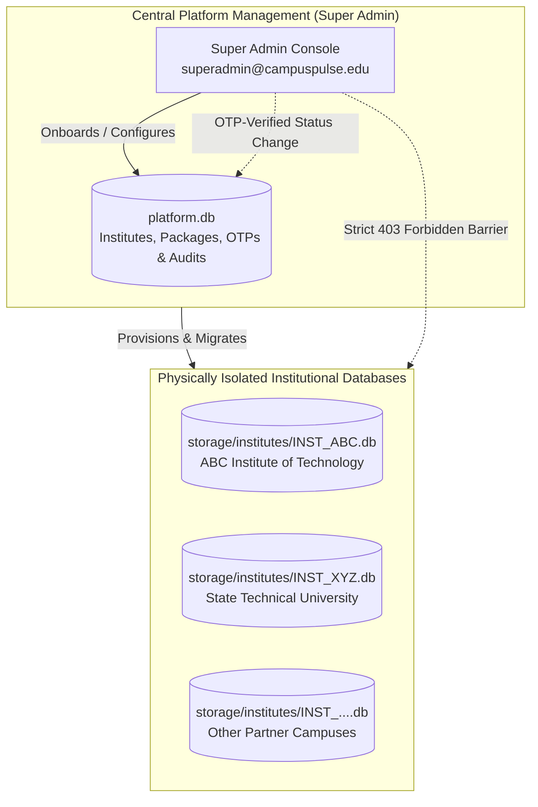
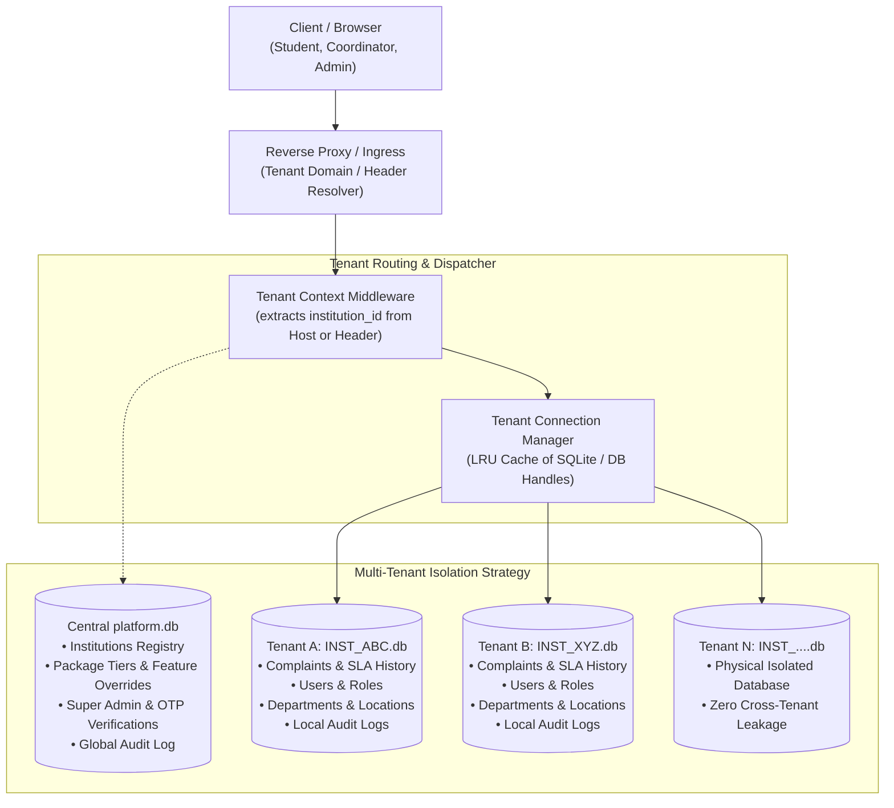
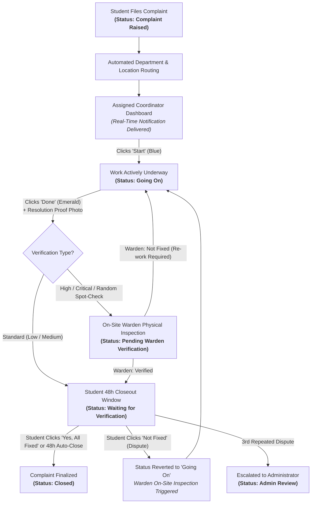

# Campus Pulse — Multi-Institute Campus Governance & Grievance SaaS Platform

[](https://python.org)
[](https://fastapi.tiangolo.com)
[](https://react.dev)
[](https://vitejs.dev)
[](https://tailwindcss.com)
[](https://sqlite.org)
[](LICENSE)

🌐 **Official Showcase Website:** [https://gowthame23.github.io/campus_pulse/](https://gowthame23.github.io/campus_pulse/)  
🚀 **Live Production Application:** [https://campuspulse-frontend-wlws.onrender.com](https://campuspulse-frontend-wlws.onrender.com)

**Campus Pulse** is a high-accountability, multi-tenant campus grievance, emergency response, and facilities management SaaS platform. Engineered to eliminate the "black hole" of collegiate ticketing systems, Campus Pulse enforces physical tenant data isolation, direct coordinator ownership, tamper-evident photo verification, zero-knowledge anonymous whistleblowing, and automated SLA escalations.

---

## 🏛️ Multi-Institute SaaS Architecture & Data Isolation

Campus Pulse provides scalable multi-tenancy while guaranteeing complete data isolation and privacy across educational institutions.



### 1. Physical Database Isolation
* **Separate Tenant Databases**: Each registered institution receives its own independent SQLite database located at `storage/institutes/{institution_id}.db`.
* **Zero Leakage**: Student records, complaints, attachments, comments, audit trails, and physical locations are physically segregated. No institution can ever view or query another institution's data.
* **Super Admin Data Boundary**: Super Admins maintain platform infrastructure, onboard institutes, and configure packages, but are strictly prohibited (`HTTP 403 Forbidden`) from viewing institutional operational records.

### 2. Subscription Packages & Feature Entitlement
Campus Pulse features a modular entitlement engine gating capabilities per tier:

| Feature Capability | Basic | Intermediate | Premium |
| :--- | :---: | :---: | :---: |
| Student Complaint Filing & Tracking | ✅ | ✅ | ✅ |
| Automated Coordinator Routing | ✅ | ✅ | ✅ |
| 3-Stage Lifecycle & SLA Engine | ✅ | ✅ | ✅ |
| Role-Based Notifications & Audit Logs | ✅ | ✅ | ✅ |
| Location-Scoped Warden Verification | ❌ | ✅ | ✅ |
| Anonymous Whistleblower Safety Reports | ❌ | ✅ | ✅ |
| Duplicate Image Detection | ❌ | ✅ | ✅ |
| Executive Analytics Dashboard | ❌ | ✅ | ✅ |
| Lost & Found Campus Repository | ❌ | ❌ | ✅ |
| Resource & Facility Room Booking | ❌ | ❌ | ✅ |
| AI Automated Classification | ❌ | ❌ | ✅ |

*Dynamic Feature Overrides*: Super Admins can customize individual feature flags per institute without migrating database schemas.

### 3. Dual-Factor Email OTP Institute Security
* **Tamper-Proof Status Management**: Deactivating or reactivating an institution requires a cryptographically generated, 6-digit one-time password (OTP) dispatched to the Super Admin's registered email (`superadmin@campuspulse.edu`).
* **Brute-Force Protection**: OTPs expire after 10 minutes, use cryptographic salt hashing, and automatically lock after 5 failed attempts.
* **Instant Session Block**: When an institution is marked `Inactive`, all active sessions for that campus are immediately blocked with `403 Forbidden`.

---

## 🏗️ Multi-Tenant Architecture & Tradeoff Analysis



### Why One SQLite Database Per Tenant?
1. **Physical Data Isolation (Zero Cross-Tenant Leakage)**: Queries never need complex `WHERE institution_id = ?` clauses that can be accidentally omitted in ORMs or raw SQL. A catastrophic data leak between rival colleges or departments is physically impossible because each institution's data resides in its own isolated file.
2. **Simplified Tenant Lifecycle (Point-in-Time Backups & Archival)**: Backing up, restoring, offboarding, or moving an institution to another storage tier is simply a file-system copy (`shutil.copy2` or SQLite `.backup()`) with zero downtime or locks for other institutions.
3. **Tailored SLAs, Upgrades, & Maintenance Windows**: Migrations can be applied incrementally tenant-by-tenant. If a migration fails on one tenant, no other tenant's operations are affected.
4. **Zero-Resource Idle Tenants**: An inactive small college incurs zero memory overhead, database server connection pooling cost, or idle compute.
5. **Regulatory & Compliance Alignment (FERPA, GDPR)**: Individual institution databases can easily be retained, encrypted with separate tenant keys, or deleted on contract termination without complex schema scrubbing.

### What Changes at Scale?
1. **Connection Pooling & File Handle Limits**: With thousands of simultaneous active tenants, operating system open file descriptors (`nofile`) can be exhausted. A dynamic connection cache with LRU eviction must close idle SQLite handles.
2. **Horizontal Scaling Across Multi-Nodes**: Local SQLite files bind a tenant to a single container or server. At multi-node scale, tenants must either use network replication (e.g., Litestream / LiteFS replicated to object storage) or migrate to a managed distributed database (PostgreSQL with row-level security or Citus/schema-per-tenant).
3. **Cross-Tenant Aggregation & Global Analytics**: Platform-wide reporting across hundreds of institutions requires federated ETL (e.g., DuckDB querying across multiple tenant databases or periodic data replication into an analytical warehouse).
4. **Write Concurrency per Tenant**: SQLite supports one concurrent writer per database file (WAL mode allows concurrent readers). For large campuses with thousands of simultaneous ticket updates, write lock contention requires partitioning into micro-databases or transitioning busy tenants to PostgreSQL.

---

## 🎯 Accountable 3-Stage Complaint Lifecycle

Campus Pulse replaces convoluted 12-state bureaucratic queues with a streamlined **3-stage lifecycle**:

$$\text{Complaint Raised} \xrightarrow{\quad\text{Coordinator Starts}\quad} \text{Going On} \xrightarrow{\quad\text{Coordinator Done}\quad} \text{Fixed} \xrightarrow{\quad\text{48h Verification / Dispute}\quad} \text{Closed}$$



### Deterministic SLA Deadlines
Every complaint receives a deterministic resolution deadline upon registration:
* **Critical**: 4 hours *(immediate escalation alert on breach)*
* **High**: 24 hours
* **Medium**: 48 hours
* **Low**: 72 hours

An automated background scheduler monitors active tickets, dispatching multi-tier escalation warnings when deadlines approach or breach.

---

## 🛡️ Anti-Fraud & Quality Assurance Architecture

Traditional campus systems suffer from "phantom fixes"—tickets marked resolved without repairs or with stock photos. Campus Pulse eliminates this through:

### 1. SHA-256 Duplicate Image Fingerprinting
* The raw binary bytes of every uploaded photo are hashed via **SHA-256** upon receipt.
* The system queries historical records:
  ```sql
  SELECT complaint_id FROM attachments WHERE sha256 = ? AND complaint_id != ? LIMIT 1
  ```
* If the exact photo was ever uploaded to another complaint, the system immediately tags it with a **`REUSED`** fraud alert flag.

### 2. EXIF Timestamp Tamper Verification
* For JPEG/JPG uploads, the backend extracts the embedded camera metadata (`DateTimeOriginal`, EXIF tag 36867).
* If an "after repair" proof photo has a capture timestamp **older than when the repair job was actually started**, the system flags it as **`OLDER_THAN_JOB`**.

### 3. Photo-Skip Streak Penalty
* If a coordinator repeatedly marks complaints done without photo proof, the system tracks their skip streak. Reaching the threshold automatically locks the ticket and mandates an in-person Warden physical inspection.

---

## 🔒 Privacy-First Anonymous Whistleblowing

Students often stay silent about ragging, harassment, mental health crises, or facility hazards due to fear of academic or social retaliation. Campus Pulse provides **genuine zero-knowledge anonymous reporting**:

```
[Student Submits Report]
         │
         ├──► safety_reports (report_id, case_code, category, description, status)  ← Accessible by Admins
         │
         └──► safety_report_identity (report_id, reporter_user_id, revealed = 0)     ← Sealed in Isolation
```

1. **Table-Level Structural Segregation**:
   The primary `safety_reports` table has **no foreign keys to students**. Regular administration screens, analytics, and two-way messaging only ever touch `safety_reports`.
2. **Anonymous 2-Way Chat**:
   Students track progress and chat bidirectionally with administrators using an ephemeral **Case Code** without logging in.
3. **Dual-Control Identity Unsealing Gate**:
   Identity unsealing can only occur during an extreme life-safety crisis or formal disciplinary misuse:
   * Requires Administrator role privilege.
   * Mandates **live password re-authentication** (`PBKDF2-HMAC-SHA256`).
   * Requires a typed legal / emergency justification.
   * Every unsealing event permanently records an entry into `audit_logs`, protected by SQLite triggers that abort any `UPDATE` or `DELETE` attempt.

---

## 🚨 Rapid Emergency SOS Engine

* **1-Tap Emergency Trigger**: Instant selection between Medical, Fire, and Security emergencies.
* **Real-Time Geolocation Broadcast**: Immediately pushes the student's physical location, block, and room to security dispatchers and campus health centers via WebSockets and Web Push.
* **Manual Call Chain (no auto-escalation)**: After choosing an emergency, the student sees Security and their location's Warden with one-tap call buttons. Only if neither responds does the App Manager's number appear. Coordinators are not part of the chain.

---

## 👥 Role Matrix & Clean Core Baseline

Campus Pulse enforces a role hierarchy with zero ambiguous "employee" intermediaries:

| Role | Responsibilities |
| :--- | :--- |
| 🎓 **Student** | Files complaints, tracks live status, verifies or disputes repairs, triggers SOS alerts, claims lost & found items. |
| 👔 **Coordinator** | Directly handles complaints end-to-end within assigned departments. Updates live progress, provides proof photos, coordinates repairs. |
| 🛡️ **Warden** | Physical location in-charge. Notified of location issues, conducts on-site verifications for high-priority tickets, inspects student disputes. |
| 📊 **App Manager** | Geographic supervisor. Oversees multi-location zones, maps wardens and coordinators, monitors department SLA health, handles unassigned tickets. |
| ⚡ **Administrator** | Campus governance, department/location mapping, final decisions on disputed complaints, audit trail inspection, unsealing safety reports. |
| 👑 **Super Admin** | Platform maintenance, institution onboarding, package & subscription management, root system health. |

---

## 💻 Tech Stack & Architecture

* **Frontend**:
  * React 19 + Vite 6
  * Tailwind CSS 3.4 (with dynamic Light/Dark mode)
  * Lucide React Icons
  * Axios with global auth & 401 token refresh interceptors
  * VitePWA with Web Push service worker
* **Backend**:
  * Python 3.10+ / FastAPI 0.115+
  * SQLite3 (WAL mode enabled, strict foreign key constraints) + PostgreSQL engine support
  * WebSockets for real-time ticket, notification, and emergency dispatch
  * PBKDF2-HMAC-SHA256 password security (600,000 OWASP iteration standard)
  * PyJWT for sliding session authentication
  * PyWebPush (VAPID W3C standards)
* **DevOps & Containerization**:
  * Docker & Docker Compose multi-stage builds

---

## 🚀 Quick Start Guide

### Option A: Docker Compose (Recommended)
Clone the repository and spin up the full stack in one command:
```bash
git clone https://github.com/campuspulse/campus_pulse.git
cd campus_pulse
docker-compose up --build
```
* **Frontend**: `http://localhost:5173`
* **FastAPI Docs**: `http://localhost:8000/docs`

---

### Option B: Local Development Setup

#### 1. Backend Setup
```bash
cd Backend
python -m venv venv

# Windows:
venv\Scripts\activate
# macOS / Linux:
source venv/bin/activate

pip install -r requirements.txt
cp .env.example .env
uvicorn api.main:app --reload --port 8000
```

#### 2. Frontend Setup
```bash
cd Frontend
npm install
npm run dev
```
Open `http://localhost:5173` in your browser.

---

## 🧪 Running Automated Tests

Run the full SaaS multi-tenant, lifecycle, and emergency test suites:
```bash
cd Backend
pytest tests/test_saas_multi_tenant.py -v
pytest tests/test_emergency_flow.py -v
```

---

## ⚠️ Known Issues

The following 5 items are documented inconsistencies in legacy application behavior. They are deliberately retained under the project freeze policy; modifying them would alter live application logic and role authorization boundaries, requiring an explicit product decision before any behavioral change is introduced:

1. **Active Jobs Count for Assigned Complaints**: When a complaint is assigned, `assign_work` saves the complaint with canonical status `Complaint.ASSIGNED` (`"Going On"`), whereas `get_eligible_assignees` executes SQL querying `status IN ('Assigned', 'In Progress', 'Waiting for Parts')`. Because `'Going On'` is not in this query, `active_jobs_count` reports `0` for newly assigned staff.
2. **Employee Status Start Transition**: In `/complaints/{id}/status`, `Complaint.ASSIGNED` and `Complaint.IN_PROGRESS` both evaluate to `"Going On"`. Sending `{"status": "In Progress"}` fails the equality check against `Complaint.IN_PROGRESS`, while sending `{"status": "Going On"}` matches `Complaint.ASSIGNED` which explicitly forbids non-admin callers. Employees therefore cannot transition tickets to In Progress via this endpoint.
3. **Closed Complaint Feedback Status Check**: Confirming resolution via `POST /confirm` sets `complaint.status = Complaint.CLOSED` (`"Fixed"`). However, `POST /feedback` requires `status in (STATUS_CLOSED, STATUS_AUTO_CLOSED, "Closed", "Closed (Auto Closed)")`. Because `STATUS_CLOSED` is `"Closed"`, verified complaints with status `"Fixed"` cannot accept feedback.
4. **Assignee On-Leave Complaint Flagging**: When staff submit a leave request via `POST /leaves`, `mark_employee_on_leave` updates complaints matching `status IN ('Assigned', 'In Progress', 'Waiting for Parts')`. Complaints holding canonical status `"Going On"` are not matched, so `assignee_on_leave_flag` remains `0`.
5. **Level 2 Escalation Warden Assignment Route Guard**: While `assign_work` contains logic allowing a Location In-Charge (Warden) to assign unhandled complaints once escalation reaches Level 2, the FastAPI router dependency on `POST /complaints/{id}/assign` enforces `require_roles(Administrator.ROLE, Coordinator.ROLE, AppManager.ROLE)`, returning HTTP 403 Forbidden before the service logic can execute.

In the automated test suite, these 5 scenarios are marked with `@pytest.mark.xfail(strict=True)` to document expected behavior while ensuring any unintended changes are flagged immediately.

---

## 📁 Repository Structure

```text
CampusPulse/
├── Backend/                 # FastAPI REST & WebSocket Backend
│   ├── api/                 # API routers, security middleware & schemas
│   ├── core/                # System configuration & operational constants
│   ├── middleware/          # Rate limiting, security headers, request logging
│   ├── models/              # Domain entities (Complaint, User, Department, Location)
│   ├── scripts/             # Administrative utilities & maintenance scripts
│   ├── services/            # Business services (tenant, complaints, auth, emergency)
│   ├── storage/             # SQLite platform & tenant databases and migration engine
│   └── tests/               # Automated multi-tenant & regression test suites
├── Frontend/                # React 19 Single Page Application
│   ├── public/              # Static assets, PWA icons, offline page, service worker
│   └── src/                 # React components, pages, context providers, services
├── docs/                    # Technical architecture & specification documents
├── docker-compose.yml       # Production multi-container orchestration
├── .env.example             # Template environment variables
└── README.md                # Primary project documentation
```

---

## 📄 License
This project is licensed under the MIT License — see the [LICENSE](LICENSE) file for details.
