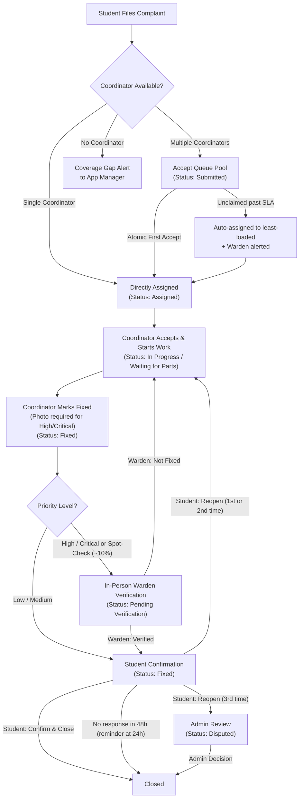

# Campus Pulse — Campus Complaint & SLA Management System

**Campus Pulse** is a production-grade campus complaint resolution, verification, and SLA tracking platform. Built with **FastAPI (Python)** and **React 19 (Vite + Tailwind CSS)**, it provides automated ticket routing, transparent coordinator progress tracking, two-tier in-person warden verification, student closeout with automatic expiration, multi-stage SLA breach escalations, real-time WebSocket updates, and installable Mobile PWA capabilities with Web Push notifications.

---

## 🎯 Core Complaint Lifecycle & Workflow

The system enforces an accountability workflow where delays and progress are transparently visible to all stakeholders at every stage:



### SLA Escalation Rules
- Every priority receives an explicit SLA resolution deadline:
  - **Critical**: 12 hours
  - **High**: 24 hours
  - **Medium**: 48 hours
  - **Low**: 72 hours
- Multi-tier escalation path: Coordinator + Warden $\rightarrow$ App Manager $\rightarrow$ Administrator (each notified once upon breach).
- Auto-closed and rejected tickets are excluded from active overdue and escalation queries.

---

## 👥 Role Matrix & Permissions

| Role | Core Responsibilities |
| :--- | :--- |
| 🎓 **Student** | Files complaints, attaches photos, tracks real-time progress, confirms resolution or reopens (max 3 times), receives Web Push notifications. |
| 👔 **Coordinator** | Assigned by location + department. Atomically claims tickets from the team queue, updates live progress notes, logs "Waiting for parts" reasons, marks issues fixed with resolution photos. |
| 🛡️ **Warden** | Oversees hostel/campus physical location. Notified of every new ticket in their area. Conducts in-person verification for High/Critical tickets (and ~10% random spot checks for Low/Medium). Cannot verify complaints they handled. |
| 📊 **App Manager** | Oversees operations: maps coordinators across multiple departments and locations, assigns wardens, monitors coordinator workloads, resolves coverage gaps. |
| ⚡ **Administrator** | System governance, department/location CRUD, final decisions on disputed 3-reopen tickets, database backups, audit trail inspection. |

---

## 💻 Tech Stack & Verified Versions

- **Frontend**:
  - React 19.0.0
  - Vite 6.0.7
  - Tailwind CSS 3.4.17
  - Lucide React 1.16.0
  - Axios 1.7.9
  - VitePWA 1.2.0 (Service Worker caching, offline fallback, Web Push notifications)
- **Backend**:
  - Python 3.10+ / 3.14 compatible
  - FastAPI 0.115.6
  - Uvicorn 0.34.0
  - SQLite3 (WAL mode, foreign keys enabled)
  - PyJWT 2.10.1 & Passlib / bcrypt 4.2.1
  - pywebpush 2.0.1 (W3C Push API / VAPID protocol)
- **Capacitor Mobile App**:
  - Capacitor 8.5.3 (Android native shell, app ID: `edu.campuspulse.app`)
- **Verified Route Count**: **318 total routes** across 26 domain routers (312 application endpoints + 2 WebSockets + 4 OpenAPI/docs routes).
- **Automated Test Suites**: **218 passing backend tests** (2 skipped) + **22 passing frontend tests** (0 failures).

---

## 🌟 Key Platform Features (Phases 1–6)

1. **Deterministic Auto-Routing & Accept Queue**: Complaints are classified via deterministic keyword rules and routed directly to coordinators mapped to that department and location. Multiple coordinators share an atomic accept queue.
2. **Coordinators Are the Only Fixers**: Wardens supervise, inspect High/Critical tickets, and spot-check; wardens never fix complaints and cannot be assigned tickets.
3. **Transparent SLA Escalations**: Critical (12h), High (24h), Medium (48h), Low (72h). Automated notifications escalate to Coordinator, Warden, App Manager, and Administrator.
4. **Fast Complaint Form**: Category icon grid, recent places quick-select pills, outside-hostel guidance, live duplicate search, and `exact_spot` field.
5. **Multi-Language Support**: Full UI localization in English, Telugu, and Hindi, with language picker on first login and speech-to-text hints.
6. **Campus Health Map & TV Mode**: Real-time status cards (green/yellow/red) for campus buildings, pattern detection alerts (>=5 complaints in 21 days), and full-screen TV view at `/health-map/tv`.
7. **Fixer Recognition**: 1-5 star ratings, thank-you notes, monthly Fixer of the Month calculation, public badge widget, and downloadable certificates.
8. **Sealed Safety Reports**: Admin-toggled anonymous reporting with secure `SAFE-XXXX` tracking, 2-way anonymous messaging, and unsealing restricted solely to administrator-flagged misuse with mandatory written justification.
9. **Real-Time Everywhere & PWA**: WebSocket updates with exponential backoff reconnecting, 30s background polling fallback, Web Push notifications via VAPID, offline fallback page, and installable PWA.
10. **Android Mobile App**: Full Capacitor Android wrapper ready to build and run on mobile devices.

---

## 🔍 System Reality Check & Architectural Decisions

- **Routing Engine**: Deterministic keyword matching and department mapping. Does not rely on external cloud AI or LLM APIs.
- **Notification Delivery**: In-app WebSockets and W3C Web Push (via VAPID/pywebpush). No SMS/Twilio dependency.
- **Tenancy**: Single institution per deployment instance.
- **Database Architecture**: Pilot runs on SQLite (WAL mode, single Uvicorn worker). Enterprise scaling target migrates to PostgreSQL, Redis pub/sub backplane, and S3 object storage.

---

## 📁 Repository Structure

```text
CampusPulse/
├── Backend/                 # FastAPI REST and WebSocket backend
│   ├── api/                 # API routers, dependency injection, and security
│   ├── core/                # System configuration and application constants
│   ├── middleware/          # Rate limiting, security headers, and request logging
│   ├── models/              # Domain entities and Pydantic schemas
│   ├── scripts/             # Administrative, cleanup, and maintenance scripts
│   ├── services/            # Business logic (complaints, auth, notifications, push, etc.)
│   ├── storage/             # SQLite database, schema repository, and migrations
│   └── tests/               # Pytest automated test suites (218 passing tests)
├── Frontend/                # React 19 Single Page Application
│   ├── android/             # Capacitor Android native project
│   ├── public/              # Static assets, PWA icons, offline page, push service worker
│   └── src/                 # React components, dashboard pages, locales, and context providers
└── docs/                    # Technical architecture, manuals, and data models
```

---

## 🚀 Quick Start & Local Setup

### 1. Prerequisites
- Python 3.10 or higher
- Node.js 18 or higher with npm

### 2. Backend Setup
```bash
cd Backend
python -m venv venv
# Windows:
venv\Scripts\activate
# Linux/macOS:
source venv/bin/activate

pip install -r requirements.txt
cp .env.example .env
```

*(Optional)* Generate VAPID keys for browser Web Push notifications:
```bash
python scripts/generate_vapid_keys.py
```
Copy the generated keys into your `Backend/.env`. If omitted, the system gracefully falls back to in-app WebSocket notifications.

Start the FastAPI server:
```bash
uvicorn api.main:app --reload --port 8000
```
API Documentation will be available at `http://localhost:8000/docs`.

### 3. Frontend Setup
```bash
cd Frontend
npm install
npm run dev
```
Open `http://localhost:5173` in your browser.

---

## 🚢 Deployment Notes (Pilot to Production)

> [!IMPORTANT]
> **Single Worker for SQLite Pilot:**  
> In pilot deployments using SQLite, run exactly **one Uvicorn worker** (`uvicorn api.main:app --workers 1 --port 8000`). SQLite file locking and the in-memory background scheduler require a single-process deployment.
> 
> **Scaling Path:**  
> Before scaling to multi-worker or containerized clusters:
> 1. Migrate SQLite to PostgreSQL.
> 2. Replace in-memory rate limiter and WebSocket connection manager with Redis.
> 3. Move local `/storage/attachments` to S3 or compatible object storage.

---

## 📖 Technical Documentation

- [API Documentation & Endpoints](API_DOCUMENTATION.md)
- [Administrator & App Manager Manual](ADMIN_MANUAL.md)
- [System Architecture & Data Flow](ARCHITECTURE.md)
- [Database Schema Reference](DATABASE_SCHEMA.md)
- [Unused Speculative Tables Inventory](docs/UNUSED_TABLES.md)
- [Role Permissions Matrix](ROLE_PERMISSIONS.md)
