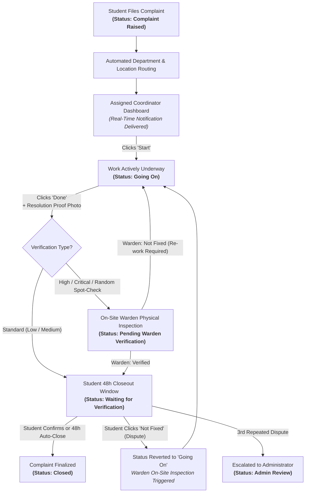

# Campus Pulse — Modern Campus Governance & Grievance Intelligence Platform

[](https://python.org)
[](https://fastapi.tiangolo.com)
[](https://react.dev)
[](https://vitejs.dev)
[](https://tailwindcss.com)
[](https://sqlite.org)
[](LICENSE)

**Campus Pulse** is a high-accountability campus grievance, emergency response, and facilities management platform. Engineered to eliminate the "black hole" of collegiate ticketing systems, Campus Pulse enforces direct coordinator ownership, tamper-evident photo verification, zero-knowledge anonymous whistleblowing, and automated SLA escalations.

---

## 🎯 Accountable 3-Stage Complaint Lifecycle

Campus Pulse replaces convoluted 12-state bureaucratic queues with a streamlined **3-stage lifecycle**:

$$\text{Complaint Raised} \xrightarrow{\quad\text{Coordinator Starts}\quad} \text{Going On} \xrightarrow{\quad\text{Coordinator Done}\quad} \text{Fixed} \xrightarrow{\quad\text{48h Verification / Dispute}\quad} \text{Closed}$$



### SLA Resolution Deadlines & Escalation Engine
Every ticket receives a deterministic SLA deadline calculated from its category and priority:
* **Critical**: 12 hours *(auto-escalates to App Manager and Admin on breach)*
* **High**: 24 hours
* **Medium**: 48 hours
* **Low**: 72 hours

An automated background scheduler scans active complaints every minute, firing multi-tier escalation notifications if milestones are missed.

---

## 🛡️ Anti-Fraud & Quality Assurance Architecture

Traditional portals suffer from "phantom fixes"—technicians marking tickets resolved without performing repairs or recycling stock photos from the internet. Campus Pulse eliminates this through two layers:

### 1. SHA-256 Duplicate Image Fingerprinting
* The raw binary bytes of every uploaded photo are hashed via **SHA-256** upon receipt.
* The system queries historical records:
  ```sql
  SELECT complaint_id FROM attachments WHERE sha256 = ? AND complaint_id != ? LIMIT 1
  ```
* If the exact photo was ever uploaded to another complaint, the system immediately tags it with a **`REUSED`** fraud alert flag.

### 2. EXIF Timestamp Tamper Verification
* For JPEG/JPG uploads, the backend extracts the embedded camera metadata (`DateTimeOriginal`, EXIF tag 36867).
* If an "after repair" proof photo has a capture timestamp **older than when the repair job was actually started**, the system flags it as **`OLDER_THAN_JOB`**.

### 3. Photo-Skip Streak Penalty
* If a coordinator repeatedly marks complaints done without photo proof, the system tracks their skip streak. Reaching the threshold automatically locks the ticket and mandates an in-person Warden physical inspection.

---

## 🔒 Privacy-First Anonymous Whistleblowing

Students often stay silent about ragging, harassment, mental health crises, or facility hazards due to fear of academic or social retaliation. Campus Pulse provides **genuine zero-knowledge anonymous reporting**:

```
[Student Submits Report]
         │
         ├──► safety_reports (report_id, case_code, category, description, status)  ← Accessible by Admins
         │
         └──► safety_report_identity (report_id, reporter_user_id, revealed = 0)     ← Sealed in Isolation
```

1. **Table-Level Structural Segregation**:
   The primary `safety_reports` table has **no foreign keys to students**. Regular administration screens, analytics, and two-way messaging only ever touch `safety_reports`.
2. **Anonymous 2-Way Chat**:
   Students track progress and chat bidirectionally with administrators using an ephemeral **Case Code** without logging in.
3. **Dual-Control Identity Unsealing Gate**:
   Identity unsealing can only occur during an extreme life-safety crisis or formal disciplinary misuse:
   * Requires Administrator role privilege.
   * Mandates **live password re-authentication** (`PBKDF2-HMAC-SHA256`).
   * Requires a typed legal / emergency justification.
   * Every unsealing event permanently records an entry into `audit_logs`, protected by SQLite triggers that abort any `UPDATE` or `DELETE` attempt.

---

## 🚨 Rapid Emergency SOS Engine

* **1-Tap Emergency Trigger**: Instant selection between Medical, Fire, and Security emergencies.
* **Real-Time Geolocation Broadcast**: Immediately pushes the student's physical location, block, and room to security dispatchers and campus health centers via WebSockets and Web Push.
* **10-Minute Escalation Daemon**: If an active SOS alert remains unacknowledged after 10 minutes, the background daemon automatically escalates the incident to senior administrative leadership.

---

## 👥 Role Matrix & Clean Core Baseline

Campus Pulse enforces a role hierarchy with zero ambiguous "employee" intermediaries:

| Role | Responsibilities |
| :--- | :--- |
| 🎓 **Student** | Files complaints, tracks live status, verifies or disputes repairs, triggers SOS alerts, claims lost & found items. |
| 👔 **Coordinator** | Directly handles complaints end-to-end within assigned departments. Updates live progress, provides proof photos, coordinates repairs. |
| 🛡️ **Warden** | Physical location in-charge. Notified of location issues, conducts on-site verifications for high-priority tickets, inspects student disputes. |
| 📊 **App Manager** | Geographic supervisor. Oversees multi-location zones, maps wardens and coordinators, monitors department SLA health, handles unassigned tickets. |
| ⚡ **Administrator** | Campus governance, department/location mapping, final decisions on disputed complaints, audit trail inspection, unsealing safety reports. |
| 👑 **Super Admin** | Platform maintenance, institution configuration, root system health. |

### Verified 10-User Account Baseline
| User ID | Email | Role | Scope |
| :--- | :--- | :--- | :--- |
| `USR_ADMIN` | `gowthamejjurothu@gmail.com` | Administrator | Campus-wide governance |
| `USR_SUPER_ADMIN` | `superadmin@campuspulse.edu` | Super Admin | Platform maintenance |
| `USR_MANAGER` | `ejjurothugowtham@gmail.com` | App Manager | Zone 1 (Hostel 1, Academic 1, Mess 1, SAC 1, Sports 1) |
| `USR_MANAGER_2` | `appmanager2@campus.edu` | App Manager | Zone 2 (Hostel 2, Academic 2, Mess 2, SAC 2, Sports 2) |
| `USR_WARDEN` | `naveen@campus.edu` | Warden | Location In-Charge (Zone 1 facilities) |
| `USR_WARDEN_2` | `warden2@campus.edu` | Warden | Location In-Charge (Zone 2 facilities) |
| `USR_STUDENT` | `gowtham.e23@iiits.in` | Student | Resident (Hostel 1) |
| `USR_STUDENT_2` | `student2@campus.edu` | Student | Resident (Hostel 2) |
| `USR_COORD_1` | `coordinator1@campuspulse.edu` | Coordinator | Department Coordinator (Admin assigned) |
| `USR_COORD_2` | `coordinator2@campuspulse.edu` | Coordinator | Department Coordinator (Admin assigned) |

---

## 🏢 11-Location Dual-Zone Infrastructure

The campus environment is organized into dual-zone infrastructure:

* **Zone 1 (Managed by App Manager 1 & Warden 1)**:
  * `Hostel 1` (`LOC_HOSTEL_1`)
  * `Academic Block 1` (`LOC_ACADEMIC_1`)
  * `Mess 1` (`LOC_MESS_1`)
  * `Student Activity Center 1` (`LOC_SAC_1`)
  * `Sports Complex 1` (`LOC_SPORTS_1`)
* **Zone 2 (Managed by App Manager 2 & Warden 2)**:
  * `Hostel 2` (`LOC_HOSTEL_2`)
  * `Academic Block 2` (`LOC_ACADEMIC_2`)
  * `Mess 2` (`LOC_MESS_2`)
  * `Student Activity Center 2` (`LOC_SAC_2`)
  * `Sports Complex 2` (`LOC_SPORTS_2`)
* **Central Facility**:
  * `Other / Not Sure` (`LOC_OTHER`)

---

## 💻 Tech Stack & Architecture

* **Frontend**:
  * React 19 + Vite 6
  * Tailwind CSS 3.4 (with dynamic Light/Dark mode)
  * Lucide React Icons
  * Axios with global auth & 401 token refresh interceptors
  * VitePWA with Web Push service worker
* **Backend**:
  * Python 3.10+ / FastAPI 0.115+
  * SQLite3 (WAL mode enabled, strict foreign key constraints) + PostgreSQL engine support
  * WebSockets for real-time ticket, notification, and emergency dispatch
  * PBKDF2-HMAC-SHA256 password security (600,000 OWASP iteration standard)
  * PyJWT for sliding session authentication
  * PyWebPush (VAPID W3C standards)
* **DevOps & Containerization**:
  * Docker & Docker Compose multi-stage builds

---

## 🚀 Quick Start Guide

### Option A: Docker Compose (Recommended)
Clone the repository and spin up the full stack in one command:
```bash
git clone https://github.com/gowthame23/campus_pulse.git
cd campus_pulse
docker-compose up --build
```
* **Frontend**: `http://localhost:5173`
* **FastAPI Docs**: `http://localhost:8000/docs`

---

### Option B: Local Development Setup

#### 1. Backend Setup
```bash
cd Backend
python -m venv venv

# Windows:
venv\Scripts\activate
# macOS / Linux:
source venv/bin/activate

pip install -r requirements.txt
cp .env.example .env
uvicorn api.main:app --reload --port 8000
```

#### 2. Frontend Setup
```bash
cd Frontend
npm install
npm run dev
```
Open `http://localhost:5173` in your browser.

---

## 🧪 Running the Test Suite

Execute the regression and security test suites from the `Backend` directory:
```bash
cd Backend
pytest tests/ -v
```

---

## 📁 Repository Structure

```text
CampusPulse/
├── Backend/                 # FastAPI REST & WebSocket Backend
│   ├── api/                 # API routers, security middleware & schemas
│   ├── core/                # System configuration & operational constants
│   ├── middleware/          # Rate limiting, security headers, request logging
│   ├── models/              # Domain entities (Complaint, User, Department, Location)
│   ├── scripts/             # Administrative utilities & maintenance scripts
│   ├── services/            # Business services (complaints, auth, attachments, notifications)
│   ├── storage/             # SQLite database (campus_pulse.db) & migration engine
│   └── tests/               # Automated test suites
├── Frontend/                # React 19 Single Page Application
│   ├── public/              # Static assets, PWA icons, offline page, service worker
│   └── src/                 # React components, pages, context providers, services
├── docs/                    # Technical architecture & specification documents
├── docker-compose.yml       # Production multi-container orchestration
├── .env.example             # Template environment variables
└── README.md                # Primary project documentation
```

---

## 📄 License
This project is licensed under the MIT License — see the [LICENSE](LICENSE) file for details.
