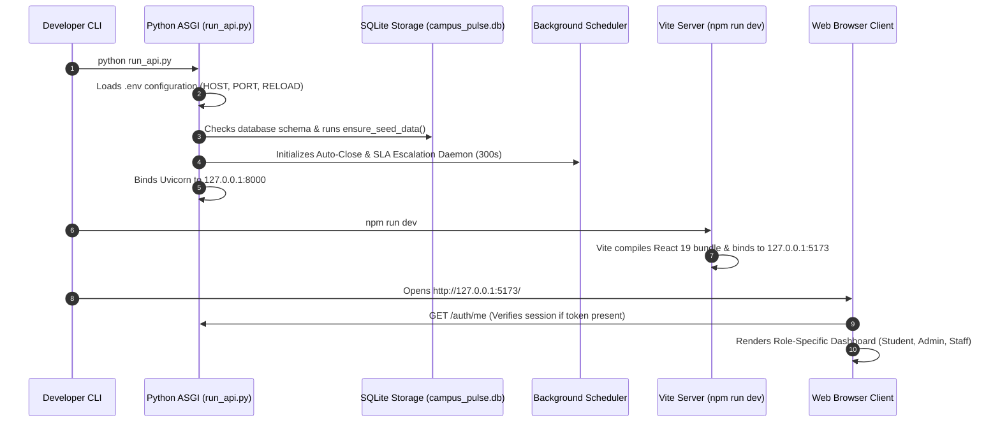

# Campus Pulse — Technical Master Guide & System Architecture

> **Document Type:** Master Architectural Guide & System Overview  
> **Status:** Production-Verified against Active Codebase  
> **Repository:** Campus Pulse (`CampusPulse_co`)  
> **Target Audience:** Software Architects, Full-Stack Engineers, DevOps, System Administrators  

---

## 1. Executive Introduction & System Overview (Part 1)

### 1.1 What is Campus Pulse?
**Campus Pulse** is a centralized, multi-role campus operations and complaint lifecycle management system designed for universities and residential collegiate institutions. It bridges the communication gap between students, facility wardens, departmental maintenance coordinators, operational app managers, and senior college administrators.

### 1.2 The Problem It Solves
Traditional university campus maintenance relies on fragmented communication channels (WhatsApp groups, physical complaint registers, informal phone calls, or unmonitored email inboxes). This creates several critical failure points:
1. **Zero Accountability:** Grievances are lost, ignored, or untracked.
2. **Slow Resolution:** Maintenance technicians are not notified automatically.
3. **Premature Closures:** Work is claimed to be complete without student verification.
4. **No Service Level Agreements (SLAs):** Critical hazards (e.g., electrical sparking, water leaks) languish without automated escalation.
5. **No Historical Intelligence:** Campus administrators have no macro-level visibility into recurring failure points across hostels and departments.

Campus Pulse replaces this with an automated, SLA-driven state machine with proof-of-work uploads, mandatory student verification windows, real-time push notifications, and administrative analytics.

---

### 1.3 Intended Users & Operating Philosophy

Campus Pulse serves six distinct campus roles:
- **Students:** Report grievances, track status, verify or reopen resolutions, view official announcements, and report lost & found items.
- **Coordinators:** Department-level staff (Plumbing, Electrical, IT, Mess) who do the actual repair work. A single coordinator can cover multiple departments and multiple locations.
- **Wardens / Location In-Charges:** Facility supervisors (Hostels, Messes, Sports) overseeing physical buildings. The warden supervises their location(s), verifies High/Critical fixes and spot checks, and can file complaints on behalf of students. The warden never fixes complaints and is never assigned complaints.
- **App Managers:** Operational supervisors managing multiple campus facilities, mapping coordinator coverage, reallocating workloads, and reviewing compliance.
- **Administrators:** Institutional authorities controlling user accounts, facilities, departments, database backups, and institutional settings.
- **Super Admins:** Platform administrators for optional multi-tenant institutional onboarding (standard Campus Pulse is a self-contained single-institution deployment).

**Core Operating Philosophy:**
- **Zero-Drop Routing:** No complaint can be orphaned; automatic routing matches eligible coordinators. If exactly 1, assigns immediately; if >1, places in coordinator accept pool; if 0, raises an immediate coverage gap alert to App Manager and Admin. Wardens are never assigned.
- **Two-Tier Verification:** Coordinator marks work resolved -> Warden verifies High/Critical resolutions and 10% random spot checks -> Student confirms resolution within 48 hours (or auto-closes).
- **Transparent Governance:** Every administrative action is logged to an immutable audit trail.

---

### 1.4 High-Level System Architecture Diagram

```mermaid
graph TD
    subgraph Users ["Campus Stakeholders"]
        Student[Student]
        Coord[Department Coordinator]
        Warden[Hostel Warden]
        Manager[App Manager]
        Admin[Campus Administrator]
    end

    subgraph FrontendApp ["Frontend Application (Vite + React 19)"]
        UI[Tailwind CSS Interface]
        AuthCtx[AuthContext Session Store]
        AxiosClient[Axios Interceptor Transport]
        WSClient[WebSocket Listener]
    end

    subgraph NetworkGate ["Perimeter & Middleware"]
        CORS[CORS Policy]
        RateLimit[Sliding Window Rate Limiter]
        SecHeaders[Security Headers Middleware]
    end

    subgraph BackendAPI ["FastAPI REST Backend (Uvicorn / Python 3)"]
        Routers[24 Domain Routers]
        RBAC[Dependency Inversion RBAC]
        Services[Business Logic Service Singletons]
        Scheduler[Background SLA Scheduler (300s)]
        WSMgr[WebSocket Connection Manager]
    end

    subgraph StorageTier ["Data Persistence & Storage"]
        DB[(SQLite 3 Database - WAL Mode)]
        Filesystem[(Local File Storage: attachments/)]
        Logs[(Application & Audit Logs)]
    end

    subgraph ExternalServices ["External Protocols"]
        SMTP[Standard SMTP Server (Gmail / University Mail)]
    end

    Users --> UI
    UI --> AuthCtx --> AxiosClient
    UI --> WSClient
    AxiosClient -- "REST HTTPS / JSON" --> CORS --> RateLimit --> SecHeaders --> Routers
    WSClient -- "WSS" --> WSMgr
    Routers --> RBAC --> Services
    Services --> DB
    Services --> Filesystem
    Services --> Logs
    Services --> SMTP
    Scheduler --> Services
```

---

### 1.5 Application Startup Process



---

## 2. Documentation Package Directory & Index

To ensure deep technical rigor without overwhelming a single file, this documentation is structured into specialized, cross-referenced modules:

| Document File | Core Content Covered | Key Target Audience |
| :--- | :--- | :--- |
| [`docs/CAMPUS_PULSE_TECHNICAL_MASTER_GUIDE.md`](file:///c:/Users/gowth/OneDrive/Desktop/GOWTHAM/CampusPulse/CampusPulse_co/docs/CAMPUS_PULSE_TECHNICAL_MASTER_GUIDE.md) | **Master Guide (This File)**: System overview, developer cheatsheets, onboarding guide | All Engineers & Architects |
| [`docs/TECH_STACK_AND_DESIGN_DECISIONS.md`](file:///c:/Users/gowth/OneDrive/Desktop/GOWTHAM/CampusPulse/CampusPulse_co/docs/TECH_STACK_AND_DESIGN_DECISIONS.md) | **Parts 2 & 13**: Language inventory (6 languages), libraries, decision table, architecture trade-offs | Architects & Tech Leads |
| [`docs/ARCHITECTURE_AND_DATA_FLOW.md`](file:///c:/Users/gowth/OneDrive/Desktop/GOWTHAM/CampusPulse/CampusPulse_co/docs/ARCHITECTURE_AND_DATA_FLOW.md) | **Parts 3 & 15**: 20-layer architecture, 16 step-by-step end-to-end execution traces | Full-Stack Developers |
| [`docs/DATABASE_AND_DATA_MODEL.md`](file:///c:/Users/gowth/OneDrive/Desktop/GOWTHAM/CampusPulse/CampusPulse_co/docs/DATABASE_AND_DATA_MODEL.md) | **Part 4**: Database schema, PRAGMA settings, table specs, ER diagram, retention policies | Database Engineers |
| [`docs/SECURITY_AUTHENTICATION_AND_NOTIFICATIONS.md`](file:///c:/Users/gowth/OneDrive/Desktop/GOWTHAM/CampusPulse/CampusPulse_co/docs/SECURITY_AUTHENTICATION_AND_NOTIFICATIONS.md) | **Parts 5 & 7**: RBAC matrix, sessions, PBKDF2 hashing, tokens, notification pipeline | Security Engineers & DevOps |
| [`docs/FUNCTIONALITY_DEEP_DIVE.md`](file:///c:/Users/gowth/OneDrive/Desktop/GOWTHAM/CampusPulse/CampusPulse_co/docs/FUNCTIONALITY_DEEP_DIVE.md) | **Part 6**: Exhaustive 14-point template specifications for all verified modules | Product Engineers |
| [`docs/API_REFERENCE_AND_PERMISSIONS.md`](file:///c:/Users/gowth/OneDrive/Desktop/GOWTHAM/CampusPulse/CampusPulse_co/docs/API_REFERENCE_AND_PERMISSIONS.md) | **Part 8**: 277 REST endpoints directory, request schemas, HTTP statuses, permissions | Frontend/API Integrators |
| [`docs/TESTING_DEPLOYMENT_AND_OPERATIONS.md`](file:///c:/Users/gowth/OneDrive/Desktop/GOWTHAM/CampusPulse/CampusPulse_co/docs/TESTING_DEPLOYMENT_AND_OPERATIONS.md) | **Parts 10, 11 & 12**: QA test runs, environment variables, Docker, deployment, technical debt | QA & DevOps Engineers |
| [`docs/FILE_BY_FILE_REFERENCE.md`](file:///c:/Users/gowth/OneDrive/Desktop/GOWTHAM/CampusPulse/CampusPulse_co/docs/FILE_BY_FILE_REFERENCE.md) | **Part 14**: Exhaustive file-by-file inventory of all 527 files across the entire codebase | Maintainers & Reviewers |

---

## 3. Developer Quick Reference Guide (Part 16)

### A. Technology Cheat Sheet
- **Backend Framework:** FastAPI 0.109+ on Python 3.10+ (Running on Python 3.14.2).
- **ASGI Web Server:** Uvicorn 0.27+ with WatchFiles reload.
- **Frontend Framework:** React 19.2.7 with React Router DOM 7.18.
- **Build Tool:** Vite 8.1.3 with Rollup bundling.
- **Styling System:** Tailwind CSS 4.3.2 with PostCSS.
- **Persistence Engine:** SQLite 3 in WAL mode (`campus_pulse.db`).
- **Data Validation:** Pydantic 2.6+ with type hinting.
- **HTTP Transport:** Axios 1.18+ with bearer token interceptors.
- **Automated Testing:** Pytest 8.0+ (Backend) and Vitest 3.0+ (Frontend).

---

### B. Role & Permission Cheat Sheet

| Role | Database Value | Scope | Key Capabilities | Prohibited Capabilities |
| :--- | :--- | :--- | :--- | :--- |
| **Super Admin** | `super_admin` | Multi-Tenant Platform | Onboard institutions, monitor platform health (optional platform mode) | Campus daily operations |
| **Administrator** | `administrator` | College / Campus | User management, settings, backups, notices, offline restore | Multi-campus data |
| **App Manager** | `app_manager` | Multi-Facility | Reassign complaints, facility oversight, coordinator mappings, notices | System root config |
| **Location In-Charge** | `location_in_charge` | Assigned Building(s) | Supervise location, verify High/Critical & spot-checks, post hostel notices | **Never assigned complaints; cannot fix** |
| **Coordinator** | `coordinator` | Assigned Dept(s) & Location(s) | Accept tickets from pool, execute repairs, upload proof | **Cannot post notices** |
| **Student** | `student` | Personal Complaints | Report issues, verify/reopen (max 3), Lost & Found | **Cannot post notices** |

---

### C. File Navigation Guide

Where to look when modifying specific aspects of Campus Pulse:

| What You Need to Change | Primary Frontend Location | Primary Backend Location | Key Database Table |
| :--- | :--- | :--- | :--- |
| **A page, button, or modal** | `Frontend/src/pages/` | N/A | N/A |
| **An API endpoint handler** | `Frontend/src/services/` | `Backend/api/routers/` | N/A |
| **A database column or model** | UI form fields | `Backend/models/`, `Backend/services/` | PRAGMA alter / schema script |
| **A role permission or guard** | `Frontend/src/routes/ProtectedRoute.jsx` | `Backend/api/security.py` | `users.role` |
| **An in-app notification** | `Frontend/src/pages/NotificationsPage.jsx` | `Backend/services/notification_service.py` | `notifications` |
| **Transactional email / token** | `Frontend/src/pages/auth/` | `Backend/utils/email.py` | `activation_tokens` |
| **Complaint state transition** | `Frontend/src/pages/complaints/` | `Backend/services/complaint_service.py` | `complaints.status` |
| **File upload or attachment** | File input handlers | `Backend/services/attachment_service.py` | `attachments` |
| **A scheduled cron job** | N/A | `Backend/services/scheduler_service.py` | `scheduled_jobs` |
| **An automated test suite** | `Frontend/src/__tests__/` | `Backend/tests/` | Test SQLite DB |

---

### D. Common Debugging Guide

1. **Investigating Backend HTTP Errors:**
   - Review log entries in [`Backend/logs/app.log`](file:///c:/Users/gowth/OneDrive/Desktop/GOWTHAM/CampusPulse/CampusPulse_co/Backend/logs/app.log) or terminal output.
   - Look for format: `Method: POST | Path: /complaints | Status: 400 | User: USR_STUDENT | Time: 12.4ms`.
2. **Investigating 403 Forbidden Access Errors:**
   - Look for log warning: `403 Forbidden - Reason: Role 'coordinator' attempted 'POST /announcements', Required: ('administrator', ...)`.
   - Check `Backend/api/security.py` and router dependency `require_roles()`.
3. **Investigating Database Locks (`database is locked`):**
   - Ensure PRAGMA WAL mode is active: `PRAGMA journal_mode;` returns `wal`.
   - Confirm long-running transactions are wrapped in short-lived `with self._connect() as conn:` context managers.
4. **Verifying System Health After Modifications:**
   - Run smoke test: `python Backend/tests/smoke_test.py` (Must yield 19/19 PASS).
   - Run workflow tests: `python -m pytest Backend/tests/test_workflow8_announcements.py`.

---

### E. New Developer Onboarding Guide

To set up and run Campus Pulse from scratch on a new developer workstation:

1. **Prerequisites:**
   - Python 3.10+ (verified on Python 3.14).
   - Node.js 18+ and npm.
2. **Backend Setup:**
   ```bash
   cd Backend
   python -m venv venv
   # Windows: venv\Scripts\activate | Linux: source venv/bin/activate
   pip install -r requirements.txt
   python run_api.py
   ```
   *Verification:* Open `http://127.0.0.1:8000/docs` in your browser.
3. **Frontend Setup:**
   ```bash
   cd Frontend
   npm install
   npm run dev
   ```
   *Verification:* Open `http://127.0.0.1:5173/` in your browser.
4. **Login with Verified Seed Accounts:**
   - **Administrator:** `gowthamejjurothu@gmail.com` / `Admin@123`
   - **App Manager:** `ejjurothugowtham@gmail.com` / `Manager@123`
   - **Hostel Warden:** `naveen@campus.edu` / `warden@123`
   - **Coordinator:** `gowthamejjurothu15@gmail.com` / `Coordinator@123`
   - **Student:** `gowtham.e23@iiits.in` / `Student@123`
5. **Run Test Suites:**
   ```bash
   python Backend/tests/smoke_test.py
   npm test
   ```

---

## 4. Documentation Completeness Checklist (Part 16.J)

| Section / Topic | Status | Verified Document Reference |
| :--- | :---: | :--- |
| **Part 1: Project Overview & Philosophy** | **Complete** | [`docs/CAMPUS_PULSE_TECHNICAL_MASTER_GUIDE.md`](file:///c:/Users/gowth/OneDrive/Desktop/GOWTHAM/CampusPulse/CampusPulse_co/docs/CAMPUS_PULSE_TECHNICAL_MASTER_GUIDE.md) |
| **Part 2: Technology & Language Inventory (6 Languages)**| **Complete** | [`docs/TECH_STACK_AND_DESIGN_DECISIONS.md`](file:///c:/Users/gowth/OneDrive/Desktop/GOWTHAM/CampusPulse/CampusPulse_co/docs/TECH_STACK_AND_DESIGN_DECISIONS.md) |
| **Part 3: 20-Layer Architecture & Connections** | **Complete** | [`docs/ARCHITECTURE_AND_DATA_FLOW.md`](file:///c:/Users/gowth/OneDrive/Desktop/GOWTHAM/CampusPulse/CampusPulse_co/docs/ARCHITECTURE_AND_DATA_FLOW.md) |
| **Part 4: Database & Schema Specification (196 Tables)**| **Complete** | [`docs/DATABASE_AND_DATA_MODEL.md`](file:///c:/Users/gowth/OneDrive/Desktop/GOWTHAM/CampusPulse/CampusPulse_co/docs/DATABASE_AND_DATA_MODEL.md) |
| **Part 5: Role-Based Access Control Matrix (6 Roles)**| **Complete** | [`docs/SECURITY_AUTHENTICATION_AND_NOTIFICATIONS.md`](file:///c:/Users/gowth/OneDrive/Desktop/GOWTHAM/CampusPulse/CampusPulse_co/docs/SECURITY_AUTHENTICATION_AND_NOTIFICATIONS.md) |
| **Part 6: Exhaustive Functionality Catalogue (14-Points)**| **Complete** | [`docs/FUNCTIONALITY_DEEP_DIVE.md`](file:///c:/Users/gowth/OneDrive/Desktop/GOWTHAM/CampusPulse/CampusPulse_co/docs/FUNCTIONALITY_DEEP_DIVE.md) |
| **Part 7: Deep Dive into Specific Shared Mechanisms** | **Complete** | [`docs/SECURITY_AUTHENTICATION_AND_NOTIFICATIONS.md`](file:///c:/Users/gowth/OneDrive/Desktop/GOWTHAM/CampusPulse/CampusPulse_co/docs/SECURITY_AUTHENTICATION_AND_NOTIFICATIONS.md) |
| **Part 8: Complete API Inventory (277 Endpoints)** | **Complete** | [`docs/API_REFERENCE_AND_PERMISSIONS.md`](file:///c:/Users/gowth/OneDrive/Desktop/GOWTHAM/CampusPulse/CampusPulse_co/docs/API_REFERENCE_AND_PERMISSIONS.md) |
| **Part 9: Frontend Architecture & UI UX** | **Complete** | [`docs/ARCHITECTURE_AND_DATA_FLOW.md`](file:///c:/Users/gowth/OneDrive/Desktop/GOWTHAM/CampusPulse/CampusPulse_co/docs/ARCHITECTURE_AND_DATA_FLOW.md) |
| **Part 10: Testing & QA Verification Report** | **Complete** | [`docs/TESTING_DEPLOYMENT_AND_OPERATIONS.md`](file:///c:/Users/gowth/OneDrive/Desktop/GOWTHAM/CampusPulse/CampusPulse_co/docs/TESTING_DEPLOYMENT_AND_OPERATIONS.md) |
| **Part 11: Configuration, Environment & Deployment** | **Complete** | [`docs/TESTING_DEPLOYMENT_AND_OPERATIONS.md`](file:///c:/Users/gowth/OneDrive/Desktop/GOWTHAM/CampusPulse/CampusPulse_co/docs/TESTING_DEPLOYMENT_AND_OPERATIONS.md) |
| **Part 12: Bugs, Fixes, Limitations & Technical Debt** | **Complete** | [`docs/TESTING_DEPLOYMENT_AND_OPERATIONS.md`](file:///c:/Users/gowth/OneDrive/Desktop/GOWTHAM/CampusPulse/CampusPulse_co/docs/TESTING_DEPLOYMENT_AND_OPERATIONS.md) |
| **Part 13: Architectural Design Decisions Analysis** | **Complete** | [`docs/TECH_STACK_AND_DESIGN_DECISIONS.md`](file:///c:/Users/gowth/OneDrive/Desktop/GOWTHAM/CampusPulse/CampusPulse_co/docs/TECH_STACK_AND_DESIGN_DECISIONS.md) |
| **Part 14: Complete File-by-File Inventory (527 Files)**| **Complete** | [`docs/FILE_BY_FILE_REFERENCE.md`](file:///c:/Users/gowth/OneDrive/Desktop/GOWTHAM/CampusPulse/CampusPulse_co/docs/FILE_BY_FILE_REFERENCE.md) |
| **Part 15: 16 Step-by-Step End-to-End Traces** | **Complete** | [`docs/ARCHITECTURE_AND_DATA_FLOW.md`](file:///c:/Users/gowth/OneDrive/Desktop/GOWTHAM/CampusPulse/CampusPulse_co/docs/ARCHITECTURE_AND_DATA_FLOW.md) |
| **Part 16: Developer Reference Cheatsheets & Guides** | **Complete** | [`docs/CAMPUS_PULSE_TECHNICAL_MASTER_GUIDE.md`](file:///c:/Users/gowth/OneDrive/Desktop/GOWTHAM/CampusPulse/CampusPulse_co/docs/CAMPUS_PULSE_TECHNICAL_MASTER_GUIDE.md) |
