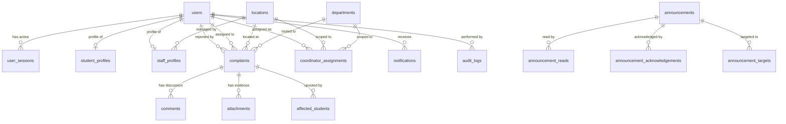

# Campus Pulse — Database Architecture, Schema Specification & Data Model

> **Document Type:** Core Database Specification & Entity-Relationship Reference  
> **Status:** Verified against `Backend/storage/campus_pulse.db` and SQLite System Catalogs  
> **Repository:** Campus Pulse (`CampusPulse_co`)  

---

## 1. Persistence Architecture & Engine Selection

Campus Pulse utilizes **SQLite 3** as its active persistence engine. The runtime database file is located at `Backend/storage/campus_pulse.db`.

Active runtime schema comprises ~39 production tables and active indexes. Speculative enterprise tables (~135 unused tables from earlier architecture drafts) have been cleanly isolated into `Backend/scripts/legacy_scaffold_schema.py` and documented in [`docs/UNUSED_TABLES.md`](file:///c:/Users/gowth/OneDrive/Desktop/GOWTHAM/CampusPulse/CampusPulse_co/docs/UNUSED_TABLES.md).



---

### Database Configuration & Pragma Directives

The database operates under strict performance and integrity directives initialized on every connection in `Backend/services/auth_service.py` and `Backend/services/complaint_service.py`:

```sql
PRAGMA journal_mode = WAL;          -- Write-Ahead Logging for concurrent reader execution
PRAGMA foreign_keys = ON;           -- Enforces relational integrity and CASCADE constraints
PRAGMA synchronous = NORMAL;        -- Balances durability with disk write latency
PRAGMA busy_timeout = 5000;         -- 5-second retry timeout for busy lock acquisition
```

### Transaction Management & Concurrency Control
- **Connection Isolation:** Python's standard `sqlite3` context manager (`with self._connect() as conn:`) automatically wraps multi-statement operations in `BEGIN IMMEDIATE` transactions.
- **Rollback Guarantee:** Any unhandled exception triggers an immediate `conn.rollback()`, ensuring no partial records or corrupted foreign keys remain.
- **Row Mapping:** All queries set `conn.row_factory = sqlite3.Row`, allowing dict-like column access by name while preserving tuple indexing speed.

---

## 2. Core Relational Schema Specification

### 2.1 Table: `users`
Central user registry for all campus actors.

| Column | Type | Nullable | Default | Constraints & Description |
| :--- | :--- | :--- | :--- | :--- |
| `user_id` | TEXT | NO | None | **PRIMARY KEY**. Formats: `USR_ADMIN`, `USR_STUDENT`, `USR_<UUID>` |
| `email` | TEXT | NO | None | **UNIQUE**. Primary login username |
| `password_hash` | TEXT | NO | None | PBKDF2-HMAC-SHA256 hex digest (100,000 iterations) |
| `salt` | TEXT | NO | None | 16-byte random cryptographic hex salt |
| `role` | TEXT | NO | None | Enum: `super_admin`, `administrator`, `app_manager`, `location_in_charge`, `coordinator`, `student` |
| `name` | TEXT | NO | None | Full display name |
| `status` | TEXT | NO | `'Active'` | Enum: `'Active'`, `'Inactive'`, `'Pending'`, `'Suspended'`, `'Archived'` |
| `active` | INTEGER | NO | `1` | Boolean flag (1=Active, 0=Deactivated) |
| `is_deleted` | INTEGER | NO | `0` | Soft-delete flag (0=Active, 1=Soft Deleted) |
| `is_temp_password` | INTEGER | NO | `0` | Requires mandatory password change if 1 |
| `institution_id` | TEXT | YES | `NULL` | Optional institution identifier (single-institution runtime) |
| `phone_number` | TEXT | YES | `NULL` | Contact phone number |
| `created_at` | TEXT | NO | `CURRENT_TIMESTAMP` | ISO 8601 creation timestamp |
| `updated_at` | TEXT | NO | `CURRENT_TIMESTAMP` | Last updated timestamp |

---

### 2.2 Table: `student_profiles`
Student academic attributes and hostel residency scoping.

| Column | Type | Nullable | Default | Constraints & Description |
| :--- | :--- | :--- | :--- | :--- |
| `student_id` | TEXT | NO | None | **PRIMARY KEY**, **FOREIGN KEY** → `users(user_id)` ON DELETE CASCADE |
| `roll_number` | TEXT | YES | None | University roll/registration number |
| `program_id` | TEXT | YES | None | Academic program reference (e.g., `BTECH_CSE`) |
| `year_of_study` | INTEGER| YES | None | Academic year (1, 2, 3, 4) |
| `hostel_location_id`| TEXT | YES | None | **FOREIGN KEY** → `locations(location_id)`. Enforces hostel complaint restrictions |
| `room_number` | TEXT | YES | None | Room designation |
| `emergency_contact` | TEXT | YES | None | Parent/guardian phone number |

---

### 2.3 Table: `staff_profiles`
Operational role details for administrators, app managers, wardens, and coordinators.

| Column | Type | Nullable | Default | Constraints & Description |
| :--- | :--- | :--- | :--- | :--- |
| `staff_id` | TEXT | NO | None | **PRIMARY KEY**, **FOREIGN KEY** → `users(user_id)` ON DELETE CASCADE |
| `department_id` | TEXT | YES | None | Primary departmental affiliation |
| `location_id` | TEXT | YES | None | Primary location affiliation (Hostel, Mess, etc.) |
| `designation` | TEXT | YES | None | Title (e.g., "Chief Warden", "Senior Coordinator") |
| `office_room` | TEXT | YES | None | Office location |

---

### 2.4 Table: `locations`
Physical campus facilities and buildings.

| Column | Type | Nullable | Default | Constraints & Description |
| :--- | :--- | :--- | :--- | :--- |
| `location_id` | TEXT | NO | None | **PRIMARY KEY**. e.g., `LOC_HOSTEL_1`, `LOC_ACADEMIC_1` |
| `name` | TEXT | NO | None | Human-readable name (e.g., "Hostel 1") |
| `location_type` | TEXT | NO | None | Enum: `Hostel`, `Academic`, `Mess`, `SAC`, `Sports`, `Other` |
| `app_manager_id`| TEXT | YES | None | **FOREIGN KEY** → `users(user_id)`. Designated responsible App Manager |
| `warden_id` | TEXT | YES | None | **FOREIGN KEY** → `users(user_id)`. Designated Location In-Charge |
| `status` | TEXT | NO | `'Active'` | Enum: `'Active'`, `'Inactive'` |
| `created_at` | TEXT | NO | `CURRENT_TIMESTAMP` | Creation timestamp |

---

### 2.5 Table: `departments`
Functional service divisions responsible for resolving issues.

| Column | Type | Nullable | Default | Constraints & Description |
| :--- | :--- | :--- | :--- | :--- |
| `department_id` | TEXT | NO | None | **PRIMARY KEY**. e.g., `DEPT_PLUMBING`, `DEPT_ELECTRICAL` |
| `name` | TEXT | NO | None | Display name (e.g., "Electrical Works", "Hostel Affairs") |
| `code` | TEXT | YES | None | Department short code |
| `head_of_dept` | TEXT | YES | None | Name or user reference of department head |
| `status` | TEXT | NO | `'Active'` | Enum: `'Active'`, `'Inactive'` |

---

### 2.6 Table: `coordinator_assignments`
Mapping table assigning departmental coordinators to specific locations.

| Column | Type | Nullable | Default | Constraints & Description |
| :--- | :--- | :--- | :--- | :--- |
| `assignment_id` | TEXT | NO | None | **PRIMARY KEY** |
| `coordinator_id`| TEXT | NO | None | **FOREIGN KEY** → `users(user_id)` ON DELETE CASCADE |
| `location_id` | TEXT | NO | None | **FOREIGN KEY** → `locations(location_id)` ON DELETE CASCADE |
| `department_id` | TEXT | NO | None | **FOREIGN KEY** → `departments(department_id)` ON DELETE CASCADE |
| `is_primary` | INTEGER| NO | `1` | 1 if primary responder, 0 if backup |
| `created_at` | TEXT | NO | `CURRENT_TIMESTAMP` | Assignment timestamp |

---

### 2.7 Table: `complaints`
Central grievance lifecycle entity.

| Column | Type | Nullable | Default | Constraints & Description |
| :--- | :--- | :--- | :--- | :--- |
| `complaint_id` | TEXT | NO | None | **PRIMARY KEY**. e.g., `CMP-<UUID>` |
| `title` | TEXT | NO | None | Complaint summary title |
| `description` | TEXT | NO | None | Detailed grievance description |
| `category` | TEXT | YES | None | Categorization tag |
| `location_id` | TEXT | NO | None | **FOREIGN KEY** → `locations(location_id)` |
| `department_id` | TEXT | NO | None | **FOREIGN KEY** → `departments(department_id)` |
| `created_by` | TEXT | NO | None | **FOREIGN KEY** → `users(user_id)`. Author student |
| `assigned_to` | TEXT | YES | None | **FOREIGN KEY** → `users(user_id)`. Responsible staff member |
| `status` | TEXT | NO | `'Submitted'`| Enum: `'Submitted'`, `'Assigned'`, `'In Progress'`, `'Resolved'`, `'Waiting for Verification'`, `'Closed'`, `'Closed (Auto Closed)'`, `'Reopened'`, `'Rejected'` |
| `priority` | TEXT | NO | `'Normal'` | Enum: `'Low'`, `'Normal'`, `'High'`, `'Critical'` |
| `sla_deadline` | TEXT | YES | None | ISO 8601 SLA resolution deadline |
| `is_escalated` | INTEGER| NO | `0` | 1 if SLA deadline breached |
| `reopen_count` | INTEGER| NO | `0` | Number of times reopened by student (max 3) |
| `reopen_notes` | TEXT| YES | None | Notes/reason provided when reopening |
| `resolution_notes`| TEXT| YES | None | Remarks entered by resolving coordinator |
| `resolution_proof_url`| TEXT| YES | None | URL / filepath of proof photo |
| `warden_verified_at`| TEXT| YES | None | Timestamp when warden verified High/Critical or spot check |
| `warden_verified_by`| TEXT| YES | None | **FOREIGN KEY** → `users(user_id)`. Verifying warden |
| `warden_decision`| TEXT| YES | None | `'approved'` or `'rejected'` |
| `student_confirmed_at`| TEXT| YES | None | Timestamp when student confirmed resolution |
| `is_spot_check` | INTEGER| NO | `0` | 1 if selected for random spot check (10% of Normal/Low) |
| `resolved_at` | TEXT | YES | None | Timestamp when marked resolved |
| `closed_at` | TEXT | YES | None | Timestamp when student verified or auto-closed |
| `created_at` | TEXT | NO | `CURRENT_TIMESTAMP` | Creation timestamp |
| `updated_at` | TEXT | NO | `CURRENT_TIMESTAMP` | Last updated timestamp |

---

### 2.8 Table: `user_sessions`
Active opaque session token registry.

| Column | Type | Nullable | Default | Constraints & Description |
| :--- | :--- | :--- | :--- | :--- |
| `session_token` | TEXT | NO | None | **PRIMARY KEY**. SHA-256 hash of random bearer token |
| `user_id` | TEXT | NO | None | **FOREIGN KEY** → `users(user_id)` ON DELETE CASCADE |
| `created_at` | REAL | NO | None | Epoch timestamp of creation |
| `expires_at` | REAL | NO | None | Epoch timestamp of expiration (sliding or 24-hour) |
| `last_seen` | REAL | NO | None | Epoch timestamp of latest authenticated request |

---

### 2.9 Table: `notifications`
In-app notification records.

| Column | Type | Nullable | Default | Constraints & Description |
| :--- | :--- | :--- | :--- | :--- |
| `notification_id`| TEXT | NO | None | **PRIMARY KEY** |
| `user_id` | TEXT | NO | None | **FOREIGN KEY** → `users(user_id)` ON DELETE CASCADE |
| `title` | TEXT | NO | None | Notification title |
| `message` | TEXT | NO | None | Detailed message text |
| `reference_type`| TEXT | YES | None | Associated entity type (`Complaint`, `Announcement`) |
| `reference_id` | TEXT | YES | None | Entity primary key (`complaint_id`, etc.) |
| `is_read` | INTEGER| NO | `0` | Read flag (0=Unread, 1=Read) |
| `created_at` | TEXT | NO | `CURRENT_TIMESTAMP` | ISO 8601 timestamp |

---

### 2.10 Table: `announcements`
Campus circulars and emergency broadcast bulletins.

| Column | Type | Nullable | Default | Constraints & Description |
| :--- | :--- | :--- | :--- | :--- |
| `announcement_id`| TEXT | NO | None | **PRIMARY KEY** |
| `title` | TEXT | NO | None | Broadcast title |
| `content` | TEXT | NO | None | Full circular body text |
| `summary` | TEXT | YES | None | 1-line summary |
| `category` | TEXT | NO | `'General'` | Enum: `Academic`, `Examination`, `Hostel`, `Maintenance`, `Emergency`, `General` |
| `priority` | TEXT | NO | `'Normal'` | Enum: `Normal`, `High`, `Critical` |
| `is_pinned` | INTEGER| NO | `0` | Pinned announcement flag |
| `requires_ack` | INTEGER| NO | `0` | 1 if student must submit mandatory acknowledgement |
| `status` | TEXT | NO | `'Published'`| Enum: `Draft`, `Scheduled`, `Published`, `Archived`, `Cancelled` |
| `created_by` | TEXT | NO | None | **FOREIGN KEY** → `users(user_id)` (Admin, Manager, or Warden) |
| `published_at` | TEXT | YES | None | ISO 8601 publish timestamp |
| `expires_at` | TEXT | YES | None | ISO 8601 expiration timestamp |
| `created_at` | TEXT | NO | `CURRENT_TIMESTAMP` | Creation timestamp |

---

### 2.11 Table: `audit_logs`
Immutable audit trail for governance, compliance, and security tracking.

| Column | Type | Nullable | Default | Constraints & Description |
| :--- | :--- | :--- | :--- | :--- |
| `log_id` | INTEGER| NO | None | **PRIMARY KEY AUTOINCREMENT** |
| `action` | TEXT | NO | None | Audit action (e.g., `USER_DEACTIVATED`, `ROLE_ASSIGNED`) |
| `entity_type` | TEXT | NO | None | Target entity (e.g., `User`, `Location`, `Complaint`) |
| `entity_id` | TEXT | YES | None | Target entity identifier |
| `actor_id` | TEXT | NO | None | Performer user ID (`users.user_id`) |
| `details` | TEXT | YES | None | JSON string of state diff or parameters |
| `ip_address` | TEXT | YES | None | Client IP address |
| `created_at` | TEXT | NO | `CURRENT_TIMESTAMP` | Immutable timestamp |

---

### 2.12 Table: `coordinator_departments`
Many-to-many mapping allowing a single coordinator to cover multiple departments.

| Column | Type | Nullable | Default | Constraints & Description |
| :--- | :--- | :--- | :--- | :--- |
| `coordinator_id` | TEXT | NO | None | **FOREIGN KEY** → `users(user_id)` ON DELETE CASCADE |
| `department_id` | TEXT | NO | None | **FOREIGN KEY** → `departments(department_id)` ON DELETE CASCADE |
| `created_at` | TEXT | NO | `CURRENT_TIMESTAMP` | Assignment timestamp |

*Primary Key:* `(coordinator_id, department_id)`

---

### 2.13 Table: `coordinator_locations`
Many-to-many mapping allowing a single coordinator to cover multiple campus locations.

| Column | Type | Nullable | Default | Constraints & Description |
| :--- | :--- | :--- | :--- | :--- |
| `coordinator_id` | TEXT | NO | None | **FOREIGN KEY** → `users(user_id)` ON DELETE CASCADE |
| `location_id` | TEXT | NO | None | **FOREIGN KEY** → `locations(location_id)` ON DELETE CASCADE |
| `created_at` | TEXT | NO | `CURRENT_TIMESTAMP` | Assignment timestamp |

*Primary Key:* `(coordinator_id, location_id)`

---

### 2.14 Table: `push_subscriptions`
Stores Web Push (VAPID) subscription endpoints and crypto keys for browser push notifications.

| Column | Type | Nullable | Default | Constraints & Description |
| :--- | :--- | :--- | :--- | :--- |
| `subscription_id` | TEXT | NO | None | **PRIMARY KEY** (`sub_<UUID>`) |
| `user_id` | TEXT | NO | None | **FOREIGN KEY** → `users(user_id)` ON DELETE CASCADE |
| `endpoint` | TEXT | NO | None | Browser push service subscription URL |
| `p256dh` | TEXT | NO | None | Client public key (Base64url) |
| `auth` | TEXT | NO | None | Client auth secret (Base64url) |
| `user_agent` | TEXT | YES | `NULL` | Browser client user-agent string |
| `created_at` | TEXT | NO | `CURRENT_TIMESTAMP` | Registration timestamp |

---

## 3. Data Lifecycle & Deletion Policies

1. **Soft Deletion vs Physical Deletion:**
   - **Users:** Soft-deleted via `users.status = 'Inactive'`, `users.active = 0`, and `users.is_deleted = 1`. Physical deletion is strictly prohibited for accounts with complaint, comment, or audit history to maintain institutional integrity.
   - **Complaints:** Terminal states are `'Closed'` and `'Rejected'`. Complaints are retained permanently for institutional reporting and pattern analysis.
   - **Sessions:** Physically deleted upon logout or purged by background scheduler upon expiry.
   - **Notifications:** Marked read or cleared per user; retained in historical activity tables.
2. **Referential Integrity & Cascades:**
   - Deleting a user cascade-deletes profile details (`student_profiles`, `staff_profiles`) and session tokens (`user_sessions`).
   - Foreign key constraints prevent deleting locations or departments that have active complaint records attached.
3. **Database Backup Strategy:**
   - Backups are captured using SQLite Online Backup API into `Backend/storage/backups/`.
   - Point-in-time snapshots preserve complete database state without requiring server downtime.
