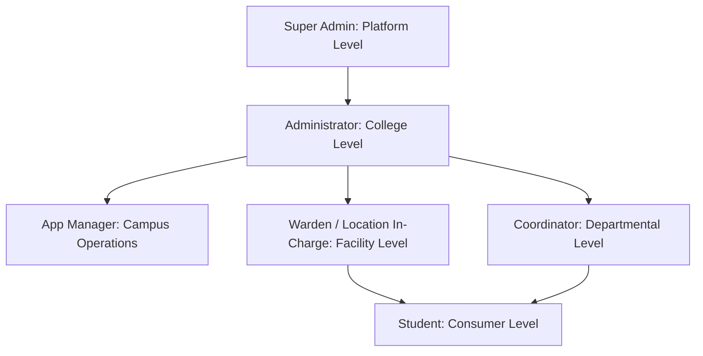
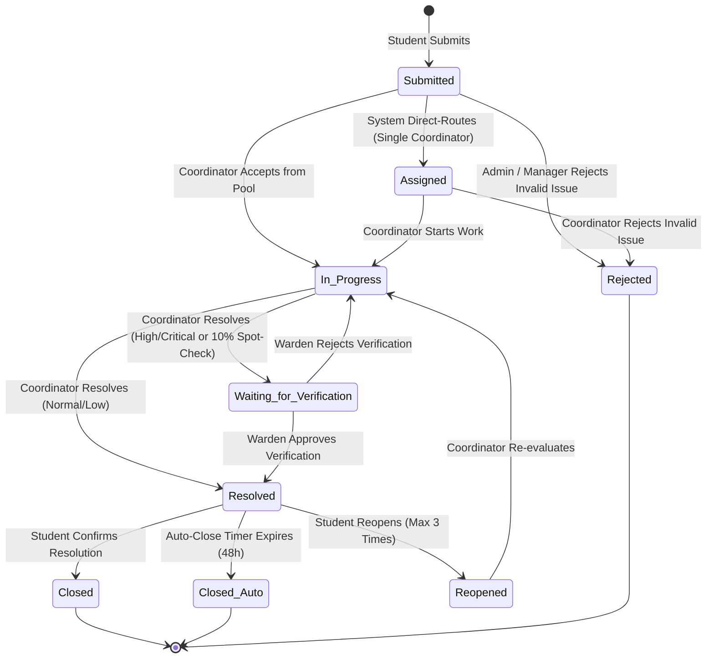

# Campus Pulse — Security Architecture, RBAC, Authentication & Core Mechanisms

> **Document Type:** Deep-Dive Security & Shared Mechanisms Specification  
> **Status:** Verified against Source Code  
> **Repository:** Campus Pulse (`CampusPulse_co`)  

---

## 1. Role-Based Access Control (RBAC) & Scope Matrix

Campus Pulse implements hierarchical and domain-scoped Role-Based Access Control. Six distinct roles exist in the system, enforced at both the HTTP perimeter and business service layers.

---

### 1.1 The Six User Roles & Scopes

1. **Super Admin (`super_admin`):**
   - **Scope:** Multi-tenant platform level.
   - **Permissions:** Manages institution tenants, monitors platform health, manages global technical support tickets.
   - **Restrictions:** Restricted from interfering in daily campus-level complaint assignments unless acting as global support.
2. **Administrator (`administrator`):**
   - **Scope:** Institution / Campus-wide.
   - **Permissions:** Full institutional control: user creation and deactivation, location/department CRUD, system settings, backup creation/restoration, system audit logs, announcement broadcasts, complaint reassignment, emergency overrides.
   - **Restrictions:** Cannot access or modify other institutions in multi-tenant mode.
3. **App Manager (`app_manager`):**
   - **Scope:** Multi-location operational supervisor (Hostel, Mess, Academic Block, SAC, Sports).
   - **Permissions:** Operational dashboard, user management (Coordinators/Students/Staff), location management, complaint reassignment across assigned locations, notice broadcasts, reports, analytics, audit log inspection.
   - **Restrictions (Remediation F-05):** Strictly prohibited from modifying, deactivating, or restoring `administrator` or `super_admin` accounts (`PermissionError`); prohibited from assigning the `administrator` role during user imports; cannot alter root system settings or restore full database backups.
4. **Warden / Location In-Charge (`location_in_charge`):**
   - **Scope:** Assigned physical facility (Hostel, Mess, or Complex).
   - **Permissions:** Supervises facility complaints; in-person verification of High/Critical resolutions and 10% random spot checks; publishes location-scoped announcements (hostel circulars); can submit complaints on behalf of residents.
   - **Restrictions:** **Never assigned complaints to fix; cannot mark complaints resolved; cannot verify complaints they filed themselves**; cannot modify departmental definitions or create administrator accounts.
5. **Coordinator (`coordinator` / `employee`):**
   - **Scope:** Multi-department and multi-location service delivery (e.g. Carpentry + Electrical across Block A and Block B).
   - **Permissions:** Accept tickets from pooled queues; update complaint progress; mark resolved and upload photo proof; add internal/public comments; direct chat with complainants.
   - **Restrictions:** **Cannot verify complaints; cannot publish campus announcements** (strictly rejected with 403 Forbidden); cannot manage user accounts or modify campus infrastructure.
6. **Student (`student`):**
   - **Scope:** Personal student complaints and public campus announcements.
   - **Permissions:** Submit facility complaints (restricted to their assigned hostel for residential issues); upvote peer public complaints; verify resolutions or reopen within 48 hours; submit feedback; report lost/found items; view announcements.
   - **Restrictions:** **Cannot compose or publish announcements**; cannot access administrative dashboards; cannot view private complaints of other students.

---

### 1.2 Comprehensive Role-Permission Matrix

| Operation / Resource | Super Admin | Administrator | App Manager | Warden (In-Charge) | Coordinator | Student | Enforcement Mechanism |
| :--- | :---: | :---: | :---: | :---: | :---: | :---: | :--- |
| **Login & Session Management** | Yes | Yes | Yes | Yes | Yes | Yes | `POST /auth/login`, `POST /auth/logout` |
| **Create Student Complaints** | No | No | No | Optional | No | **Yes** | `POST /complaints` (`require_roles("student", ...)`) |
| **View All Campus Complaints** | Platform | **Yes** | Scoped | Location Only | Dept Only | Personal Only | `GET /complaints` (Service scoping filter) |
| **Resolve Complaints** | No | Yes | Yes | Yes | **Yes** | No | `PUT /complaints/:id/resolve` |
| **Verify / Close Complaints** | No | Yes (Override)| No | No | No | **Yes** (Author)| `PUT /complaints/:id/verify` |
| **Reopen Resolved Complaints** | No | Yes | No | No | No | **Yes** (Author)| `POST /complaints/:id/reopen` |
| **Compose & Publish Notices** | No | **Yes** | **Yes** | **Yes** | **NO (403)** | **NO (403)**| `POST /announcements` (`require_roles(...)`) |
| **View Announcements** | Yes | Yes | Yes | Yes | Yes | **Yes** | `GET /announcements` |
| **Manage Users (Create/Deactivate)**| No | **Yes** | **Yes (Staff/Student)** | No | No | No | `POST /users`, `PUT /users/:id/deactivate` (F-05 Protected) |
| **Manage Locations & Depts** | No | **Yes** | **Yes** | No | No | No | `POST /locations`, `POST /departments` |
| **Create Backups** | No | **Yes** | **Yes** | No | No | No | `POST /backups` |
| **Restore Backups** | No | **Yes** | **NO (Admin Only)** | No | No | No | `POST /backups/:id/restore` |
| **View Audit Logs** | Yes | **Yes** | **Yes** | No | No | No | `GET /audit` (`require_roles("admin", "manager")`)|
| **Institution Registry Management**| **Yes** | No | No | No | No | No | `POST /superadmin/institutions` |

---

## 2. Deep Dive into Technical Mechanisms

### 2.1 Authentication & Login Pipeline
1. **Request Intake:** Client submits email and plaintext password to `POST /auth/login`.
2. **Rate Limiting:** `rate_limit_middleware` checks IP attempt count in `login_attempts` table. Exceeding 5 failures within 15 minutes enforces a lockout window (`429 Too Many Requests`).
3. **Credential Resolution:** `AuthService.authenticate(username, password)` queries `users` table for `active = 1` and `is_deleted = 0`.
4. **PBKDF2 Verification:** Passes input password through `hashlib.pbkdf2_hmac("sha256", password.encode(), bytes.fromhex(user.salt), 100000)`. Compares hex output with `user.password_hash` using `secrets.compare_digest()` to eliminate timing attack side-channels.
5. **Session Token Generation:** Generates 32 bytes of cryptographically secure randomness via `secrets.token_urlsafe(32)`.
6. **Token Hashing & Storage:** Computes `hashlib.sha256(raw_token.encode()).hexdigest()` and inserts into `user_sessions`.
7. **Transmission:** Returns raw token to client. Subsequent requests transmit `Authorization: Bearer <raw_token>`.

---

### 2.2 Sessions and Password Hashing Mechanics
- **Why Opaque Session Tokens?** Unlike stateless JWTs, database-backed opaque tokens can be revoked instantaneously. When an administrator deactivates an account or a user changes their password, `revoke_user_sessions(user_id)` deletes all matching hashes from `user_sessions`. Stale tokens fail immediately on the next HTTP request.
- **Why Store SHA-256 Hashes of Tokens?** Storing only the SHA-256 hash in `user_sessions` ensures that even a catastrophic database leak does not expose active bearer tokens to attackers.
- **Absolute vs Sliding Expiration (Remediation F-01):**
  - **Absolute Expiry:** Hard cap enforced at exactly 24 hours (`MAX_SESSION_LIFETIME = 86400s`) measured strictly from the immutable original `created_at` timestamp. Sessions cannot be extended indefinitely.
  - **Idle Expiry:** Sessions time out if idle for more than 4 hours (`SESSION_LIFETIME = 14400s`) based on `last_seen`. Sliding window updates preserve the original `created_at` in storage.
- **Cookie Security (Remediation F-04):** Dynamic `secure=is_secure` flag sets `Secure; HttpOnly; SameSite=Lax` based on request protocol (`https://` or `X-Forwarded-Proto`).
- **WebSocket First-Login Enforcement (Remediation F-04):** WebSockets check `first_login` status; users requiring initial password setup cannot bypass first-login workflows via real-time sockets.

---

### 2.3 Account Activation & Password Reset OTP Mechanics (Remediation F-02 & F-03)
- **Account Activation:** Utilizes high-entropy cryptographic URL activation tokens (`secrets.token_urlsafe(32)`), stored in `activation_tokens` table, expiring in 7 days.
- **Password Reset Flow (OTP):**
  - Triggered via `POST /auth/password-reset/request`. If the email exists, generates a 6-digit cryptographic OTP tied to a unique `reset_id` and dispatches via email/mock transport with a 15-minute expiry.
  - Returns a generic status response to prevent user enumeration attacks.
  - Client submits OTP via `POST /auth/password-reset/verify` along with `reset_id` and the new password.
  - **Brute-Force & Flooding Protection:** Max 3 incorrect OTP verification attempts per `reset_id`. Exceeding 3 attempts permanently invalidates the reset token. IP-based rate limiting (5 requests per 15 minutes) prevents request flooding.
  - **Lockout Synchronization (Remediation F-03):** Successful password reset/change atomically clears both `login_attempts` and `login_rate_limits`, ensuring accounts are cleanly unblocked upon credential reset.

---

### 2.4 In-App & Web Push Notification Pipeline
- **Trigger Points:** Complaint creation, coordinator assignment, status transition, SLA escalation, announcement publication, feedback requests.
- **Recipient Resolution:**
  - For new complaints: Eligible coordinator(s) + Location Warden.
  - For resolutions requiring warden check: Location Warden.
  - For student verification: Complainant student.
  - For escalations: Location Warden first, then App Manager, then Administrator.
- **Storage:** Persisted to `notifications` table (`notification_id`, `user_id`, `title`, `message`, `reference_type`, `reference_id`, `is_read`).
- **Real-Time Dispatch:** Handled via `WebSocketManager`. WebSocket connections require a single-use ticket (`POST /auth/ws-ticket`), verifying that the caller's authenticated user ID matches the connection path.
- **Web Push Notifications:** Asynchronous background delivery via Web Push protocol (VAPID) to registered client service workers (`push_subscriptions` table).

---

### 2.5 Routing, Assignment & Escalation Engine
- **Resolution Matrix:**
  1. **Direct Assignment:** If exactly 1 coordinator is mapped to the complaint's department and location, sets `assigned_to` immediately and status `'Assigned'`.
  2. **Coordinator Pool Queue:** If >1 coordinators are mapped, leaves `assigned_to = None` in status `'Submitted'`, and notifies all eligible coordinators. The first coordinator to accept claims it atomically (`POST /complaints/{id}/accept`) and transitions it to `'In Progress'`.
  3. **Coverage Gap Alert:** If 0 coordinators are mapped, leaves `assigned_to = None` in `'Submitted'` and immediately alerts App Manager and Administrator to map staff. **Wardens are never assigned complaints.**
- **SLA Deadlines:**
  - `Critical`: 4 hours.
  - `High`: 24 hours.
  - `Normal`: 48 hours.
  - `Low`: 72 hours.
- **Escalation Trigger:** The background scheduler runs every 5 minutes (`services/scheduler_service.py`), identifies complaints where `datetime.utcnow() > sla_deadline` and `status NOT IN ('Resolved', 'Closed', 'Closed (Auto Closed)', 'Rejected')`, flags `is_escalated = 1`, and escalates tier-by-tier: Warden first, then App Manager, then Administrator.

---

### 2.6 Complaint Lifecycle & State Transitions

- **Atomicity:** All status transitions run inside a SQLite transaction, updating `complaints.status`, appending an entry to `activity_events`, and inserting a row into `notifications`.

---

### 2.7 Lost & Found Architecture
- **Reporting:** Authenticated users submit item details to `POST /lost-found`. Fields: `title`, `description`, `category` (Electronics, ID Card, Clothing, Books, Other), `location_id`, `date_lost_found`, `contact_info`, `item_type` (`Lost` or `Found`).
- **Image Evidence:** Uploaded through `POST /lost-found/upload` and stored in `Backend/storage/attachments/lost_found/`.
- **Claim Workflow:** Users can submit ownership claims via comments or direct contact. Admin/Staff can mark items as `'Claimed'` or `'Resolved'`.
- **Safety:** Unwanted records are soft-deleted or cleaned up with cascading file removal.

---

### 2.8 Redirects and Navigation Hierarchy
- **Unauthenticated Users:** Any attempt to access protected paths redirects to `/login`.
- **Role-Based Home Redirect (`RoleHome` in `AppRoutes.jsx`):**
  - `super_admin` → `/superadmin`
  - `administrator` → `/admin`
  - `app_manager` → `/manager`
  - `location_in_charge` → `/location`
  - `coordinator` → `/coordinator`
  - `student` → `/student`
- **403 Forbidden Guard:** If an authenticated user attempts to access a route disallowed by their role (e.g., student visiting `/admin/users`), `ProtectedRoute.jsx` intercepts and renders `AccessDeniedPage.jsx`.

---

### 2.9 Email Delivery Implementation
- **Protocol:** Standard SMTP via Python's built-in `smtplib.SMTP`.
- **Configuration (Environment Variables):**
  - `SMTP_SERVER`: e.g., `smtp.gmail.com`
  - `SMTP_PORT`: `587` (STARTTLS)
  - `SMTP_USERNAME`: Sender email address
  - `SMTP_PASSWORD`: Secret application token (REDACTED)
  - `SMTP_FROM`: Formatted sender header
- **Error Handling:** Wrapped in `try...except Exception` blocks in [`Backend/utils/email.py`](file:///c:/Users/gowth/OneDrive/Desktop/GOWTHAM\CampusPulse\CampusPulse_co\Backend\utils\email.py). Failed email transmissions are logged as warnings and do not crash user creation or registration transactions.

---

### 2.10 File Uploads & Attachment Security
- **Size Limit:** 10 MB per file.
- **Allowed MIME Types:** `image/jpeg`, `image/png`, `image/webp`, `application/pdf`.
- **Path Traversal Protection:** Filenames are stripped of `../` and directory characters via `os.path.basename()`; files are stored with unique UUID prefixes (e.g., `att_8f7b3a_document.pdf`).
- **Access Control:** Files are served through authenticated streaming endpoints (`GET /attachments/:id`), preventing direct unauthenticated disk access.

---

### 2.11 Audit Logs & Governance
- **Monitored Actions:** User account creation, deactivation, password reset, role assignment, location reassignment, complaint escalation, settings modification, safety report identity disclosure.
- **Logged Attributes:** `actor_id`, `action`, `entity_type`, `entity_id`, `details` (JSON diff), `ip_address`, `created_at`.
- **Immutability:** No API endpoint exists to update or delete rows in `audit_logs`. Logs are append-only.

---

### 2.12 Anonymous Safety Reports Identity Protection (Remediation F-06)
- **Normal Display:** All anonymous safety reports are displayed strictly as **"Anonymous"** across all standard views, lists, details, exports, and WebSockets.
- **Controlled Disclosure Requirement:** Under product governance, identity revelation is strictly reserved for investigating suspected abuse.
- **Step-Up Authentication & RBAC Guard:**
  - Endpoint: `POST /safety-reports/{id}/reveal-identity`.
  - Accessible **strictly by Administrators** (`administrator` or `super_admin`).
  - Requires **step-up re-authentication**: The administrator must provide their current password (`admin_password`). Verified via `admin_user.check_password()`.
  - Returns minimal PII (`name`, `email`, `phone_number`).
  - Emits an immutable audit log record recording the admin's identity, timestamp, and justification reason.
- **Database Architecture:** Underlying user mappings are stored in `safety_report_identity` table, decoupled from standard complaint queries to guarantee zero accidental leakage.
