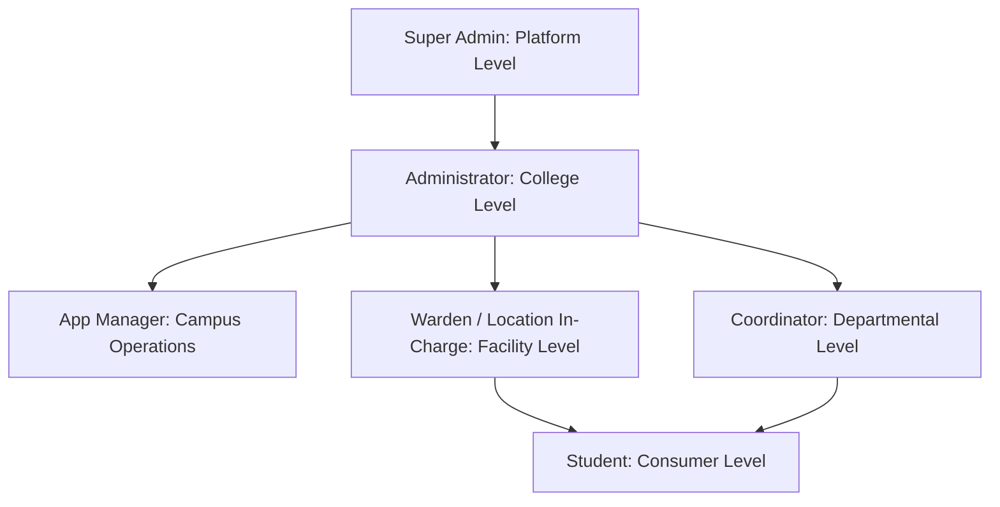
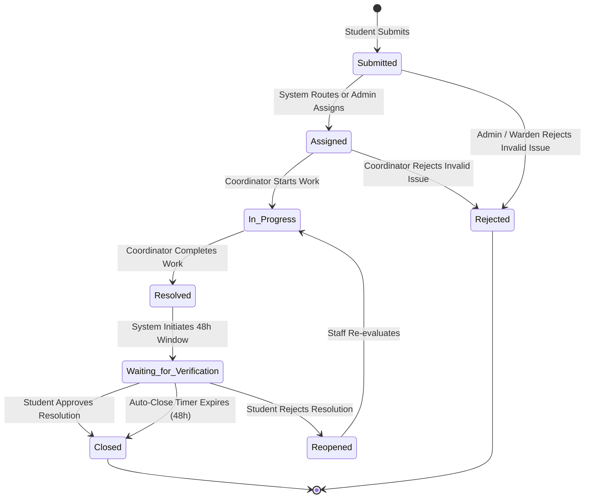

# Campus Pulse — Security Architecture, RBAC, Authentication & Core Mechanisms

> **Document Type:** Deep-Dive Security & Shared Mechanisms Specification  
> **Status:** Verified against Source Code  
> **Repository:** Campus Pulse (`CampusPulse_co`)  

---

## 1. Role-Based Access Control (RBAC) & Scope Matrix

Campus Pulse implements hierarchical and domain-scoped Role-Based Access Control. Six distinct roles exist in the system, enforced at both the HTTP perimeter and business service layers.

---

### 1.1 The Six User Roles & Scopes

1. **Super Admin (`super_admin`):**
   - **Scope:** Multi-tenant platform level.
   - **Permissions:** Manages institution tenants, monitors platform health, manages global technical support tickets.
   - **Restrictions:** Restricted from interfering in daily campus-level complaint assignments unless acting as global support.
2. **Administrator (`administrator`):**
   - **Scope:** Institution / Campus-wide.
   - **Permissions:** Full institutional control: user creation and deactivation, location/department CRUD, system settings, backup creation/restoration, system audit logs, announcement broadcasts, complaint reassignment, emergency overrides.
   - **Restrictions:** Cannot access or modify other institutions in multi-tenant mode.
3. **App Manager (`app_manager`):**
   - **Scope:** Multi-location operational supervisor (Hostel, Mess, Academic Block, SAC, Sports).
   - **Permissions:** Operational dashboard, user management (Coordinators/Students), location management, complaint reassignment across assigned locations, notice broadcasts, reports, analytics, audit log inspection.
   - **Restrictions:** Cannot alter system-wide root configurations or perform destructive database resets.
4. **Warden / Location In-Charge (`location_in_charge`):**
   - **Scope:** Assigned physical facility (Hostel, Mess, or Complex).
   - **Permissions:** Full oversight of complaints arising within their designated facility; complaint assignment and priority escalation; publishing location-scoped announcements (e.g., hostel roll call, maintenance notices); direct chat with residents.
   - **Restrictions:** Cannot modify departmental definitions, create administrator accounts, or view complaints from unrelated facilities.
5. **Coordinator (`coordinator`):**
   - **Scope:** Departmental service delivery (Plumbing, Electrical, Internet/IT, Mess, Civil).
   - **Permissions:** Access assigned complaint queues; update complaint progress; upload proof of resolution; add internal/public comments; direct chat with complainants.
   - **Restrictions:** **Cannot publish campus announcements** (strictly rejected with 403 Forbidden); cannot manage user accounts or modify campus infrastructure.
6. **Student (`student`):**
   - **Scope:** Personal student complaints and public campus announcements.
   - **Permissions:** Submit facility complaints (restricted to their assigned hostel for residential issues); upvote peer public complaints; verify resolutions or reopen within 48 hours; submit feedback; report lost/found items; view announcements.
   - **Restrictions:** **Cannot compose or publish announcements**; cannot access administrative dashboards; cannot view private complaints of other students.

---

### 1.2 Comprehensive Role-Permission Matrix

| Operation / Resource | Super Admin | Administrator | App Manager | Warden (In-Charge) | Coordinator | Student | Enforcement Mechanism |
| :--- | :---: | :---: | :---: | :---: | :---: | :---: | :--- |
| **Login & Session Management** | Yes | Yes | Yes | Yes | Yes | Yes | `POST /auth/login`, `POST /auth/logout` |
| **Create Student Complaints** | No | No | No | Optional | No | **Yes** | `POST /complaints` (`require_roles("student", ...)`) |
| **View All Campus Complaints** | Platform | **Yes** | Scoped | Location Only | Dept Only | Personal Only | `GET /complaints` (Service scoping filter) |
| **Resolve Complaints** | No | Yes | Yes | Yes | **Yes** | No | `PUT /complaints/:id/resolve` |
| **Verify / Close Complaints** | No | Yes (Override)| No | No | No | **Yes** (Author)| `PUT /complaints/:id/verify` |
| **Reopen Resolved Complaints** | No | Yes | No | No | No | **Yes** (Author)| `POST /complaints/:id/reopen` |
| **Compose & Publish Notices** | No | **Yes** | **Yes** | **Yes** | **NO (403)** | **NO (403)**| `POST /announcements` (`require_roles(...)`) |
| **View Announcements** | Yes | Yes | Yes | Yes | Yes | **Yes** | `GET /announcements` |
| **Manage Users (Create/Deactivate)**| No | **Yes** | **Yes** | No | No | No | `POST /users`, `PUT /users/:id/deactivate` |
| **Manage Locations & Depts** | No | **Yes** | **Yes** | No | No | No | `POST /locations`, `POST /departments` |
| **Create & Restore Backups** | No | **Yes** | **Yes** | No | No | No | `POST /backups`, `POST /backups/:id/restore`|
| **View Audit Logs** | Yes | **Yes** | **Yes** | No | No | No | `GET /audit` (`require_roles("admin", "manager")`)|
| **Institution Registry Management**| **Yes** | No | No | No | No | No | `POST /superadmin/institutions` |

---

## 2. Deep Dive into Technical Mechanisms

### 2.1 Authentication & Login Pipeline
1. **Request Intake:** Client submits email and plaintext password to `POST /auth/login`.
2. **Rate Limiting:** `rate_limit_middleware` checks IP attempt count in `login_attempts` table. Exceeding 5 failures within 15 minutes enforces a lockout window (`429 Too Many Requests`).
3. **Credential Resolution:** `AuthService.authenticate(username, password)` queries `users` table for `active = 1` and `is_deleted = 0`.
4. **PBKDF2 Verification:** Passes input password through `hashlib.pbkdf2_hmac("sha256", password.encode(), bytes.fromhex(user.salt), 100000)`. Compares hex output with `user.password_hash` using `secrets.compare_digest()` to eliminate timing attack side-channels.
5. **Session Token Generation:** Generates 32 bytes of cryptographically secure randomness via `secrets.token_urlsafe(32)`.
6. **Token Hashing & Storage:** Computes `hashlib.sha256(raw_token.encode()).hexdigest()` and inserts into `user_sessions`.
7. **Transmission:** Returns raw token to client. Subsequent requests transmit `Authorization: Bearer <raw_token>`.

---

### 2.2 Sessions and Password Hashing Mechanics
- **Why Opaque Session Tokens?** Unlike stateless JWTs, database-backed opaque tokens can be revoked instantaneously. When an administrator deactivates an account or a user changes their password, `revoke_user_sessions(user_id)` deletes all matching hashes from `user_sessions`. Stale tokens fail immediately on the next HTTP request.
- **Why Store SHA-256 Hashes of Tokens?** Storing only the SHA-256 hash in `user_sessions` ensures that even a catastrophic database leak does not expose active bearer tokens to attackers.
- **Sliding Expiration:** Authenticated requests update `last_seen` in `user_sessions`. Schedulers purge sessions idle beyond `SESSION_LIFETIME` (24 hours).

---

### 2.3 Account Activation & Verification Tokens (OTP Investigation)
- **Codebase Findings:** A rigorous inspection of the entire codebase confirms that **Campus Pulse does NOT use SMS/numeric One-Time Passwords (OTP)**.
- **Actual Mechanism:** The application utilizes **High-Entropy Cryptographic URL Activation Tokens**.
  - Generated via `secrets.token_urlsafe(32)` (256 bits of cryptographic entropy).
  - Stored in the `activation_tokens` table alongside `user_id`, `created_at`, and `expires_at` (default 7-day validity).
  - Delivered via email links pointing to `${FRONTEND_URL}/activate?token=<token>`.
  - Consumed upon successful password establishment, preventing replay attacks.
  - Rate limiting applies to submission attempts on `POST /auth/activate`.

---

### 2.4 In-App Notification Pipeline
- **Trigger Points:** Complaint creation, coordinator assignment, status transition, SLA escalation, announcement publication, feedback requests.
- **Recipient Resolution:**
  - For new complaints: Assigned coordinator + Location Warden.
  - For resolutions: Complainant student.
  - For escalations: App Manager + College Administrator.
- **Storage:** Persisted to `notifications` table (`notification_id`, `user_id`, `title`, `message`, `reference_type`, `reference_id`, `is_read`).
- **Real-Time Dispatch:** Handled via `WebSocketManager`. If the recipient has an active WebSocket connection, the payload is transmitted immediately to the browser client; otherwise, it is retrieved upon the next HTTP page load or unread count polling.

---

### 2.5 Routing, Assignment & Escalation Engine
- **Resolution Matrix:**
  1. Primary Match: Matches `location_id` and `department_id` against `coordinator_assignments`. If a primary coordinator is assigned, sets `assigned_to` and status `'Assigned'`.
  2. Fallback 1 (Location In-Charge): If no coordinator exists for that department at that location, checks `locations.warden_id` (Hostel Warden / Supervisor).
  3. Fallback 2 (App Manager): If no warden exists, flags to `locations.app_manager_id`.
  4. Fallback 3 (Unassigned): Leaves complaint in `'Submitted'` status and alerts Administrator.
- **SLA Deadlines:**
  - `Critical`: 4 hours.
  - `High`: 24 hours.
  - `Normal`: 48 hours.
  - `Low`: 72 hours.
- **Escalation Trigger:** The background scheduler runs every 5 minutes (`services/scheduler_service.py`), identifies complaints where `datetime.utcnow() > sla_deadline` and `status NOT IN ('Resolved', 'Closed')`, flags `is_escalated = 1`, and notifies App Manager and Administrator.

---

### 2.6 Complaint Lifecycle & State Transitions

- **Atomicity:** All status transitions run inside a SQLite transaction, updating `complaints.status`, appending an entry to `activity_events`, and inserting a row into `notifications`.

---

### 2.7 Lost & Found Architecture
- **Reporting:** Authenticated users submit item details to `POST /lost-found`. Fields: `title`, `description`, `category` (Electronics, ID Card, Clothing, Books, Other), `location_id`, `date_lost_found`, `contact_info`, `item_type` (`Lost` or `Found`).
- **Image Evidence:** Uploaded through `POST /lost-found/upload` and stored in `Backend/storage/attachments/lost_found/`.
- **Claim Workflow:** Users can submit ownership claims via comments or direct contact. Admin/Staff can mark items as `'Claimed'` or `'Resolved'`.
- **Safety:** Unwanted records are soft-deleted or cleaned up with cascading file removal.

---

### 2.8 Redirects and Navigation Hierarchy
- **Unauthenticated Users:** Any attempt to access protected paths redirects to `/login`.
- **Role-Based Home Redirect (`RoleHome` in `AppRoutes.jsx`):**
  - `super_admin` → `/superadmin`
  - `administrator` → `/admin`
  - `app_manager` → `/manager`
  - `location_in_charge` → `/location`
  - `coordinator` → `/coordinator`
  - `student` → `/student`
- **403 Forbidden Guard:** If an authenticated user attempts to access a route disallowed by their role (e.g., student visiting `/admin/users`), `ProtectedRoute.jsx` intercepts and renders `AccessDeniedPage.jsx`.

---

### 2.9 Email Delivery Implementation
- **Protocol:** Standard SMTP via Python's built-in `smtplib.SMTP`.
- **Configuration (Environment Variables):**
  - `SMTP_SERVER`: e.g., `smtp.gmail.com`
  - `SMTP_PORT`: `587` (STARTTLS)
  - `SMTP_USERNAME`: Sender email address
  - `SMTP_PASSWORD`: Secret application token (REDACTED)
  - `SMTP_FROM`: Formatted sender header
- **Error Handling:** Wrapped in `try...except Exception` blocks in [`Backend/utils/email.py`](file:///c:/Users/gowth/OneDrive/Desktop/GOWTHAM\CampusPulse\CampusPulse_co\Backend\utils\email.py). Failed email transmissions are logged as warnings and do not crash user creation or registration transactions.

---

### 2.10 File Uploads & Attachment Security
- **Size Limit:** 10 MB per file.
- **Allowed MIME Types:** `image/jpeg`, `image/png`, `image/webp`, `application/pdf`.
- **Path Traversal Protection:** Filenames are stripped of `../` and directory characters via `os.path.basename()`; files are stored with unique UUID prefixes (e.g., `att_8f7b3a_document.pdf`).
- **Access Control:** Files are served through authenticated streaming endpoints (`GET /attachments/:id`), preventing direct unauthenticated disk access.

---

### 2.11 Audit Logs & Governance
- **Monitored Actions:** User account creation, deactivation, password reset, role assignment, location reassignment, complaint escalation, settings modification.
- **Logged Attributes:** `actor_id`, `action`, `entity_type`, `entity_id`, `details` (JSON diff), `ip_address`, `created_at`.
- **Immutability:** No API endpoint exists to update or delete rows in `audit_logs`. Logs are append-only.
