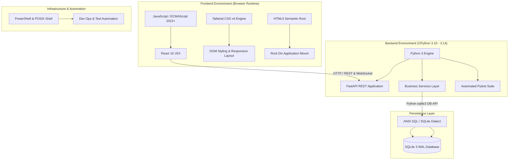
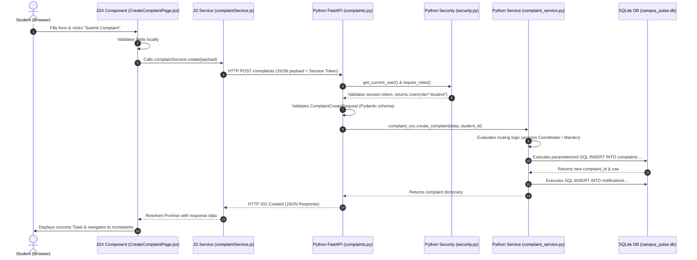

# Campus Pulse — Technology Stack, Languages & Architectural Design Decisions

> **Document Type:** Core Architectural Specification & Technology Inventory  
> **Status:** Verified against Source Code  
> **Repository:** Campus Pulse (`CampusPulse_co`)  
> **Target Audience:** Principal Engineers, Architects, Backend/Frontend Developers, Security Reviewers  

---

## 1. Executive Summary & Purpose

Campus Pulse is an enterprise-grade campus operations and complaint lifecycle management platform designed to automate, route, escalate, and resolve student grievances and facility issues across decentralized university campuses. This document provides a rigorous, source-code-driven inventory of every programming language, library, framework, runtime, database engine, build tool, and architectural decision implemented in the project.

Every claim herein is directly grounded in the source code, dependency manifests (`Backend/requirements.txt`, `Frontend/package.json`), database schemas, configuration files, and test suites. Where an original historical rationale was not formally documented in repository commit messages or markdown files, it is explicitly identified as **"Undocumented in original repository records"** and accompanied by an objective **Engineering Assessment**.

---

## 2. Programming Languages Inventory

The Campus Pulse codebase utilizes six distinct language paradigms across its backend services, frontend web application, persistent storage, build systems, and operational tooling.

---

### 2.1 Python

1. **Language Name & Version:** Python (CPython 3.10+ compatible; verified running on Python 3.14.2).
2. **Where Used:** Entire backend application (`Backend/api/`, `Backend/models/`, `Backend/services/`, `Backend/middleware/`, `Backend/utils/`, `Backend/scripts/`, `Backend/tests/`).
3. **Exact File Locations:** 141 Python files across the `Backend/` directory tree, entry point at [`Backend/run_api.py`](file:///c:/Users/gowth/OneDrive/Desktop/GOWTHAM/CampusPulse/CampusPulse_co/Backend/run_api.py).
4. **Responsibility:** Implements all backend RESTful API endpoints, request validation, authentication and session management, role-based authorization, routing engine, escalation scheduler, database querying, email delivery, file storage validation, audit logging, and automated integration testing.
5. **Syntax, Features & Patterns:**
   - **Type Hinting & Schemas:** Extensive use of `typing` (`Optional`, `List`, `Dict`, `Union`) combined with `pydantic.BaseModel` for schema parsing and serialization.
   - **Asynchronous & Synchronous Concurrency:** Async route handlers alongside thread-pooled synchronous execution (`asynccontextmanager` in [`Backend/api/main.py`](file:///c:/Users/gowth/OneDrive/Desktop/GOWTHAM/CampusPulse/CampusPulse_co/Backend/api/main.py#L19-L35)).
   - **Context Managers:** SQLite connection context management (`with self._connect() as conn:`) ensuring safe transaction commit and auto-closing.
   - **Dependency Injection:** FastAPI's `Depends()` pattern across [`Backend/api/dependencies.py`](file:///c:/Users/gowth/OneDrive/Desktop/GOWTHAM/CampusPulse/CampusPulse_co/Backend/api/dependencies.py) and [`Backend/api/security.py`](file:///c:/Users/gowth/OneDrive/Desktop/GOWTHAM/CampusPulse/CampusPulse_co/Backend/api/security.py) for service singleton caching and RBAC verification.
   - **Object-Oriented Encapsulation:** Service classes (`AuthService`, `ComplaintService`, `NotificationService`, `AnnouncementService`) encapsulating business logic.
6. **Communication with Other Layers:** Communicates with the browser via HTTP/1.1 and WebSockets (FastAPI Starlette ASGI). Communicates with SQLite persistence via Python's standard `sqlite3` driver using parameter-bound queries.
7. **Appropriateness:** Excellent balance of rapid development velocity, clean data-modelling semantics, native SQLite integration, and strong ASGI asynchronous ecosystem.
8. **Alternatives:**
   - *Node.js / TypeScript:* Faster asynchronous raw I/O, unified language between frontend and backend.
   - *Go:* Minimal memory footprint, high concurrent throughput, single-binary static deployments.
   - *Java / Spring Boot:* Heavy enterprise footprint, strong typing, verbose ceremony.
9. **Trade-offs:** High developer productivity and standard library maturity; trade-off is Global Interpreter Lock (GIL) and lower CPU-bound throughput compared to compiled languages (mitigated by I/O bound nature of campus management operations).
10. **Architecture Role:** Essential core backend runtime.

---

### 2.2 JavaScript (ECMAScript 2022+ / JSX)

1. **Language Name & Version:** JavaScript (ES2022+ with React JSX extensions).
2. **Where Used:** Entire frontend client application (`Frontend/src/`).
3. **Exact File Locations:** 70 `.jsx` component/page files, 29 `.js` service/utility/hook files, configuration scripts (`Frontend/vite.config.js`).
4. **Responsibility:** Implements client-side Single Page Application (SPA), state management, routing, form validation, dynamic modal rendering, asynchronous API communication via Axios, and UI interactivity.
5. **Syntax, Features & Patterns:**
   - **React Functional Components & Hooks:** `useState`, `useEffect`, `useMemo`, `useCallback`, `useContext`, custom `useAsyncData`.
   - **Modern ES Features:** Optional chaining (`?.`), nullish coalescing (`??`), async/await, array destructuring, spread operators.
   - **Context API:** `AuthContext` managing reactive session persistence, user credentials, and logout broadcast.
   - **Promise Chaining & Interceptors:** Centralized Axios instance intercepting requests to inject session headers and handling 401/403 errors.
6. **Communication with Other Layers:** Communicates with the Backend API over HTTP via JSON payloads; renders directly to the browser DOM via React 19.
7. **Appropriateness:** Universal browser support, massive UI component ecosystem, declarative component hierarchy.
8. **Alternatives:**
   - *TypeScript:* Static compile-time type verification (would improve refactoring safety).
   - *Vue.js / Svelte:* Simpler reactivity model, smaller runtime bundle.
9. **Trade-offs:** Extremely rapid feature development and declarative UI rendering; lack of TypeScript compile-time types requires runtime prop validation.
10. **Architecture Role:** Essential core frontend runtime.

---

### 2.3 SQL (Structured Query Language — SQLite Dialect)

1. **Language Name & Dialect:** ANSI SQL with SQLite 3 extensions.
2. **Where Used:** Data Access Layer throughout `Backend/services/*.py` and schema scripts in `Backend/scripts/`.
3. **Exact File Locations:** Embedded parameterized SQL queries across 32 backend service files and database scripts.
4. **Responsibility:** Table creation, index definition, foreign key constraint enforcement, relational joins, ACID transactions, data querying, and aggregation.
5. **Syntax, Features & Patterns:**
   - **Parameterized Queries:** Strict use of `?` positional parameters to eliminate SQL injection vulnerabilities.
   - **Relational Joins:** Multi-table joins (`LEFT JOIN`, `INNER JOIN`) linking complaints with users, departments, locations, and attachments.
   - **Aggregations:** `COUNT`, `SUM`, `AVG`, `GROUP BY`, `DATE()` date truncations.
   - **Transaction Directives:** Explicit `BEGIN IMMEDIATE`, `COMMIT`, `ROLLBACK` for multi-step mutations.
6. **Communication with Other Layers:** Executed by Python's `sqlite3.Cursor` and `sqlite3.Connection`, returning tabular data converted into dictionary rows (`sqlite3.Row`).
7. **Appropriateness:** Zero-configuration, serverless, self-contained, lightning-fast in-process execution with ACID guarantees.
8. **Alternatives:**
   - *PostgreSQL:* Full client-server database, concurrent writes, row-level locking, rich JSONB operations.
   - *MySQL / MariaDB:* Widespread LAMP stack database.
9. **Trade-offs:** Zero administrative overhead and single-file portability; trade-off is file-level write locking which restricts massive concurrent write scaling.
10. **Architecture Role:** Essential core persistence language.

---

### 2.4 CSS / Styling (Tailwind CSS v4)

1. **Language & Tool:** CSS3 with Tailwind CSS utility classes and modern `@tailwindcss/postcss` integration.
2. **Where Used:** `Frontend/src/index.css` and utility classes embedded across all 70 JSX files.
3. **Exact File Locations:** [`Frontend/src/index.css`](file:///c:/Users/gowth/OneDrive/Desktop/GOWTHAM/CampusPulse/CampusPulse_co/Frontend/src/index.css).
4. **Responsibility:** Styling, visual hierarchy, dark mode theming (`class="dark"`), typography, flexbox/grid layouts, responsive breakpoints (`sm:`, `md:`, `lg:`), and micro-animations.
5. **Syntax, Features & Patterns:**
   - Tailwind utility-first styling (`flex items-center justify-between p-4 bg-white dark:bg-slate-900 rounded-xl`).
   - CSS custom properties (`var(--color-primary)`).
   - Responsive design variants and pseudo-classes (`hover:`, `focus:`, `disabled:`).
6. **Communication with Other Layers:** Processed at build time by PostCSS into optimized, purged CSS bundles consumed by the browser DOM.
7. **Appropriateness:** Prevents bloated custom CSS stylesheets, enforces consistent design tokens (colors, margins, typography), eliminates dead styling rules.
8. **Alternatives:** Plain vanilla CSS, CSS Modules, Styled-Components, Sass/SCSS.
9. **Trade-offs:** Faster UI iteration and tiny production CSS footprint; class strings in JSX templates can become verbose.
10. **Architecture Role:** Essential UI styling language.

---

### 2.5 HTML (HyperText Markup Language)

1. **Language & Standard:** HTML5.
2. **Where Used:** Application host shell [`Frontend/index.html`](file:///c:/Users/gowth/OneDrive/Desktop/GOWTHAM/CampusPulse/CampusPulse_co/Frontend/index.html).
3. **Exact File Locations:** `Frontend/index.html`.
4. **Responsibility:** Provides the initial Document Object Model (DOM) root `

`, meta tags, viewport configurations, and script entry points for Vite bundling.
5. **Syntax & Features:** Standard HTML5 semantic structure.
6. **Communication with Other Layers:** Hosts the React DOM tree mounted by `Frontend/src/main.jsx`.
7. **Appropriateness:** Universal web platform standard.
8. **Architecture Role:** Essential application host document.

---

### 2.6 Shell Scripting (PowerShell & POSIX Shell)

1. **Language:** PowerShell (Windows) and POSIX Shell (Docker).
2. **Where Used:** Automated build triggers, smoke test automation, process management, and Docker entry points.
3. **Responsibility:** Automation, testing, environment setup, and service orchestration.
4. **Architecture Role:** Supporting development and deployment language.

---

## 3. Language Subgroups and Architectural Responsibilities

The codebase organizes languages into functional tiers. The table below traces their responsibilities and interactions:

| Subgroup | Languages Used | Primary Directory | Key Responsibilities |
| :--- | :--- | :--- | :--- |
| **Backend REST & Business Logic** | Python 3 | `Backend/api/`, `Backend/services/` | API routing, Pydantic validation, business rules, RBAC checks |
| **Backend Models & Data Access** | Python 3, SQL | `Backend/models/`, `Backend/services/` | Entity abstractions, parameterized SQL queries, transaction management |
| **Backend Security & Middleware** | Python 3 | `Backend/middleware/`, `Backend/api/security.py` | Rate limiting, CORS, session hashing, security headers |
| **Frontend Single Page App** | JavaScript (ES2022+), JSX | `Frontend/src/` | View rendering, client routing, user state, Axios calls |
| **Frontend Styling & Design** | CSS3, Tailwind CSS v4 | `Frontend/src/index.css`, JSX | Design system, responsive grids, dark/light themes |
| **Persistence & Storage** | SQL (SQLite) | `Backend/storage/*.db` | Relational tables, foreign key constraints, indexes, WAL journal |
| **Automated Testing** | Python 3 (Pytest), JavaScript (Vitest) | `Backend/tests/`, `Frontend/src/__tests__/` | Unit, integration, workflow, security, and component tests |
| **DevOps & Containers** | YAML, Dockerfile, Shell | Root, `Backend/Dockerfile`, `docker-compose.yml` | Container images, multi-container orchestration |

---

### Request Trace Across Language Subgroups

The following trace illustrates how all subgroups interact during a complaint lifecycle event:

---

## 4. Frameworks, Libraries and Dependency Inventory

### 4.1 Backend Dependencies (Python)

Verified from [`Backend/requirements.txt`](file:///c:/Users/gowth\OneDrive\Desktop\GOWTHAM\CampusPulse\CampusPulse_co\Backend\requirements.txt) and active virtual environment:

| Library / Tool | Verified Version | Purpose in Campus Pulse | Usage Evidence & Key Imports | Alternatives | Trade-offs |
| :--- | :--- | :--- | :--- | :--- | :--- |
| **FastAPI** | 0.109.0+ | Core web API framework, dependency injection, OpenAPI generation | `from fastapi import FastAPI, Depends, HTTPException, Query, Request` in all routers | Flask, Django REST Framework, Tornado | High performance, automatic Swagger UI, declarative typing; requires async/await awareness |
| **Uvicorn** | 0.27.0+ | Lightning-fast ASGI web server implementation | `uvicorn.run("api.main:app", host=host, port=port, reload=reload)` in `run_api.py` | Hypercorn, Gunicorn, Daphne | Standard high-performance ASGI server; requires process manager (Gunicorn) in production |
| **Pydantic** | 2.6.0+ | Data validation, request body schemas, response serialisation | `from pydantic import BaseModel, Field, EmailStr` across routers and models | Marshmallow, Cerberus, attrs | Extremely fast Rust-based validation (Pydantic v2); strict validation errors on type mismatch |
| **Pytest** | 8.0.0+ | Test framework for unit, integration, and security testing | `import pytest` across 31 test files in `Backend/tests/` | unittest, nose2 | Rich fixture architecture, expressive assertions; external test runner |
| **python-multipart** | 0.0.6+ | Streaming file uploads and multipart/form-data parsing | Used by FastAPI for file attachment endpoints in `attachments.py` | Built-in cgi (deprecated) | Required for file upload streaming in FastAPI |
| **python-jose** | 3.3.0+ | Cryptographic token handling (available in dependency manifest) | Declared in requirements; project primarily utilizes DB-backed session tokens | PyJWT, Authlib | Standard JWT library; project opts for opaque session tokens for instant revocation |
| **passlib** | 1.7.4+ | Password hashing abstractions | Declared in requirements; project core uses Python `hashlib.pbkdf2_hmac` directly | bcrypt, argon2-cffi | Abstracted interface; direct standard library PBKDF2 used for zero-dependency reliability |
| **requests** | 2.31.0+ | Synchronous HTTP client for automated smoke and workflow tests | `import requests` in `smoke_test.py` and test harnesses | httpx, aiohttp, urllib3 | Simple API for testing; synchronous only |

---

### 4.2 Frontend Dependencies (Node.js / React)

Verified from [`Frontend/package.json`](file:///c:/Users/gowth/OneDrive/Desktop/GOWTHAM/CampusPulse/CampusPulse_co/Frontend/package.json):

| Package | Declared Version | Purpose in Campus Pulse | Key Components Utilizing It | Alternatives | Trade-offs |
| :--- | :--- | :--- | :--- | :--- | :--- |
| **React** | 19.2.7 | UI component architecture and declarative rendering | All `.jsx` components and pages | Vue 3, Svelte 5, Angular | Industry standard declarative UI; large ecosystem |
| **React DOM** | 19.2.7 | DOM renderer for React components | `Frontend/src/main.jsx` | React Native (mobile) | Standard web DOM adapter |
| **React Router DOM** | 7.18.1 | Declarative client-side routing and protected route guards | `Frontend/src/routes/AppRoutes.jsx`, `ProtectedRoute.jsx` | TanStack Router, Next.js | Dynamic client routing with nested layouts and RBAC guards |
| **Axios** | 1.18.1 | Promise-based HTTP client with request/response interceptors | `Frontend/src/api/axios.js` and all 19 service files | Fetch API, ky, wretch | Automatic JSON serialization, global request/error interceptors |
| **Lucide React** | 1.23.0 | Modern SVG icon system for UI controls and dashboards | Across all pages, tables, navigation sidebar, and cards | React Icons, FontAwesome, Heroicons | Lightweight tree-shakeable SVG icons |
| **Recharts** | 3.9.2 | Composable charting library for analytics dashboards | `Frontend/src/pages/AnalyticsPage.jsx`, `DashboardChart.jsx` | Chart.js, ApexCharts, D3.js | Declarative React-native SVG chart rendering |
| **React Hook Form** | 7.81.0 | High-performance form state management and validation | Form components and modals | Formik, native form state | Minimal re-renders during form input |
| **Tailwind CSS** | 4.3.2 | Utility-first CSS framework and styling engine | `@tailwindcss/postcss` in `Frontend/postcss.config.js` | Tailwind v3, CSS Modules, Bootstrap | Zero-runtime CSS extraction, fast styling workflow |
| **Vite** | 8.1.3 | Next-generation frontend build tool and dev server | `Frontend/vite.config.js`, `package.json` | Webpack, Turbopack, Rollup | Lightning-fast Hot Module Replacement (HMR) and optimized Rollup builds |
| **Vitest** | 3.0.0 | Vite-native unit test runner | `Frontend/src/__tests__/*.test.jsx` | Jest, Mocha | Instant test execution sharing Vite's configuration pipeline |

---

## 5. Technology Decision Matrix & Alternatives Analysis

| Technology / Choice | Actual Purpose in Project | Viable Alternatives | Why Choice is Reasonable | Original Rationale Verified? | Engineering Trade-offs & Limitations |
| :--- | :--- | :--- | :--- | :--- | :--- |
| **Python + FastAPI** | Backend REST API & business rules | Node.js (Express/Nest), Java (Spring), Go | Clean Pydantic validation, automatic OpenAPI, high developer velocity | Undocumented in original repo | GIL limits CPU bound tasks; higher memory than Go; mitigated by I/O bound database workflows |
| **React 19 + Vite** | SPA Frontend & Dashboard | Next.js (SSR), Vue 3, Vanilla JS | Component modularity, rich chart ecosystem, instant Vite HMR | Undocumented in original repo | Client-rendered SPA has initial bundle load; no SSR/SEO (unnecessary for internal campus portal) |
| **SQLite 3 (WAL mode)** | Relational database persistence | PostgreSQL, MySQL, MongoDB | Zero setup, embedded in-process speed, file portability, single-file backups | Undocumented in original repo | Single-writer concurrency lock; excellent for single-campus deployments, but requires migration for distributed clustering |
| **Database Sessions** | Stateful auth token management | Stateless JWT, OAuth2 / OIDC | Immediate token revocation upon logout or password change; no stale tokens | Documented in `Backend/api/security.py` | Requires database lookup per request (cached/indexed on token hash); stateful session cleanup required |
| **PBKDF2-HMAC-SHA256** | Password storage hashing | bcrypt, Argon2id, scrypt | Python standard library native (`hashlib`); zero external C-extension build failures | Documented in `Backend/utils/passwords.py` | Slightly higher iteration requirement than Argon2, but 100% portable across Windows/Linux without compilation tools |
| **Direct SMTP (smtplib)** | Transactional email delivery | SendGrid API, AWS SES, Resend | Protocol standard; compatible with standard university mail servers and Gmail SMTP | Verified in `Backend/utils/email.py` | Synchronous network latency if not dispatched in background task; depends on outbound port 587 availability |
| **Local File Storage** | Attachment storage (images/PDFs) | AWS S3, Cloudflare R2, MinIO | Zero cloud costs; direct disk I/O; complete local privacy for campus documents | Verified in `Backend/services/attachment_service.py` | Storage bounded by host disk; lacks automatic multi-region CDN replication |
| **Tailwind CSS v4** | UI Styling & Design System | CSS Modules, Styled-Components | Purged minimal CSS bundle, rapid UI iteration, consistent design tokens | Verified in `Frontend/src/index.css` | High class density in JSX markup; requires learning utility naming conventions |

---

## 6. Deep Dive into Architectural Design Decisions (Part 13 Requirement)

### Decision 1: Database-Backed Opaque Session Tokens vs Stateless JWTs
- **Decision:** The application issues a high-entropy random token (`secrets.token_urlsafe(32)`), stores its SHA-256 hash in the `user_sessions` SQLite table, and transmits the token via `Bearer` Authorization headers.
- **Problem Addressed:** In a university environment, immediate revocation of sessions upon password changes, account deactivation, or administrative suspension is critical. Stateless JWTs cannot be invalidated without complex distributed blacklists until their expiry timestamp.
- **Implementation Evidence:** [`Backend/api/security.py`](file:///c:/Users/gowth/OneDrive/Desktop/GOWTHAM/CampusPulse/CampusPulse_co/Backend/api/security.py#L40-L100) functions `create_session()`, `_lookup_session()`, `delete_session()`, and `revoke_user_sessions()`.
- **Benefits:** Instant revocation, auditability of active user devices, sliding expiration support, no signature forgery risks.
- **Trade-offs:** Every authenticated request requires a database lookup against `user_sessions` (mitigated by an index on `session_token`).
- **Engineering Assessment:** Highly sound architectural choice for security and immediate credential invalidation.

---

### Decision 2: Native Standard Library Cryptography (PBKDF2) vs External C-Extensions
- **Decision:** Utilizing Python's `hashlib.pbkdf2_hmac` with 100,000 iterations and per-user cryptographic salts (`secrets.token_hex(16)`).
- **Problem Addressed:** Eliminating brittle native C compilation dependencies (such as `bcrypt` or `argon2-cffi` wheel compilation) on diverse developer environments (Windows PowerShell vs Linux Docker).
- **Implementation Evidence:** [`Backend/utils/passwords.py`](file:///c:/Users/gowth/OneDrive/Desktop/GOWTHAM/CampusPulse/CampusPulse_co/Backend/utils/passwords.py#L1-L35).
- **Benefits:** 100% platform portability, zero wheel compilation failures, standard FIPS-compliant cryptographic hashing.
- **Trade-offs:** Argon2id offers superior memory-hard resistance against ASIC hardware cracking; however, 100,000 iterations of PBKDF2-HMAC-SHA256 provides robust defense for campus portal usage.
- **Engineering Assessment:** Excellent pragmatic balance between security and operational reliability across mixed OS environments.

---

### Decision 3: SQLite Write-Ahead Logging (WAL) and Connection Per Transaction
- **Decision:** Using SQLite in `WAL` mode (`PRAGMA journal_mode=WAL; PRAGMA foreign_keys=ON;`) with short-lived connections managed by Python context managers.
- **Problem Addressed:** SQLite's default rollback journal locks the entire database during writes, blocking concurrent readers.
- **Implementation Evidence:** [`Backend/services/auth_service.py`](file:///c:/Users/gowth/OneDrive/Desktop/GOWTHAM/CampusPulse/CampusPulse_co/Backend/services/auth_service.py) and `Backend/services/complaint_service.py` connection factories.
- **Benefits:** Multiple concurrent readers can execute simultaneously while a write is underway. Eliminates reader-writer starvation.
- **Trade-offs:** Write throughput is serialized to a single writer. While sufficient for university operations (hundreds of complaints daily), massive enterprise workloads require migration to PostgreSQL.
- **Engineering Assessment:** Appropriate for current project scale; deployment architecture must ensure SQLite file is placed on local SSD, never network-mounted storage (NFS).

---

### Decision 4: Centralized Role-Based Access Control via Dependency Inversion
- **Decision:** Authorization is enforced via reusable FastAPI dependencies (`require_roles()`, `require_super_admin()`) rather than manual checks scattered inside route bodies.
- **Problem Addressed:** Preventing authorization bypass bugs where a developer forgets to check permissions in an endpoint handler.
- **Implementation Evidence:** [`Backend/api/security.py`](file:///c:/Users/gowth/OneDrive/Desktop/GOWTHAM/CampusPulse/CampusPulse_co/Backend/api/security.py#L227-L245).
- **Benefits:** Declarative, tamper-proof route protection; automatic 403 Forbidden responses before business logic is entered.
- **Trade-offs:** Object-level authorization (verifying if a student owns a specific complaint) must still be enforced within the service layer.
- **Engineering Assessment:** Clean, maintainable, idiomatic implementation of modern API security principles.
