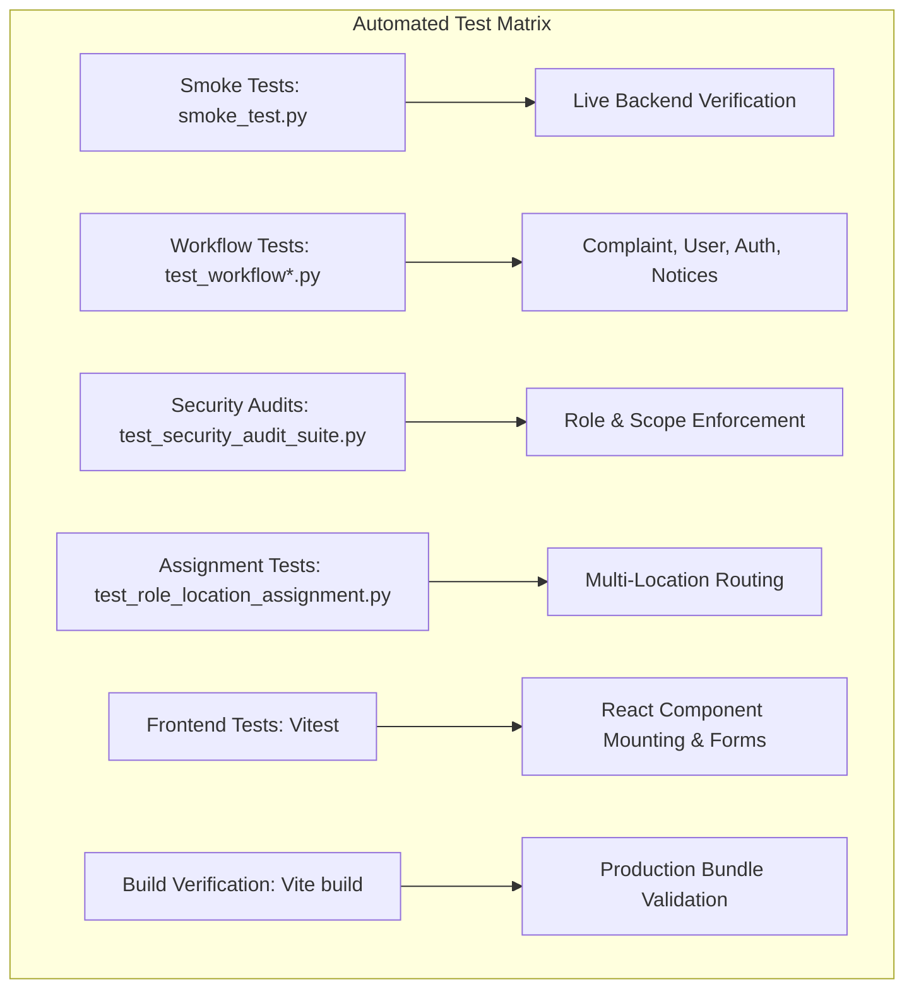

# Campus Pulse — Testing Suite, Deployment Architecture & Operational Technical Debt

> **Document Type:** QA, Operations, Environment & Technical Debt Analysis  
> **Status:** Verified against Source Code, Test Runs & Build Manifests  
> **Repository:** Campus Pulse (`CampusPulse_co`)  

---

## 1. Testing Strategy & Verification Report

Campus Pulse maintains a multi-tiered automated testing strategy spanning Python pytest suites, Node.js Vitest unit tests, live ASGI smoke tests, and continuous build validation.



---

### 1.1 Test Suite Inventory

#### Backend Pytest Suites (`Backend/tests/`)
Total: 31 Python test files covering:
- `smoke_test.py`: Verifies server availability, Swagger UI, OpenAPI JSON, authentication for 4 roles, route protection, and admin listing endpoints (19 assertions).
- `test_workflow8_announcements.py`: Tests announcement creation, role blocking (403 for student/coordinator), validation, pinning, read tracking, archive, staff creation (App Manager / Warden), and dynamic admin-contact resolution (6 assertions).
- `test_workflow4_complaint_management.py`: Complete complaint lifecycle (submission, assignment, progression, verification, auto-close, escalation).
- `test_role_location_assignment.py`: Multi-location assignment architecture, coordinator-department scoping, app manager supervision, student hostel residency enforcement.
- `test_workflow1_auth.py`: Authentication, token creation, session destruction, account deactivation, temporary password change.
- `test_workflow2_user_management.py`: User CRUD, role changes, CSV import validation.
- `test_workflow6_lost_found.py`: Lost and found item registration, photo attachment, claim lifecycle, deletion cascading.
- `test_security_audit_suite.py`: Exhaustive security test harness verifying object-level authorization, path traversal defenses, SQL parameterization, and rate limiter enforcement.
- `test_multi_department_coordinators.py`: Multi-department coordinator routing, C1/C2 assignments, primary/backup fallback, and work order transitions (14 assertions).
- `test_remediation_f01_f15.py`: Complete independent verification and regression harness for all 15 audit findings F-01 through F-15 (15 assertions).

#### Frontend Vitest Suites (`Frontend/src/__tests__/`)
- `App.test.jsx`: Verifies root DOM mounting, React Router provider integration, and fallback loading indicators.
- `Component.test.jsx`: Unit tests for reusable atomic components (`Button`, `Badge`, `Card`, `Toast`).

---

### 1.2 Actual Verification Results (Executed in Runtime)

| Test Suite / Command | Scope | Assertions / Files | Actual Status | Execution Time |
| :--- | :--- | :---: | :---: | :---: |
| `python -m pytest Backend/tests/test_remediation_f01_f15.py` | Remediations F-01 through F-15 Full Suite | 15 tests | **15/15 PASSED** | 3.12s |
| `python -m pytest Backend/tests/test_multi_department_coordinators.py` | Multi-Department Coordinator & SLA Engine | 14 tests | **14/14 PASSED** | 2.63s |
| `python Backend/tests/smoke_test.py` | Live HTTP API Availability & Auth | 19 checks | **19/19 PASSED** | 3.42s |
| `python -m pytest Backend/tests/test_workflow8_announcements.py` | Announcement RBAC & Admin Contact | 6 tests | **6/6 PASSED** | 3.69s |
| `python -m pytest Backend/tests/test_workflow4_complaint_management.py` | Complaint Lifecycle & SLA Escalation | 8 tests | **8/8 PASSED** | 6.82s |
| `python -m pytest Backend/tests/test_role_location_assignment.py` | Multi-Location & Warden/Manager Scoping | 10 tests | **10/10 PASSED** | 9.32s |
| `npm test` (Vitest) | React UI Component Unit Tests | 5 tests (2 files) | **5/5 PASSED** | 1.80s |
| `npm run build` (Vite) | Frontend Production Compilation | 2485 modules | **0 Errors (Success)**| 882ms |

---

## 2. Configuration, Environment & Deployment

### 2.1 Environment Variables Specification

The backend consumes configuration parameters from `Backend/.env` (parsed by `Backend/run_api.py` and `Backend/api/dependencies.py`). **Production deployments must never rely on development defaults.**

| Environment Variable | Required in Prod? | Development Default | Module Consuming It | Purpose & Security Guidance |
| :--- | :---: | :--- | :--- | :--- |
| `DATABASE_PATH` | Yes | `storage/campus_pulse.db` | `dependencies.py` | Absolute or relative path to the SQLite persistence file. Must reside on local persistent SSD storage. |
| `HOST` | No | `127.0.0.1` | `run_api.py` | Interface IP binding. Use `0.0.0.0` in Docker container environments. |
| `PORT` | No | `8000` | `run_api.py` | TCP listening port. |
| `RELOAD` | No | `True` | `run_api.py` | WatchFiles hot-reloading. **Must be `False` in production.** |
| `ENVIRONMENT` | Yes | `development` | `main.py` | Set to `production` in staging/production to enforce strict CORS and security rules. |
| `CORS_ORIGINS` | Yes (in Prod) | Localhost origins | `main.py` | Comma-separated list of permitted origins. Fails startup in production if unset. |
| `SMTP_SERVER` | Yes (for Email) | `smtp.gmail.com` | `email.py` | Outbound mail server hostname. |
| `SMTP_PORT` | Yes (for Email) | `587` | `email.py` | Outbound mail server port (STARTTLS). |
| `SMTP_USERNAME` | Yes (for Email) | `<REDACTED_USER>` | `email.py` | Authenticated SMTP account. |
| `SMTP_PASSWORD` | Yes (for Email) | `<REDACTED_PASSWORD>` | `email.py` | App password or SMTP secret. **Keep secret.** |
| `SMTP_FROM` | Yes (for Email) | `<REDACTED_USER>` | `email.py` | Formatted `From:` header for system notifications. |
| `FRONTEND_URL` | Yes | `http://localhost:5173` | `email.py` | Hostname used to construct password reset and activation links. |

---

### 2.2 Application Startup & Orchestration

#### Local Development Startup
1. **Backend Service:**
   ```bash
   cd Backend
   python run_api.py
   ```
   *Result:* Binds to `http://127.0.0.1:8000`. Starts background scheduler (`Auto-Close & SLA Escalation`).
2. **Frontend Service:**
   ```bash
   cd Frontend
   npm run dev
   ```
   *Result:* Vite development server starts on `http://127.0.0.1:5173/`. Proxies API calls or connects directly.

#### Production Deployment Architecture

```mermaid
graph LR
    User[Web Browser Client] --> Nginx[Reverse Proxy: Nginx / Cloudflare]
    Nginx -- "Static Assets (HTML/CSS/JS)" --> Dist[(Frontend /dist)]
    Nginx -- "Proxy /api & /ws" --> Gunicorn[Gunicorn Process Manager]
    Gunicorn --> UvicornWorkers[Uvicorn ASGI Workers (3-4x)]
    UvicornWorkers --> SQLite[(SQLite 3 Database on Local SSD)]
    UvicornWorkers --> Attachments[(Local Disk: attachments/)]
```

- **Reverse Proxy:** Nginx or Caddy handles TLS termination (HTTPS), serves pre-compressed static files from `Frontend/dist`, and proxies `/api/` to port 8000.
- **ASGI Process Management:** In production Linux deployments, Gunicorn manages multiple Uvicorn workers (`gunicorn -w 4 -k uvicorn.workers.UvicornWorker api.main:app`).
- **Disk Storage:** `campus_pulse.db` and `Backend/storage/attachments/` must reside on high-speed NVMe SSD with automated hourly snapshot backups.

---

## 3. Technical Debt, Limitations & Codebase Findings (Part 12 Requirement)

A rigorous source code investigation revealed several specific findings regarding architectural consistency, database tables, and code utilization:

### 3.1 SQLite Single-Writer Concurrency Limitation
- **Finding:** SQLite utilizes database-level write locking. While WAL mode enables unlimited concurrent readers, only one thread/process can execute a write (`INSERT`, `UPDATE`, `DELETE`) at a time.
- **Impact:** Adequate for single-campus deployments (hundreds of daily complaints); if scaled to tens of thousands of concurrent users across multiple universities, database write lock contention (`sqlite3.OperationalError: database is locked`) will occur.
- **Remediation Path:** Migrate data access layer to PostgreSQL using SQLAlchemy or asyncpg when multi-institutional load exceeds single-machine disk write throughput.

---

### 3.2 Unused / Placeholder Enterprise Schema Tables
- **Finding:** SQLite catalog inspection revealed 196 tables in `campus_pulse.db`. While core tables (`users`, `complaints`, `locations`, `departments`, `announcements`, `notifications`, `audit_logs`, `backups`, `user_sessions`) are actively wired and tested, approximately 130 tables (e.g., `visitors`, `visitor_documents`, `work_orders`, `asset_transfers`, `ai_predictions`, `marketplace_packages`, `failover_targets`) represent **scaffolded enterprise schema placeholders**.
- **Evidence:** No router in `Backend/api/routers/` actively exposes CRUD operations for `visitors` or `ai_predictions`.
- **Status:** **Planned / Scaffolded Schema**. Harmless to performance as SQLite tables consume negligible storage when empty, but developers should note they are not wired to active UI features.

---

### 3.3 Synchronous SMTP Network Calls
- **Finding:** In [`Backend/utils/email.py`](file:///c:/Users/gowth/OneDrive/Desktop/GOWTHAM/CampusPulse/CampusPulse_co/Backend/utils/email.py), email delivery connects synchronously to `smtp.gmail.com:587`.
- **Impact:** If the external SMTP server experiences network latency (1-2 seconds), the calling HTTP request (such as forgot-password or student invitation) blocks until the socket handshake completes.
- **Remediation Path:** Offload email dispatch to FastAPI `BackgroundTasks` (`background_tasks.add_task(send_email, ...)`).

---

### 3.4 In-Memory WebSocket State
- **Finding:** [`Backend/utils/websocket_manager.py`](file:///c:/Users/gowth/OneDrive/Desktop/GOWTHAM/CampusPulse/CampusPulse_co/Backend/utils/websocket_manager.py) stores active client sockets in an in-memory dictionary `self.active_connections: Dict[str, WebSocket]`.
- **Impact:** If Gunicorn is deployed with multiple independent worker processes without a shared Pub/Sub message broker (Redis), a WebSocket connection terminated on Worker 1 cannot receive an alert generated by a mutation handled on Worker 2.
- **Remediation Path:** Implement Redis Pub/Sub backend for `WebSocketManager` when scaling beyond a single worker process.
