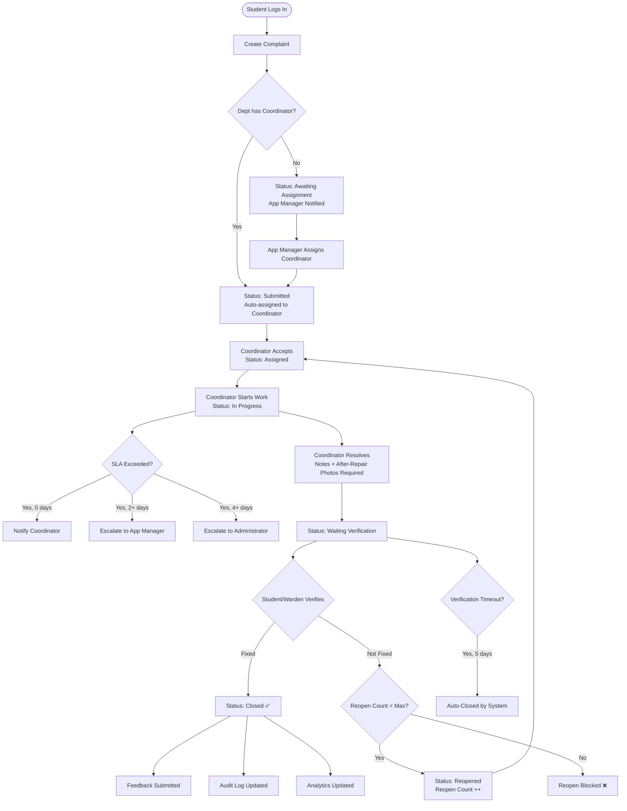
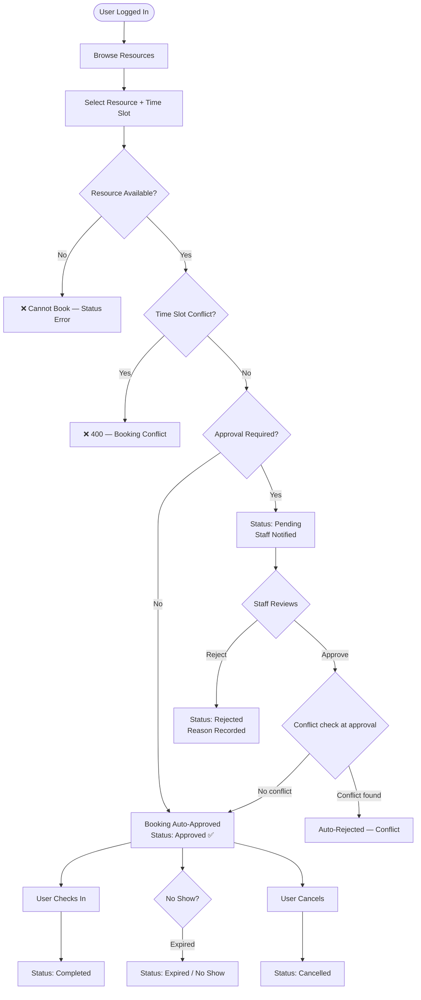
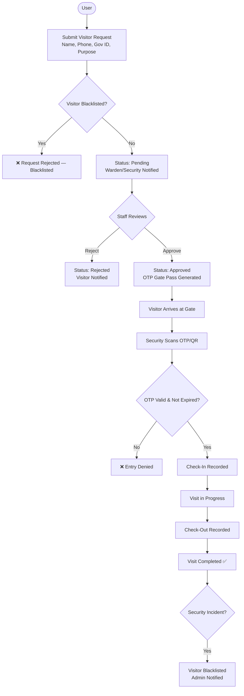
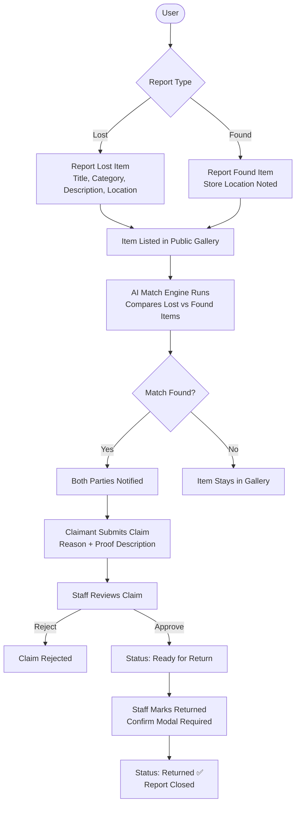
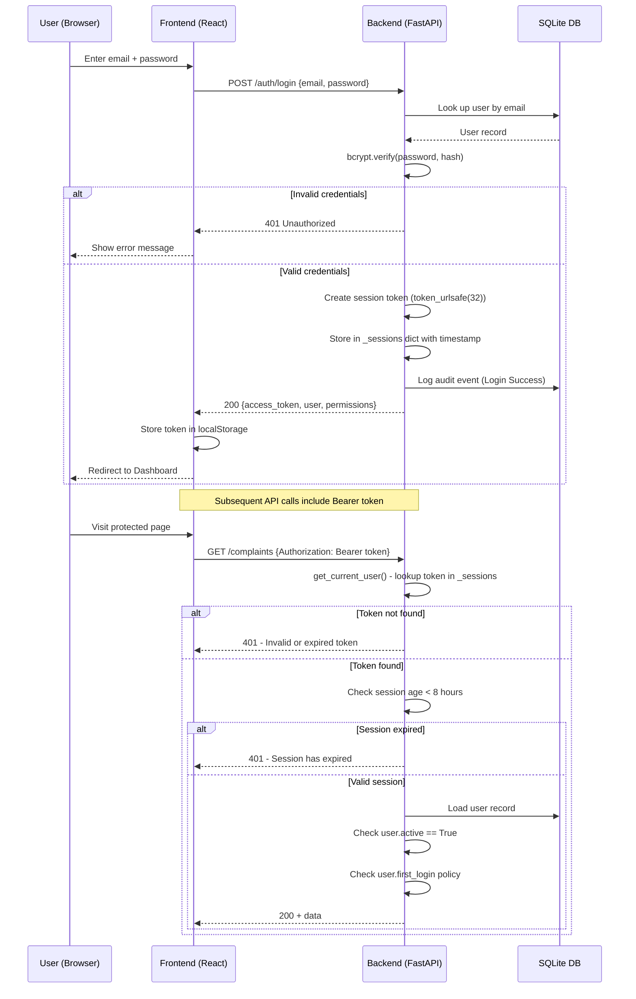
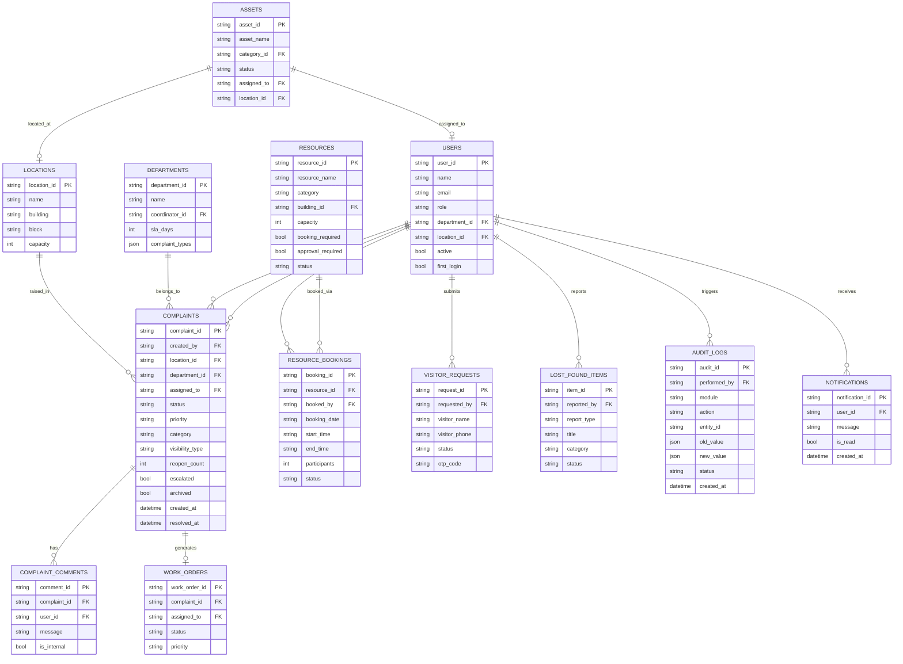

# CampusPulse — Workflow & Architecture Diagrams

## 1. System Architecture

```
┌─────────────────────────────────────────────────────────────┐
│                     CLIENT (Browser)                         │
│                                                             │
│   React 18 + Vite  ──  Axios ─────────────────────────────┐│
│   (Port 5173)           JWT Bearer Token                   ││
└────────────────────────────────────────────────────────────┼┘
                                                             │
                         HTTP/REST API                       │
                                                             ▼
┌─────────────────────────────────────────────────────────────┐
│                  FastAPI Backend (Port 8000)                 │
│                                                             │
│  ┌─────────────┐  ┌──────────────┐  ┌───────────────────┐  │
│  │ CORS + Rate │  │  JWT Session │  │  Request Logger   │  │
│  │  Limiter   │  │  Middleware  │  │  Middleware        │  │
│  └─────────────┘  └──────────────┘  └───────────────────┘  │
│                                                             │
│  ┌─────────────────────────────────────────────────────┐   │
│  │             44 API Routers (FastAPI)                │   │
│  │  /complaints  /resources  /visitors  /lost-found    │   │
│  │  /announcements  /work-orders  /assets  /feedback   │   │
│  │  /auth  /users  /departments  /locations  /audit    │   │
│  │  /analytics  /backups  /monitoring  /ai-center ...  │   │
│  └─────────────────────────────────────────────────────┘   │
│                         │                                   │
│  ┌─────────────────────────────────────────────────────┐   │
│  │             46 Service Classes                       │   │
│  │  ComplaintService  ResourceService  AuthService      │   │
│  │  VisitorService    AuditService     NotificationSvc  │   │
│  │  WorkOrderService  AssetService     FeedbackService  │   │
│  └─────────────────────────────────────────────────────┘   │
│                         │                                   │
│  ┌─────────────────────────────────────────────────────┐   │
│  │         SQLiteRepository / sqlite3                  │   │
│  │         storage/campus_pulse.db                     │   │
│  └─────────────────────────────────────────────────────┘   │
└─────────────────────────────────────────────────────────────┘
```

---

## 2. Complaint Lifecycle Flow



---

## 3. Resource Booking Flow



---

## 4. Visitor Management Flow



---

## 5. Lost & Found Flow



---

## 6. Authentication & Session Flow



---

## 7. Core Entity Relationships (ER Diagram)



---

## 8. Deployment Architecture

```
┌─────────────────────────────────────────────────────────┐
│                 Production Deployment                    │
│                                                         │
│  ┌──────────────┐     ┌──────────────────────────────┐  │
│  │   Nginx      │────▶│  FastAPI (Uvicorn workers)   │  │
│  │   :80/:443   │     │  127.0.0.1:8000              │  │
│  │   Static     │     │  api/main.py                 │  │
│  │   + Reverse  │     └──────────────┬───────────────┘  │
│  │   Proxy      │                    │                   │
│  └──────┬───────┘                    ▼                   │
│         │              ┌─────────────────────────────┐  │
│         │              │  SQLite Database             │  │
│         │              │  storage/campus_pulse.db     │  │
│         │              └─────────────────────────────┘  │
│         ▼                                               │
│  ┌──────────────┐                                       │
│  │  React Build │                                       │
│  │  dist/       │                                       │
│  └──────────────┘                                       │
└─────────────────────────────────────────────────────────┘

Development:
  Terminal 1: cd Backend && python run_api.py  → :8000
  Terminal 2: cd Frontend && npm run dev       → :5173
```
