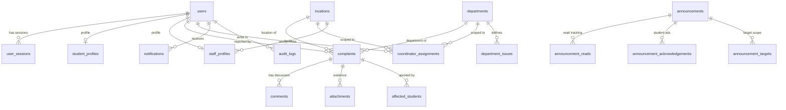

# Campus Pulse — Database Architecture, Schema Reference & Relational Model

> **Document Type:** Complete Relational Schema Specification & Catalog Reference  
> **Repository:** Campus Pulse (`CampusPulse_co`)  
> **Persistence Engine:** SQLite 3 (WAL Mode)  
> **Database Location:** `Backend/storage/campus_pulse.db`  

---

## 1. Engine Configuration & Relational Overview

The runtime database for Campus Pulse is SQLite 3, located at `Backend/storage/campus_pulse.db`. Inspection of the system catalog (`sqlite_master`) reveals **196 total tables**.



---

### PRAGMA Settings & Execution Environment

On every connection created in [`Backend/services/auth_service.py`](file:///c:/Users/gowth/OneDrive/Desktop/GOWTHAM/CampusPulse/CampusPulse_co/Backend/services/auth_service.py) and [`Backend/services/complaint_service.py`](file:///c:/Users/gowth/OneDrive/Desktop/GOWTHAM/CampusPulse/CampusPulse_co/Backend/services/complaint_service.py), the following PRAGMAs are executed:

```sql
PRAGMA journal_mode = WAL;          -- Write-Ahead Logging allows unlimited concurrent readers
PRAGMA foreign_keys = ON;           -- Enforces relational foreign key cascades and integrity
PRAGMA synchronous = NORMAL;        -- Ensures durability on checkpoints with optimal write speed
PRAGMA busy_timeout = 5000;         -- 5000ms retry window before throwing 'database is locked'
```

---

## 2. Active Core Tables vs. Scaffolded Enterprise Schema

A critical discovery of this codebase audit is distinguishing between **Active Operational Tables** and **Scaffolded Enterprise Schema Tables**:

1. **Active Operational Tables (~35 Tables):**
   - Directly wired to active FastAPI routers, service classes, UI forms, and automated tests.
   - Core tables include: `users`, `student_profiles`, `staff_profiles`, `locations`, `departments`, `department_issues`, `coordinator_assignments`, `complaints`, `comments`, `attachments`, `affected_students`, `user_sessions`, `login_attempts`, `login_history`, `activation_tokens`, `password_resets`, `notifications`, `announcements`, `announcement_reads`, `announcement_acknowledgements`, `announcement_targets`, `lost_found_items`, `lost_found_images`, `feedback`, `chat_conversations`, `chat_messages`, `audit_logs`, `backups`, `system_settings`, `institutions`.
2. **Scaffolded Enterprise Schema Placeholders (~160 Tables):**
   - Tables such as `visitors`, `visitor_documents`, `visitor_gate_pass`, `work_orders`, `work_order_parts`, `asset_assignments`, `asset_disposals`, `ai_predictions`, `ai_models`, `marketplace_packages`, `failover_targets`, `offline_sync_queue`, `privacy_requests`, `virus_scan_logs`.
   - **Verification Finding:** These tables were generated by enterprise database migrations and schema scaffolding scripts (`Backend/scripts/`). They contain empty schemas or sample definitions, but **no active API routers in `Backend/api/routers/` or pages in `Frontend/src/pages/` currently query or update them**.
   - **Guidance:** They do not impair performance or stability, but developers should not assume features like visitor check-in or AI asset maintenance exist in the user interface.

---

## 3. Core Relational Tables Specification

### 3.1 `users`
Central user identity and authentication record.

```sql
CREATE TABLE users (
    user_id TEXT PRIMARY KEY,
    email TEXT UNIQUE NOT NULL,
    password_hash TEXT NOT NULL,
    salt TEXT NOT NULL,
    role TEXT NOT NULL,                -- Enum: super_admin, administrator, app_manager, location_in_charge, coordinator, student
    name TEXT NOT NULL,
    status TEXT DEFAULT 'Active',      -- Enum: Active, Inactive, Pending, Suspended, Archived
    active INTEGER DEFAULT 1,          -- 1 = Active, 0 = Inactive
    is_deleted INTEGER DEFAULT 0,      -- Soft delete flag
    is_temp_password INTEGER DEFAULT 0,-- 1 requires password change
    institution_id TEXT DEFAULT NULL,
    phone_number TEXT DEFAULT NULL,
    created_at TEXT DEFAULT CURRENT_TIMESTAMP,
    updated_at TEXT DEFAULT CURRENT_TIMESTAMP
);
CREATE INDEX idx_users_email ON users(email);
CREATE INDEX idx_users_role ON users(role);
CREATE INDEX idx_users_status ON users(status);
```

---

### 3.2 `student_profiles`
Academic details and hostel assignment scoping.

```sql
CREATE TABLE student_profiles (
    student_id TEXT PRIMARY KEY REFERENCES users(user_id) ON DELETE CASCADE,
    roll_number TEXT,
    program_id TEXT,
    year_of_study INTEGER,
    hostel_location_id TEXT REFERENCES locations(location_id),
    room_number TEXT,
    emergency_contact TEXT
);
CREATE INDEX idx_student_hostel ON student_profiles(hostel_location_id);
```

---

### 3.3 `locations`
Physical campus facilities.

```sql
CREATE TABLE locations (
    location_id TEXT PRIMARY KEY,       -- e.g., LOC_HOSTEL_1, LOC_ACADEMIC_1
    name TEXT NOT NULL,
    location_type TEXT NOT NULL,        -- Enum: Hostel, Academic, Mess, SAC, Sports, Other
    app_manager_id TEXT REFERENCES users(user_id),
    warden_id TEXT REFERENCES users(user_id),
    status TEXT DEFAULT 'Active',
    created_at TEXT DEFAULT CURRENT_TIMESTAMP
);
CREATE INDEX idx_locations_type ON locations(location_type);
CREATE INDEX idx_locations_manager ON locations(app_manager_id);
CREATE INDEX idx_locations_warden ON locations(warden_id);
```

---

### 3.4 `departments`
Maintenance and operational service departments.

```sql
CREATE TABLE departments (
    department_id TEXT PRIMARY KEY,     -- e.g., DEPT_PLUMBING, DEPT_ELECTRICAL
    name TEXT NOT NULL,
    code TEXT,
    head_of_dept TEXT,
    status TEXT DEFAULT 'Active',
    created_at TEXT DEFAULT CURRENT_TIMESTAMP
);
```

---

### 3.5 `coordinator_assignments`
Maps departmental coordinators to specific facilities.

```sql
CREATE TABLE coordinator_assignments (
    assignment_id TEXT PRIMARY KEY,
    coordinator_id TEXT NOT NULL REFERENCES users(user_id) ON DELETE CASCADE,
    location_id TEXT NOT NULL REFERENCES locations(location_id) ON DELETE CASCADE,
    department_id TEXT NOT NULL REFERENCES departments(department_id) ON DELETE CASCADE,
    is_primary INTEGER DEFAULT 1,
    created_at TEXT DEFAULT CURRENT_TIMESTAMP
);
CREATE INDEX idx_coord_asgn_loc_dept ON coordinator_assignments(location_id, department_id);
CREATE INDEX idx_coord_asgn_coord ON coordinator_assignments(coordinator_id);
```

---

### 3.6 `complaints`
Grievance record and state machine status.

```sql
CREATE TABLE complaints (
    complaint_id TEXT PRIMARY KEY,      -- e.g., CMP-XXXXXX
    title TEXT NOT NULL,
    description TEXT NOT NULL,
    category TEXT,
    location_id TEXT NOT NULL REFERENCES locations(location_id),
    department_id TEXT NOT NULL REFERENCES departments(department_id),
    created_by TEXT NOT NULL REFERENCES users(user_id),
    assigned_to TEXT REFERENCES users(user_id),
    status TEXT DEFAULT 'Submitted',    -- Submitted, Assigned, In Progress, Resolved, Waiting for Verification, Closed, Closed (Auto Closed), Reopened, Rejected
    priority TEXT DEFAULT 'Normal',     -- Low, Normal, High, Critical
    sla_deadline TEXT,
    is_escalated INTEGER DEFAULT 0,
    reopen_count INTEGER DEFAULT 0,
    resolution_notes TEXT,
    resolved_at TEXT,
    closed_at TEXT,
    verification_due_at TEXT,
    visibility_type TEXT DEFAULT 'Private', -- Private, Public, Community
    created_at TEXT DEFAULT CURRENT_TIMESTAMP,
    updated_at TEXT DEFAULT CURRENT_TIMESTAMP
);
CREATE INDEX idx_complaints_created_by ON complaints(created_by);
CREATE INDEX idx_complaints_assigned_to ON complaints(assigned_to);
CREATE INDEX idx_complaints_status ON complaints(status);
CREATE INDEX idx_complaints_loc_dept ON complaints(location_id, department_id);
CREATE INDEX idx_complaints_escalated ON complaints(is_escalated);
```

---

### 3.7 `user_sessions`
Active opaque session token hash table.

```sql
CREATE TABLE user_sessions (
    session_token TEXT PRIMARY KEY,     -- SHA-256 hex digest of the raw bearer token
    user_id TEXT NOT NULL REFERENCES users(user_id) ON DELETE CASCADE,
    created_at REAL NOT NULL,           -- Epoch timestamp
    expires_at REAL NOT NULL,           -- Epoch timestamp
    last_seen REAL NOT NULL             -- Epoch timestamp
);
CREATE INDEX idx_sessions_user_id ON user_sessions(user_id);
```

---

### 3.8 `announcements`
Official circulars, circular targets, and acknowledgements.

```sql
CREATE TABLE announcements (
    announcement_id TEXT PRIMARY KEY,
    title TEXT NOT NULL,
    content TEXT NOT NULL,
    summary TEXT,
    category TEXT DEFAULT 'General',
    priority TEXT DEFAULT 'Normal',
    is_pinned INTEGER DEFAULT 0,
    requires_ack INTEGER DEFAULT 0,
    status TEXT DEFAULT 'Published',
    created_by TEXT NOT NULL REFERENCES users(user_id),
    published_at TEXT,
    expires_at TEXT,
    created_at TEXT DEFAULT CURRENT_TIMESTAMP
);

CREATE TABLE announcement_acknowledgements (
    ack_id TEXT PRIMARY KEY,
    announcement_id TEXT NOT NULL REFERENCES announcements(announcement_id) ON DELETE CASCADE,
    user_id TEXT NOT NULL REFERENCES users(user_id) ON DELETE CASCADE,
    remarks TEXT,
    acknowledged_at TEXT DEFAULT CURRENT_TIMESTAMP,
    UNIQUE(announcement_id, user_id)
);
```

---

### 3.9 `audit_logs`
Immutable administrative audit trail.

```sql
CREATE TABLE audit_logs (
    log_id INTEGER PRIMARY KEY AUTOINCREMENT,
    action TEXT NOT NULL,
    entity_type TEXT NOT NULL,
    entity_id TEXT,
    actor_id TEXT NOT NULL,
    details TEXT,                       -- JSON string of parameters or diffs
    ip_address TEXT,
    created_at TEXT DEFAULT CURRENT_TIMESTAMP
);
CREATE INDEX idx_audit_actor ON audit_logs(actor_id);
CREATE INDEX idx_audit_action ON audit_logs(action);
CREATE INDEX idx_audit_created ON audit_logs(created_at);
```

---

## 4. Concurrency, Serialization & Data-Integrity Risks

1. **SQLite Database-Level Write Lock:**
   - SQLite enforces single-writer serialization. If concurrent write transactions are attempted simultaneously (e.g., bulk complaint import while students are submitting issues), secondary transactions will wait up to `busy_timeout = 5000` ms.
   - If a transaction takes longer than 5 seconds, an `OperationalError: database is locked` occurs.
   - **Protection:** All service write methods use short-lived context managers that commit immediately.
2. **JSON Serialized Fields:**
   - In `audit_logs.details`, state diffs are serialized as JSON strings.
   - In `complaints.verification_reports` and `complaints.history` (when using object serialization), history logs are stored as serialized lists.
   - **Integrity Rule:** Updates to these fields must deserialize, append, and reserialize safely within a transaction.
3. **Database Backup Architecture:**
   - Backups are performed via SQLite's Online Backup API (`sqlite3.Connection.backup()`). This creates a consistent point-in-time snapshot of the database file on disk without corrupting active WAL readers.
