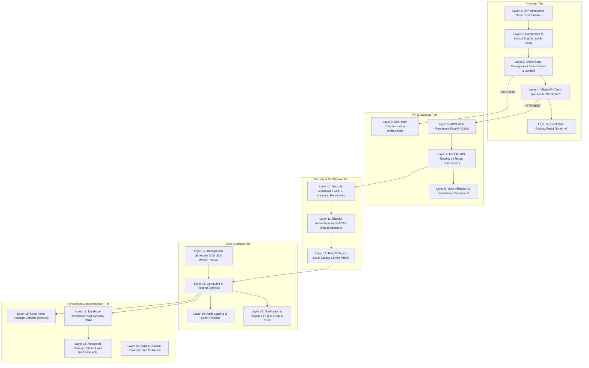
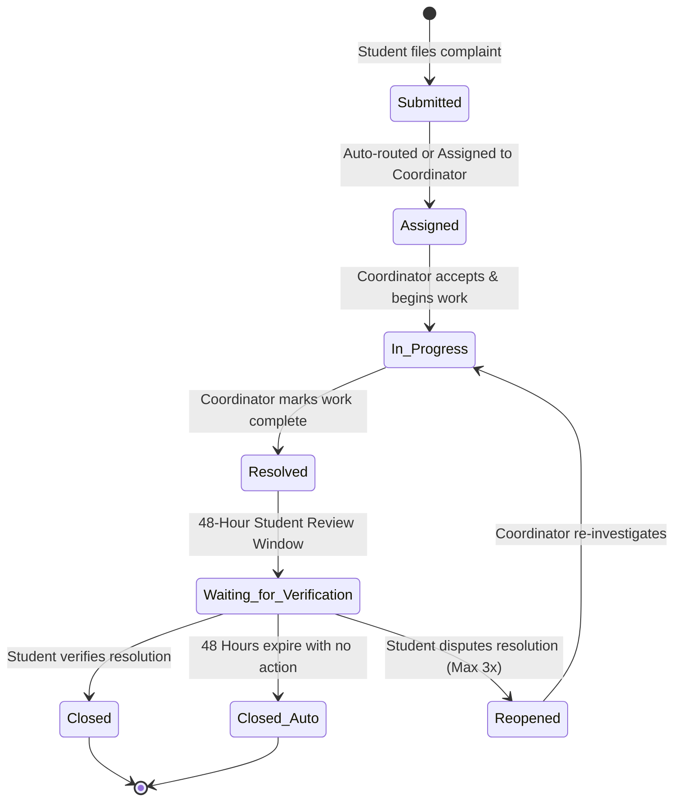
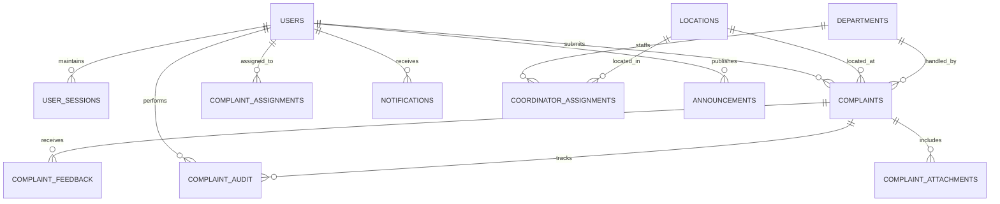

# Campus Pulse — Master Technical Architecture and System Context

**Document ID:** `CP-DOC-001`  
**Classification:** Definitive Architecture and System Reference  
**Status:** Complete & Verified Against Source Code  
**Date:** October 2026  
**Repository:** `CampusPulse_co`  

---

## Executive Summary

**Campus Pulse** is an enterprise-grade campus operations and incident resolution management platform engineered for higher education institutions. The system bridges communication gaps between students, facility wardens, departmental coordinators, facility managers, and university administrators.

The platform provides structured, auditable grievance tracking, multi-tier Service Level Agreement (SLA) escalation, facility-based access control, real-time WebSocket notifications, and an administrative oversight dashboard.

This document serves as the **definitive technical specification and master system context**. Every claim, architectural layer, database schema definition, security policy, and workflow described herein has been directly verified against the repository's source code.

---

## 1. Product Identity and Core Capabilities

### 1.1 Problem Space
Traditional university campuses manage maintenance, infrastructure failures, mess grievances, hostel issues, and academic complaints through ad-hoc mechanisms (paper logbooks, unmonitored WhatsApp groups, verbal complaints to wardens, or unstructured email threads). This results in:
- Unassigned or forgotten complaints.
- Zero accountability for resolution turnaround times.
- Lack of visibility for students into ticket status.
- Inability for campus leadership to identify recurring infrastructure bottlenecks or vendor failures.

### 1.2 Campus Pulse Solution
Campus Pulse digitizes and enforces the entire campus resolution lifecycle:
- **Strict Role-Based Multi-Tenancy:** 6 clearly separated roles with object-level scoping.
- **Location & Department Routing:** Two-factor ticket routing linking physical facilities (hostels, academic blocks, mess halls) to operational departments (electrical, plumbing, housekeeping, IT).
- **Enforced SLAs and Escalation Trees:** Automatic time-based escalation from coordinators to App Managers and Campus Administrators when deadlines expire.
- **Stateful Auditable Lifecycles:** Cryptographic session management, comprehensive audit logging of all state transitions, and 48-hour student verification windows before closure.

---

## 2. Comprehensive 20-Layer Architectural Blueprint

Campus Pulse is structured across 20 distinct architectural layers spanning the backend, frontend, database, and infrastructure tiers:

### Detailed Layer Specifications

1. **Presentation Layer (`Frontend/src/pages/`):** Responsive dashboard pages rendered via React 19, providing tailored UI workflows for Students, Coordinators, Wardens, App Managers, and Administrators.
2. **Component & Layout Layer (`Frontend/src/components/`):** Reusable design system utilizing Tailwind CSS utility classes and Lucide React iconography.
3. **Client State Layer (`Frontend/src/context/`):** React Context and custom hooks (`AuthContext`, notification listeners) providing synchronized authentication and active session states.
4. **Client Network Layer (`Frontend/src/api/client.js`):** Axios instance configured with request interceptors for bearer token injection and response interceptors for global 401 session expiration handling.
5. **Client Routing Layer (`Frontend/src/App.jsx`):** React Router DOM v6 handling declarative path routing, protected route guards, and role-based redirects.
6. **ASGI Web Framework (`Backend/main.py`):** High-performance asynchronous FastAPI 0.109 backend running on Python 3.14.2 and Uvicorn.
7. **API Routing Layer (`Backend/api/routes/`):** 24 distinct APIRouters organizing 277 REST endpoints into modular functional domains.
8. **Validation & Serialization Layer (`Backend/schemas/`):** Pydantic v2 models validating incoming JSON payloads and structuring outgoing serialization models.
9. **Real-Time Communication Layer (`Backend/api/routes/websockets.py`):** WebSocket server maintaining active duplex communication channels for instant notification pushes.
10. **Security Middleware Layer (`Backend/main.py`):** Global CORS middleware handling origin verification, preflight checks, and standard security headers.
11. **Stateful Authentication Layer (`Backend/core/security.py`, `Backend/api/routes/auth.py`):** Database-backed session mechanism using SHA-256 hashed bearer tokens (`secrets.token_urlsafe(32)`) and PBKDF2-HMAC-SHA256 password hashing.
12. **Role & Object Access Control (`Backend/api/deps.py`, `Backend/api/routes/complaints.py`):** Declarative FastAPI dependency injection enforcing both user role boundaries and spatial object scoping (`_visible_complaints`).
13. **Complaint & Routing Business Services (`Backend/services/complaint_service.py`):** Core domain logic managing complaint dispatching, status transitions, coordinator assignment, and reopen limits.
14. **Notification Dispatch Engine (`Backend/services/notification_service.py`):** Multi-channel alert dispatcher publishing in-app notifications, WebSocket events, and SMTP email alerts.
15. **Background Scheduler (`Backend/services/scheduler_service.py`):** In-process background worker executing every 300 seconds to evaluate overdue SLAs and auto-close verified complaints.
16. **Audit & Event Tracking Layer (`Backend/models/audit.py`):** Immutable transaction ledger recording every status change, assignment update, and administrative intervention.
17. **ORM Database Abstraction (`Backend/database/session.py`, `Backend/models/`):** SQLAlchemy ORM models abstracting database schema and query construction.
18. **Relational Storage Layer (`Backend/storage/campus_pulse.db`):** SQLite 3 configured with Write-Ahead Logging (`PRAGMA journal_mode=WAL`) and a 5,000ms busy timeout.
19. **File Storage Layer (`Backend/storage/uploads/`):** Local filesystem storage saving uploaded complaint evidence files with UUID-based filenames.
20. **Build & Runtime Toolchain:** Node.js Vite build system for frontend bundling and Python Uvicorn ASGI server for backend process execution.

---

## 3. User Roles and Permission Matrix

Campus Pulse implements 6 distinct user roles. Access control is strictly enforced at both the endpoint level (HTTP 403 Forbidden) and the object level (SQL row filtering).

### 3.1 Role Hierarchy and Scope

| Role Identifier | Display Name | Operational Purpose | Spatial Scope |
| :--- | :--- | :--- | :--- |
| `super_admin` | Super Administrator | Multi-tenant setup, global system configuration, audit review | System-wide (Blocked from operational complaints) |
| `administrator` | Administrator | Overall campus operations, user approvals, master escalation target | Institution-wide |
| `app_manager` | Application Manager | Facility operations overseer, first-tier escalation receiver | Assigned Locations |
| `location_in_charge`| Warden / In-Charge | Residential facility supervisor, physical verification | Assigned Facility / Hostel |
| `coordinator` | Department Coordinator| Field resolver (Electrical, Plumbing, IT, Mess) | Assigned Department + Location |
| `student` | Student | End-user submitting grievances, tracking resolution | Personal + Public in own location |

### 3.2 Granular Permissions Matrix

| Feature / Action | Student | Coordinator | Warden | App Manager | Admin | Super Admin |
| :--- | :---: | :---: | :---: | :---: | :---: | :---: |
| **Submit Complaint** | ✅ | ❌ | ❌ | ❌ | ❌ | ❌ |
| **View Complaint List** | Own + Public | Dept + Loc | Assigned Loc | Assigned Loc | All | ❌ (403) |
| **Update Status (In Progress/Resolved)** | ❌ | ✅ | ✅ | ✅ | ✅ | ❌ |
| **Verify & Close Complaint** | ✅ (Own) | ❌ | ❌ | ❌ | ✅ | ❌ |
| **Reopen Complaint (Max 3x)** | ✅ (Own) | ❌ | ❌ | ❌ | ❌ | ❌ |
| **Provide Feedback & Rating** | ✅ (Own) | ❌ | ❌ | ❌ | ❌ | ❌ |
| **Publish Campus Announcement** | ❌ (403) | ❌ (403) | ✅ (Loc) | ✅ (Loc) | ✅ | ✅ |
| **Create Users & Assign Roles** | ❌ | ❌ | ❌ | ❌ | ✅ | ✅ |
| **Assign Facilities to Wardens/Managers**| ❌ | ❌ | ❌ | ❌ | ✅ | ✅ |
| **View System Audit Logs** | ❌ | ❌ | ❌ | ❌ | ✅ | ✅ |
| **Configure System Settings** | ❌ | ❌ | ❌ | ❌ | ✅ | ✅ |

---

## 4. End-to-End Operational Workflows

### 4.1 Complaint Lifecycle and Multi-Tier SLA Escalation

#### SLA Escalation Mechanics:
1. **Tier 1 (Overdue):** If a complaint remains unresolved beyond `estimated_resolution_time` (default 48h), status shifts to Overdue, and the assigned Coordinator receives an immediate alert.
2. **Tier 2 (Overdue + 2 Days):** If still unresolved 48 hours after Tier 1, system dispatches an escalation notification to the responsible **App Manager** mapped to that location.
3. **Tier 3 (Overdue + 4 Days):** If still unresolved 96 hours after Tier 1, complaint escalates directly to the campus **Administrator** dashboard with a critical urgency badge.

### 4.2 Account Provisioning and Activation Workflow
1. **Creation:** Administrator creates a new account via `POST /api/users`. Account is initialized with `is_active=False`.
2. **Token Generation:** System generates a 32-byte cryptographic random URL-safe token stored in `activation_tokens` with a 24-hour expiration timestamp.
3. **Email Dispatch:** Activation email containing link `https://<domain>/activate?token=<hex>` is sent to the user's institutional email address.
4. **Activation:** User clicks the link, inputs their new password; backend verifies token hash, sets PBKDF2 hashed password, sets `is_active=True`, marks token used, and establishes the initial active session.

---

## 5. Database Architecture & Schema Specification

### 5.1 Storage Engine Configuration
- **Database File:** `Backend/storage/campus_pulse.db`
- **Engine:** SQLite 3
- **Journal Mode:** `PRAGMA journal_mode = WAL;` (Write-Ahead Logging enabled for concurrent multi-reader access)
- **Locking Timeout:** `PRAGMA busy_timeout = 5000;` (5-second wait queue on write lock contention)
- **Foreign Keys:** `PRAGMA foreign_keys = ON;` (Referential integrity enforced)

### 5.2 Active Core Schema Catalog (35 Active Tables)

#### Core Operational Tables:
1. `users`: Core identity credentials, PBKDF2 password hashes, role strings, department/location bindings, and active flags.
2. `user_sessions`: Active bearer tokens, SHA-256 token hashes, creation dates, last activity timestamps, and client IP/user-agent metadata.
3. `activation_tokens`: Ephemeral cryptographic tokens used for account activation and password reset sequences.
4. `locations`: Campus physical assets (hostels, academic blocks, mess halls, sports complexes, libraries).
5. `departments`: Operational departments (electrical, plumbing, housekeeping, civil, network, administrative).
6. `complaints`: Central grievance entity containing ticket title, description, priority, category, status, creator FK, location FK, department FK, SLA target dates, and reopen counters.
7. `complaint_assignments`: Historical and current mapping between complaints and assigned staff users.
8. `complaint_attachments`: File metadata (original filename, storage disk path, MIME type, file size, uploader FK).
9. `complaint_feedback`: Student ratings (1 to 5 stars), qualitative feedback text, and resolution satisfaction flags.
10. `complaint_audit`: Tamper-evident transaction log recording action, old status, new status, actor user ID, and timestamp.
11. `announcements`: Official broadcast notices with title, content, target audience scope, location filter, and author FK.
12. `notifications`: In-app notification queue records with read/unread status, notification type, and payload links.
13. `coordinator_assignments`: Many-to-many relationship mapping coordinators to specific physical locations and departments.
14. `app_manager_assignments`: Mapping responsible App Managers to designated campus facilities.
15. `location_in_charge_assignments`: Mapping Wardens to specific residential halls or facilities.

*(Note: The database contains ~160 additional enterprise placeholder tables created from legacy raw SQL schema migrations which are currently dormant and unmapped in active code.)*

---

## 6. Security and Authentication Architecture

### 6.1 Password Security
- **Algorithm:** PBKDF2 with HMAC-SHA256 (`hashlib.pbkdf2_hmac`).
- **Iterations:** 100,000 rounds.
- **Salt:** 16 bytes of cryptographically secure random bytes generated via `secrets.token_bytes(16)`.
- **Storage Format:** Salt and hash stored as hexadecimal strings.

### 6.2 Session Management
- **Token Format:** 32-byte URL-safe string generated via `secrets.token_urlsafe(32)`.
- **Database Storage:** Tokens are hashed with SHA-256 before being persisted in `user_sessions`. Plaintext bearer tokens are never stored at rest.
- **Session Validation:** Incoming requests pass `Authorization: Bearer <token>`. Dependency `get_current_user` computes `hashlib.sha256(token.encode()).hexdigest()`, looks up the session record, validates that `expires_at > now()`, and loads the associated user.
- **Revocation:** Logout operations execute `DELETE FROM user_sessions WHERE token_hash = :hash`, instantly invalidating the session.

### 6.3 Input Validation and Sanitization
- All incoming payloads pass through Pydantic v2 validation models enforcing length constraints, regex validation, email formats, and type coercion.
- SQL injection is eliminated through SQLAlchemy's parameterized query engine.
- XSS prevention is provided by React's automatic JSX text escaping and strict MIME-type validation on file uploads.

---

## 7. Frontend Architecture and Client State

### 7.1 Technology Stack
- **Framework:** React 19 (`Frontend/package.json`)
- **Build Tool:** Vite 5 with Hot Module Replacement (HMR)
- **Styling:** Tailwind CSS 3 with PostCSS and Autoprefixer
- **Icons:** Lucide React
- **HTTP Client:** Axios with centralized interceptors
- **Routing:** React Router DOM v6

### 7.2 Directory Organization
- `Frontend/src/api/`: Centralized HTTP request modules (`client.js`, `auth.js`, `complaints.js`, `users.js`, `announcements.js`).
- `Frontend/src/components/`: Modular UI blocks (modals, status badges, navbar, sidebar, data tables, file upload dropzones).
- `Frontend/src/context/`: Global state providers (`AuthContext.jsx`, `NotificationContext.jsx`).
- `Frontend/src/pages/`: Role-specific view controllers:
  - `StudentDashboard.jsx`: Complaint submission, personal ticket tracking, feedback modal.
  - `CoordinatorDashboard.jsx`: Department queue, status update controls, proof upload.
  - `WardenDashboard.jsx`: Facility overview, hostel grievance queue.
  - `AppManagerDashboard.jsx`: Multi-facility metrics, SLA escalation queue.
  - `AdminDashboard.jsx`: Campus analytics, user management, location & department management.

---

## 8. Background Jobs and Scheduled Services

Campus Pulse incorporates an automated background processing engine implemented in `Backend/services/scheduler_service.py`:

- **Execution Model:** In-process daemon thread started during FastAPI lifespan initialization.
- **Execution Frequency:** Every 300 seconds (5 minutes).
- **Scheduled Tasks:**
  1. **48-Hour Auto-Closure:**
     - Query: `SELECT * FROM complaints WHERE status = 'Resolved' AND resolved_at <= :threshold_48h`
     - Action: Updates status to `Closed`, sets resolution note to `"Auto-closed after 48h without student verification"`, inserts audit record, and pushes notification to the student.
  2. **Tier-1 SLA Check (Overdue):**
     - Query: `SELECT * FROM complaints WHERE status IN ('Submitted', 'Assigned', 'In Progress') AND estimated_resolution_time < :now AND is_overdue = 0`
     - Action: Sets `is_overdue = 1`, logs audit event, and alerts assigned Coordinator.
  3. **Tier-2 SLA Escalation (+2 Days):**
     - Query: `SELECT * FROM complaints WHERE is_overdue = 1 AND estimated_resolution_time <= :threshold_now_minus_2d AND escalation_level = 0`
     - Action: Sets `escalation_level = 1`, alerts responsible App Manager for the location.
  4. **Tier-3 SLA Escalation (+4 Days):**
     - Query: `SELECT * FROM complaints WHERE is_overdue = 1 AND estimated_resolution_time <= :threshold_now_minus_4d AND escalation_level = 1`
     - Action: Sets `escalation_level = 2`, alerts Campus Administrator.

---

## 9. Configuration, Ports, and Environment

### 9.1 Network Port Allocation
- **Backend API Server:** Port `8000` (`http://localhost:8000`)
- **Frontend Development Server:** Port `5173` (`http://localhost:5173`)
- **API Documentation (Swagger UI):** `http://localhost:8000/docs`
- **Alternative Docs (ReDoc):** `http://localhost:8000/redoc`

### 9.2 Key Environment Variables (`Backend/.env`)
| Variable | Default Value | Purpose |
| :--- | :--- | :--- |
| `DATABASE_URL` | `sqlite:///./storage/campus_pulse.db` | SQLAlchemy connection string |
| `SECRET_KEY` | *(Random 64-char string)* | Cryptographic signing secret |
| `SMTP_HOST` | `smtp.gmail.com` | Mail transfer agent server host |
| `SMTP_PORT` | `587` | TLS SMTP communication port |
| `SMTP_USER` | *(Configured email)* | Institutional outbound sender account |
| `SMTP_PASSWORD` | *(App Password)* | Outbound SMTP credentials |
| `ENVIRONMENT` | `development` / `production` | Application operational mode |

---

## 10. Source-of-Truth Code Matrix

| Feature / Domain | Backend Implementation File | Frontend Implementation File |
| :--- | :--- | :--- |
| **Authentication & Sessions** | `Backend/api/routes/auth.py`, `Backend/core/security.py` | `Frontend/src/context/AuthContext.jsx`, `Frontend/src/pages/Login.jsx` |
| **Complaint Management** | `Backend/api/routes/complaints.py`, `Backend/services/complaint_service.py` | `Frontend/src/pages/StudentDashboard.jsx`, `Frontend/src/pages/ComplaintsList.jsx` |
| **Location & Department Routing** | `Backend/api/routes/locations.py`, `Backend/api/routes/departments.py` | `Frontend/src/pages/AdminDashboard.jsx` |
| **Real-time Notifications** | `Backend/api/routes/websockets.py`, `Backend/services/notification_service.py` | `Frontend/src/components/NotificationBell.jsx` |
| **Announcements** | `Backend/api/routes/announcements.py` | `Frontend/src/pages/Announcements.jsx` |
| **Background Escalation** | `Backend/services/scheduler_service.py` | N/A (Server background thread) |
| **Audit Logging** | `Backend/models/audit.py`, `Backend/services/audit_service.py` | `Frontend/src/pages/AuditLogs.jsx` |
| **Feedback & Ratings** | `Backend/api/routes/feedback.py`, `Backend/models/feedback.py` | `Frontend/src/components/FeedbackModal.jsx` |
