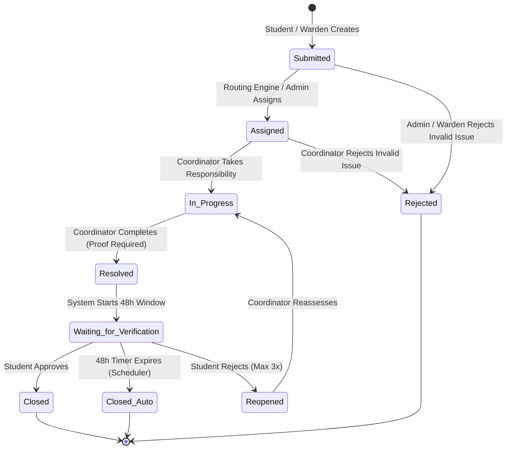
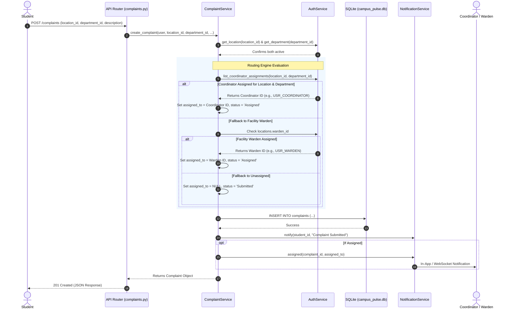
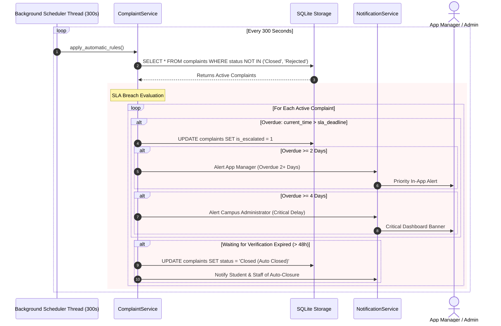
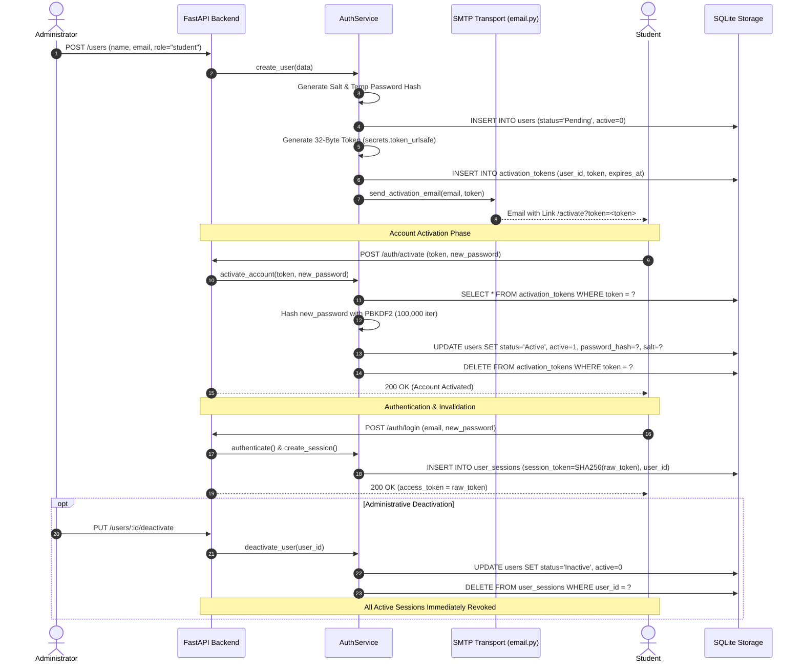
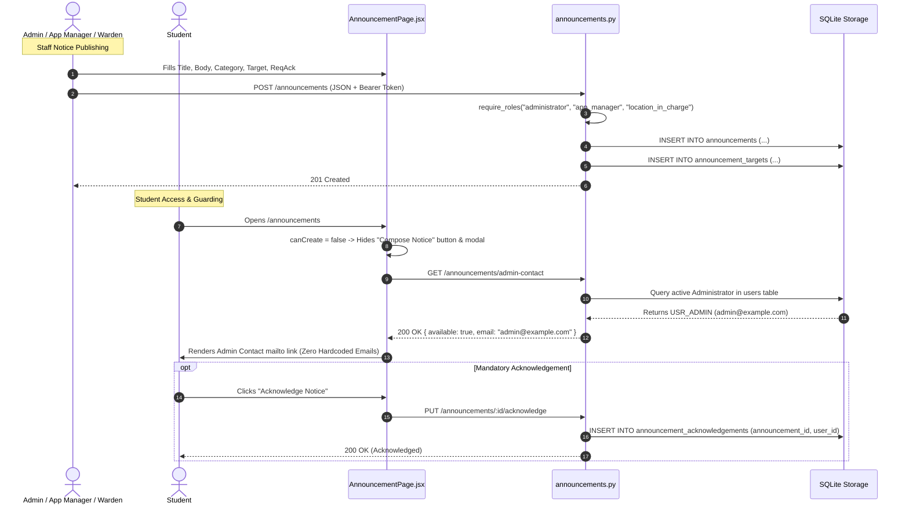

# Campus Pulse — End-to-End Workflows, State Machines & Execution Sequences

> **Document Type:** Core Workflows Specification & Sequence Diagrams  
> **Repository:** Campus Pulse (`CampusPulse_co`)  
> **Status:** Ground-Truth Verified against Source Code  

---

## 1. Complaint Lifecycle State Machine

The complaint state machine defines all permitted states, actors, and transition preconditions implemented in [`Backend/services/complaint_service.py`](file:///c:/Users/gowth/OneDrive/Desktop/GOWTHAM/CampusPulse/CampusPulse_co/Backend/services/complaint_service.py) and [`Backend/models/complaint.py`](file:///c:/Users/gowth/OneDrive/Desktop/GOWTHAM/CampusPulse/CampusPulse_co/Backend/models/complaint.py).

---

### Step-by-Step Transition Analysis

| From State | To State | Initiating Actor | Endpoint / Function | Preconditions & Validation Rules | Database Mutations | Notifications Dispatched |
| :--- | :--- | :--- | :--- | :--- | :--- | :--- |
| `[*]` | `Submitted` | Student, Warden | `POST /complaints` | Valid location & dept; title min 5 chars; desc min 10 chars; hostel residency match | `complaints` INSERT; `attachments` INSERT | Student confirmation; location resident alert (if public) |
| `Submitted` | `Assigned` | System / Admin | `assign_work()` | Coordinator active in department/location assignment table | `complaints.assigned_to`, `complaints.status = 'Assigned'` | Assigned Coordinator alerted |
| `Assigned` | `In Progress` | Coordinator | `PUT /complaints/:id/status` | Current status is `Assigned`; caller is assigned staff or admin | `complaints.status = 'In Progress'`, `updated_at` | Complainant Student alerted |
| `In Progress` | `Resolved` / `Waiting for Verification` | Coordinator, Staff | `PUT /complaints/:id/resolve` | Current status is `In Progress`; must provide "After Repair" image OR resolution notes | `complaints.status = 'Waiting for Verification'`, `resolved_at`, `verification_due_at` | Student alerted with verification action |
| `Waiting for Verification` | `Closed` | Student Author | `PUT /complaints/:id/verify` | Current status is `Waiting for Verification`; caller is complaint creator | `complaints.status = 'Closed'`, `closed_at`, `verification_reports` | Coordinator & Student closure confirmation |
| `Waiting for Verification` | `Closed (Auto Closed)` | Background Daemon | `apply_automatic_rules()` | `datetime.utcnow() > verification_due_at` (48 hours elapsed) | `complaints.status = 'Closed (Auto Closed)'`, `closed_at` | System event logged; student and staff notified |
| `Waiting for Verification` | `Reopened` | Student Author | `POST /complaints/:id/reopen` | Current status is `Waiting for Verification`; `reopen_count < max_reopen_count` (3) | `complaints.status = 'Reopened'`, `reopen_count += 1` | Coordinator alerted; if `reopen_count >= 2`, Admin alerted |
| `Submitted` / `Assigned` | `Rejected` | Admin, Warden, Coord | `PUT /complaints/:id/status` | Valid rejection reason entered; caller has authority | `complaints.status = 'Rejected'`, `rejection_reason` | Student alerted with rejection reason |

---

## 2. Multi-Location & Coordinator Routing Sequence

This workflow traces how a newly submitted complaint is routed to the appropriate department coordinator across decentralized campus locations.

---

## 3. SLA Escalation & Background Daemon Workflow

This workflow traces the 300-second periodic scheduler executed by [`Backend/services/scheduler_service.py`](file:///c:/Users/gowth/OneDrive/Desktop/GOWTHAM/CampusPulse/CampusPulse_co/Backend/services/scheduler_service.py).

---

## 4. User Account Lifecycle & Session Security Workflow

This workflow traces how user accounts are created, activated via cryptographic tokens, authenticated via PBKDF2, and securely deactivated.

---

## 5. Official Announcement Publishing & Access Workflow

This workflow traces circular publishing, RBAC enforcement, dynamic administrator contact retrieval, and mandatory student acknowledgements.

